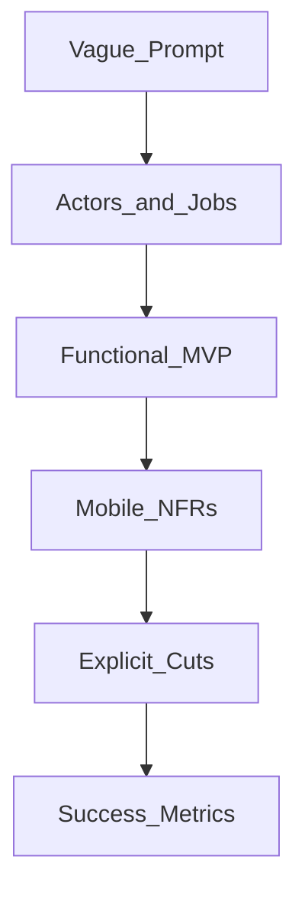

# 02 — Requirements and Scope

## Goal

Turn a vague prompt (“Design Instagram”) into a crisp MVP with explicit non-functional requirements (NFRs) interviewers can evaluate.

## Clarify in layers

### Questions that unlock scope

| Category | Example questions |
|----------|-------------------|
| Actor | Single user? Guest? Multi-account? |
| Core job | Feed browse? Create post? Chat? |
| Online posture | Always online? Intermittent? Days offline? |
| Scale (client) | Feed size, media size, concurrency on device |
| Platform | iOS only, Android only, both, tablets? |
| Existing systems | Auth already exists? CDN? Push infra? |
| Constraints | Latency budget, battery, storage quota |

## Functional vs non-functional

| Functional (what) | Non-functional (how well) |
|-------------------|---------------------------|
| Show chronological feed | First paint < 1.5s on warm cache |
| Send message | Deliver or durable-queue within 2s online |
| Like a post | Optimistic UI; reconcile within RTT |
| Download for offline | Resume after kill; integrity check |

## Hidden mobile NFRs (always ask or assume aloud)

1. **Connectivity**: airplane mode, captive portal, wifi↔cellular handoff
2. **Lifecycle**: backgrounded, memory kill, OS deferring background work
3. **Resources**: RAM budget for lists/media; disk quota; battery
4. **Security**: tokens at rest, PII in logs, screenshot risk for sensitive screens
5. **Consistency**: what the user sees offline vs after sync
6. **Accessibility & locales**: RTL, large fonts—mention if UI layout matters
7. **Compliance (fintech)**: PCI scope, consent/attestations, audit-friendly refs, data retention

## MVP cutting technique

Say the full feature list, then draw a line:

| In MVP | Later |
|--------|-------|
| 1:1 text chat | Voice notes, reactions, threads |
| Cursor pagination | Personalized ranking |
| Memory + disk image cache | AVIF pipeline, face-aware crop |
| Manual pull-to-refresh | Smart prefetch on wifi only |

Interviewers reward **conscious deferral**, not feature maximalism.

## Scale: talk client scale, not datacenter fan-out

For mobile interviews, “scale” usually means:

- Items in a list viewport and prefetch window
- Concurrent downloads / uploads
- Local DB row counts and query cost
- Media byte budget on cellular

Mention server scale only when it changes the **client contract** (e.g., cursor pagination required, rate limits, push fan-out).

## Success metrics (pick 3–5)

Examples you can reuse:

- Time-to-first-content (cached / uncached)
- Scroll frame time (<16 ms target; call out jank sources)
- Message send success within N seconds or durable outbox
- Crash-free sessions; ANR / watchdog rate
- Battery: % drain attributable to location / sync (qualitative is fine)

## Checkpoint

End of this phase: a one-sentence product MVP + a short NFR bullet list + “out of scope” list written on the board.
