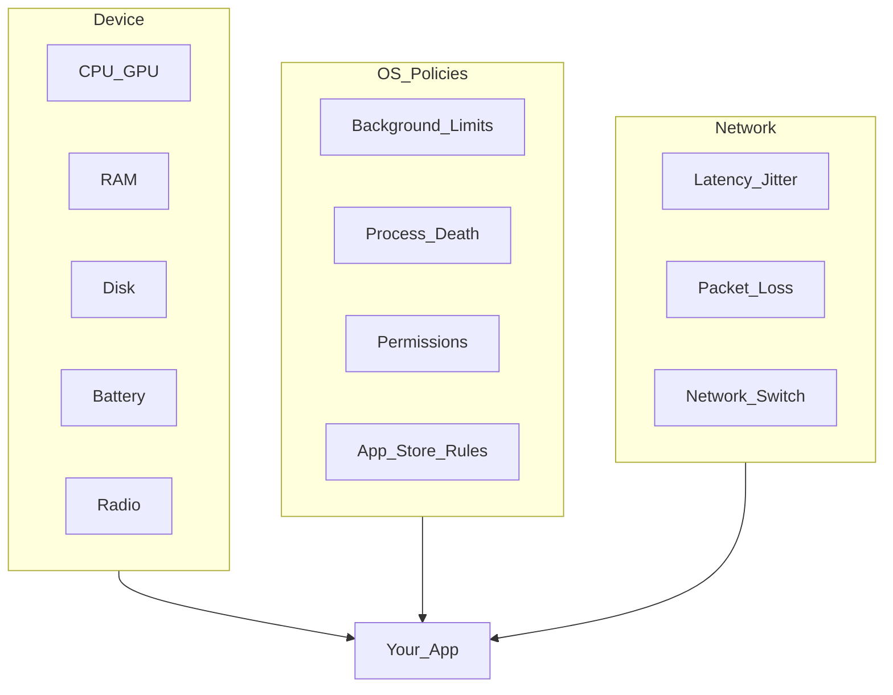
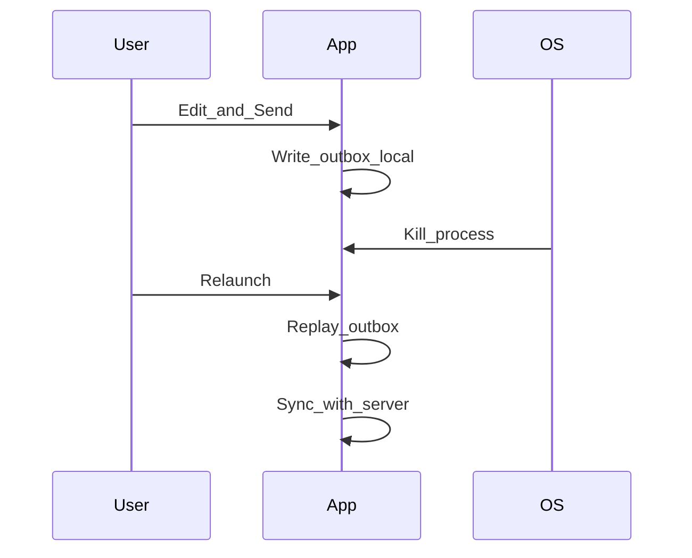

# 03 — Mobile Constraints

## Goal

Internalize the physical and OS realities that separate mobile system design from backend system design.

## Constraint map

## Memory

| Concern | Interview default |
|---------|-------------------|
| List recycling | Virtualized lists; bind cheaply |
| Image heap | Decode to display size; downsample |
| Cache cap | Memory LRU ~50–100 MB class (tune by device class) |
| Pressure | Drop memory caches on warning; keep disk |

`iOS:` memory warnings / jetsam. `Android:` `onTrimMemory` levels; large heap is not a strategy.

## Storage

- Prefer structured local DB for queryable state; files for blobs.
- Budget disk: e.g., media cache 200–500 MB with eviction.
- Schema migrations must be forward-safe; never assume install is forever.

## Battery and radios

| Work | Cost driver | Mitigation |
|------|-------------|------------|
| GPS high accuracy | Radio + chip | Coalesce, geofence, degrade accuracy |
| Frequent polling | Wakeups | Batch, push, exponential backoff |
| Chatty sync | Radio tails | Coalesce requests; sync on unmetered |
| Video decode | CPU/GPU | Cap resolution; pause offscreen |

## Network variability

Design for: slow 3G, lossy subway, captive wifi, mid-upload switch.

Patterns: timeouts + retry with jitter, idempotency keys, resumable uploads, offline-first UI, degraded modes (text-only feed).

## Process lifecycle

**Rule:** anything the user believes is “done” must survive process death via durable local state.

## Background execution

| Need | Prefer |
|------|--------|
| Deferred sync | `Android:` WorkManager / `iOS:` BGAppRefresh / BGProcessing |
| Exact alarm UX | Rare; justify carefully |
| Long download | Foreground service / URLSession background config |
| Location tracking | Explicit user purpose; battery disclosure |

## Fragmentation

Support a **core device class** (e.g., last 4–5 OS versions, mid-tier RAM). Call out graceful degradation for low-end: smaller caches, fewer prefetch, software decode limits.

## Permissions and trust

Ask only when needed (just-in-time). Design flows if permission denied: manual city pick instead of GPS, in-app gallery if camera denied.

**Modern defaults (2025–2026):** `Android 13+` POST_NOTIFICATIONS runtime permission; use **Photo Picker** / limited library access instead of broad storage reads; `iOS` PHPicker and privacy manifests for required-reason APIs.

## Platform implementation

Full translation table: [Ch 05](../part-2-building-blocks/05-platforms-android-ios-flutter-react-native.md).

| Constraint | Android | iOS | Flutter | React Native |
|------------|---------|-----|---------|--------------|
| Memory ceiling | Per-app heap (`largeHeap` is a smell); low-memory killer picks background processes; `onTrimMemory` | Jetsam kills over the per-device limit with no callback; extensions get tens of MB | Dart heap + native image memory; `ImageCache` limits (`maximumSizeBytes`) | JS heap (Hermes) + native views/images; leaks often live in native image caches |
| Process death | Common in background; restore with `SavedStateHandle` / `rememberSaveable` | Suspended then terminated silently; state restoration is opt-in | Same OS rules; `RestorationMixin` opt-in, usually persist to disk | Same OS rules; persist navigation state and drafts yourself |
| Background limits | Doze, App Standby buckets, background-start limits for foreground services (Android 12+), FGS types (Android 14+) | No arbitrary background execution; `BGTaskScheduler`, background `URLSession`, silent push | Inherits both; plugins wrap native APIs | Inherits both; headless JS or native modules |
| Storage | App-specific internal storage, scoped storage for shared media | Sandbox: `Documents` (backed up), `Application Support`, `Caches` (purgeable) | `path_provider` maps to the same directories | `expo-file-system` / RN FS map to the same directories |
| Permissions | Runtime permissions; notification permission (Android 13+); photo picker avoids storage permission | Usage strings in `Info.plist`; one-shot prompts; limited photo library; App Tracking Transparency | `permission_handler` (still needs native manifest / plist entries) | `react-native-permissions` / Expo modules (same native config) |
| Fragmentation | Thousands of devices, OEM battery killers, API 24–36 spread | Few devices, fast OS adoption; old devices still have tight RAM | Engine smooths UI, not OS behaviour | Same as native plus JS-engine differences on old devices |

Say aloud: *"Flutter and React Native don't change the constraints. The OS still kills the process, throttles the background and limits memory, so the design is the same and only the API names change."*

## Checkpoint

In every design, name at least: **memory budget**, **offline survival**, **background strategy**, and **one battery risk**.
