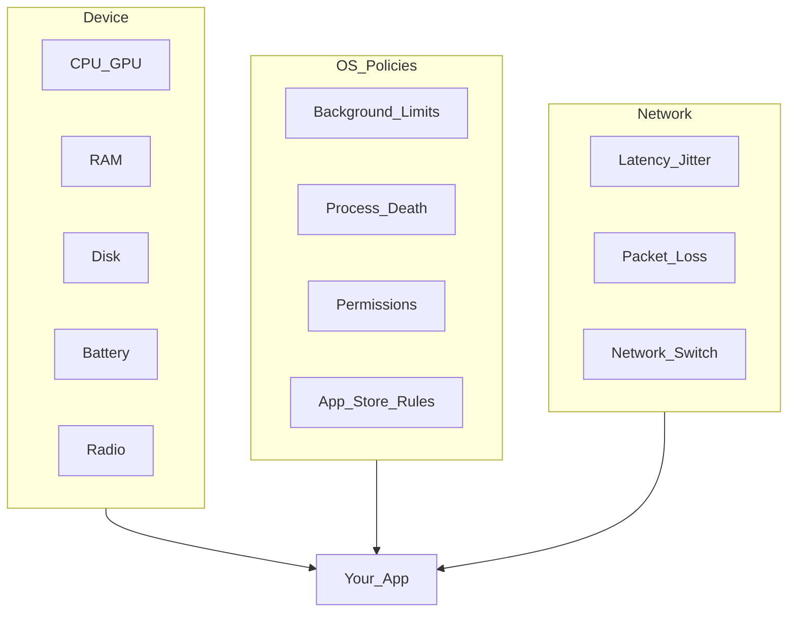
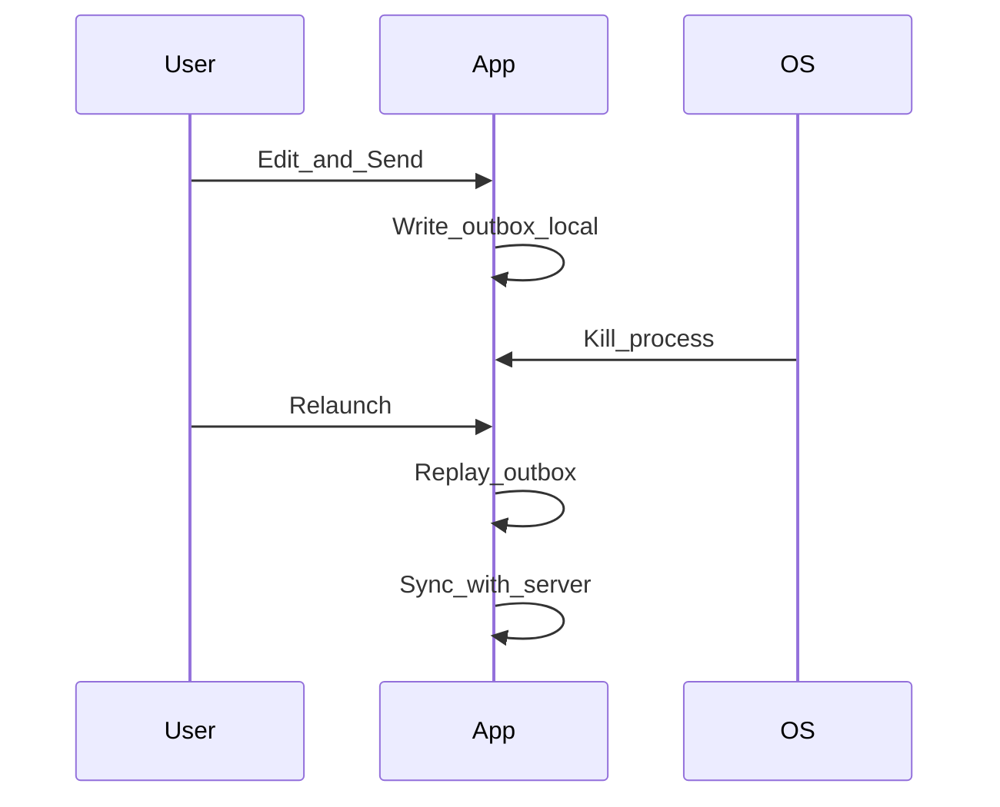

# 03 — Mobile Constraints

## Goal

Internalize the physical and OS realities that separate mobile system design from backend system design.

## Constraint map

## Memory

| Concern | Interview default |
|---------|-------------------|
| List recycling | Virtualized lists; bind cheaply |
| Image heap | Decode to display size; downsample |
| Cache cap | Memory LRU ~50–100 MB class (tune by device class) |
| Pressure | Drop memory caches on warning; keep disk |

`iOS:` memory warnings / jetsam. `Android:` `onTrimMemory` levels; large heap is not a strategy.

## Storage

- Prefer structured local DB for queryable state; files for blobs.
- Budget disk: e.g., media cache 200–500 MB with eviction.
- Schema migrations must be forward-safe; never assume install is forever.

## Battery and radios

| Work | Cost driver | Mitigation |
|------|-------------|------------|
| GPS high accuracy | Radio + chip | Coalesce, geofence, degrade accuracy |
| Frequent polling | Wakeups | Batch, push, exponential backoff |
| Chatty sync | Radio tails | Coalesce requests; sync on unmetered |
| Video decode | CPU/GPU | Cap resolution; pause offscreen |

## Network variability

Design for: slow 3G, lossy subway, captive wifi, mid-upload switch.

Patterns: timeouts + retry with jitter, idempotency keys, resumable uploads, offline-first UI, degraded modes (text-only feed).

## Process lifecycle

**Rule:** anything the user believes is “done” must survive process death via durable local state.

## Background execution

| Need | Prefer |
|------|--------|
| Deferred sync | `Android:` WorkManager / `iOS:` BGAppRefresh / BGProcessing |
| Exact alarm UX | Rare; justify carefully |
| Long download | Foreground service / URLSession background config |
| Location tracking | Explicit user purpose; battery disclosure |

## Fragmentation

Support a **core device class** (e.g., last 4–5 OS versions, mid-tier RAM). Call out graceful degradation for low-end: smaller caches, fewer prefetch, software decode limits.

## Permissions and trust

Ask only when needed (just-in-time). Design flows if permission denied: manual city pick instead of GPS, in-app gallery if camera denied.

**Modern defaults (2025–2026):** `Android 13+` POST_NOTIFICATIONS runtime permission; use **Photo Picker** / limited library access instead of broad storage reads; `iOS` PHPicker and privacy manifests for required-reason APIs.

## Checkpoint

In every design, name at least: **memory budget**, **offline survival**, **background strategy**, and **one battery risk**.
