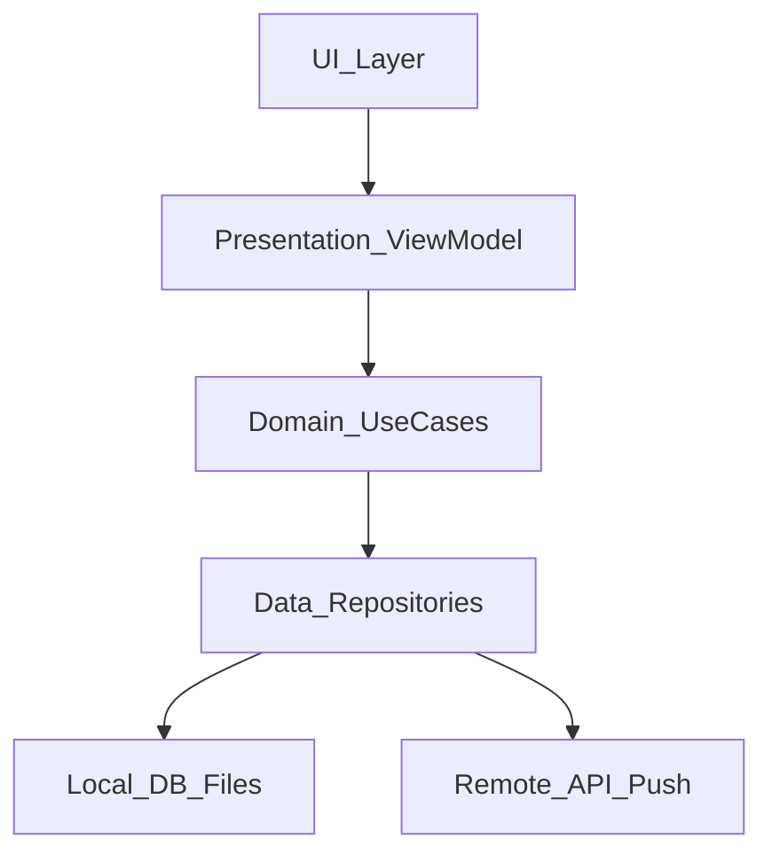
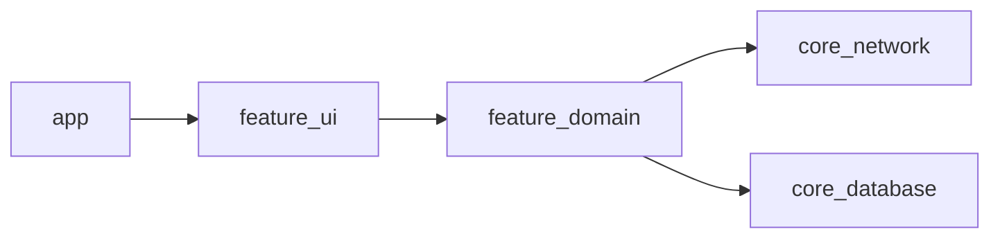

# 04 — Client Architecture

## Goal

Choose a layered client architecture you can sketch in under two minutes and defend under follow-ups.

## Reference layers



| Layer | Owns | Must not |
|-------|------|----------|
| UI | Rendering, navigation, a11y | Business rules, networking |
| Presentation | UI state, user intents | SQL, raw HTTP |
| Domain | Use cases, policies | Framework UI types |
| Data | Mapping DTO ↔ domain, caching | View-specific formatting |

## Pattern choice

| Pattern | Best when | Trade-off |
|---------|-----------|-----------|
| MVVM | Standard feature screens | Easy to dump logic into VM |
| MVI / unidirectional | Complex async state | More boilerplate |
| Clean + use cases | Large teams, shared logic | Ceremony for tiny screens |
| Modular feature APIs | Multi-team apps | Upfront module design |

**Interview default:** layered MVVM/MVI with repositories; name modules if scale warrants it.

## Dependency direction

Dependencies point **inward** toward domain. UI knows ViewModels; ViewModels know use cases/repos; repos know API/DB adapters.



## Threading model (say it aloud)

- UI on main
- DB and disk off main
- Network off main
- Single-writer for local DB recommended
- Structured concurrency: cancel on leave screen

`iOS:` MainActor / Swift concurrency (`async`/`await`). `Android:` main thread + `Dispatchers.IO` / Kotlin coroutines + **Flow/StateFlow** for UI state.

## Navigation and state restoration

- Treat process death as normal: persist “enough” to restore screen + draft.
- Deep links enter through a single router; validate auth before sensitive destinations.

## Android UI toolkits: Views (XML) and Compose

Real Android codebases run **both**: years of XML layouts + Fragments, new screens in Jetpack Compose. Answer every UI question for both, then say how they mix. The layers above do not change — only the UI layer does; ViewModel, repositories, and `StateFlow` are shared.

| Concern | Views (XML) | Compose |
|---------|-------------|---------|
| Rendering model | Inflate XML once into a View tree, then **mutate** views (`text =`, `isVisible =`) as state changes | Functions **describe** UI from state; runtime **recomposes** only what read changed state |
| UI state | ViewModel exposes `StateFlow` (or `LiveData`); Fragment collects in `viewLifecycleOwner.repeatOnLifecycle(STARTED)` and pushes into views | ViewModel exposes `StateFlow`; `collectAsStateWithLifecycle()` in a route composable; **hoist** state so screens are stateless (state in, lambdas out) |
| Local UI state | Views keep their own state + `onSaveInstanceState`; easy to drift from the VM | `remember` / `rememberSaveable`; the single source of truth is explicit |
| Lists | `RecyclerView` + `ListAdapter` (`DiffUtil.ItemCallback`); Paging 3 → `PagingDataAdapter` | `LazyColumn` / `LazyVerticalGrid` with `key` (and `contentType`); Paging 3 → `collectAsLazyPagingItems()` |
| Navigation | Fragments + Navigation component (XML nav graph, Safe Args) | Navigation Compose (`NavHost`, routes; type-safe routes in recent versions) |
| Custom drawing | Subclass `View`, override `onDraw(Canvas)` / `onMeasure`; `invalidate()` to redraw | `Canvas {}` composable, `Modifier.drawBehind` / `drawWithContent`; custom layout via `Layout {}` |
| Theming | XML themes/styles, `?attr/` tokens, Material Components; dark mode via `-night` resources | `MaterialTheme` (colorScheme, typography, shapes) + `CompositionLocal`s; dynamic color via `dynamicLightColorScheme(context)` |
| Accessibility | `contentDescription`, `importantForAccessibility`, `labelFor`, `AccessibilityDelegateCompat` | `Modifier.semantics {}`, `contentDescription` param, `semantics(mergeDescendants = true)`, `clearAndSetSemantics` |
| Testing | Espresso (`onView(withId(..)).perform(click())`), Robolectric | `compose-ui-test`: `createComposeRule()`, `onNodeWithText(..).performClick()` over the semantics tree; screenshot tests for both |
| Performance tells | Overdraw, deep/nested layouts (flatten with `ConstraintLayout`), `notifyDataSetChanged`, inflate cost | Recomposition counts (Layout Inspector), unstable params defeating skipping, missing list `key`, reading fast-changing state too high (defer with lambda modifiers / `derivedStateOf`) |
| Startup / size | Mature, no extra runtime | Compose runtime adds APK size + first-frame cost; Baseline Profiles matter more |

### Same screen, both toolkits

One ViewModel; two UIs.

```kotlin
data class ProfileUiState(val name: String = "", val following: Boolean = false)

class ProfileViewModel : ViewModel() {
    private val _state = MutableStateFlow(ProfileUiState())
    val state: StateFlow<ProfileUiState> = _state.asStateFlow()
    fun onFollowClick() = _state.update { it.copy(following = !it.following) }
}
```

=== "Views (XML) + Fragment"

    ```xml
    <!-- res/layout/fragment_profile.xml -->
    <LinearLayout xmlns:android="http://schemas.android.com/apk/res/android"
        android:layout_width="match_parent"
        android:layout_height="wrap_content"
        android:orientation="vertical"
        android:padding="16dp">
        <TextView android:id="@+id/name"
            android:layout_width="wrap_content" android:layout_height="wrap_content" />
        <Button android:id="@+id/follow"
            android:layout_width="wrap_content" android:layout_height="wrap_content" />
    </LinearLayout>
    ```

    ```kotlin
    class ProfileFragment : Fragment(R.layout.fragment_profile) {
        private val vm: ProfileViewModel by viewModels()

        override fun onViewCreated(view: View, savedInstanceState: Bundle?) {
            val b = FragmentProfileBinding.bind(view)          // ViewBinding
            b.follow.setOnClickListener { vm.onFollowClick() }
            viewLifecycleOwner.lifecycleScope.launch {
                viewLifecycleOwner.repeatOnLifecycle(Lifecycle.State.STARTED) {
                    vm.state.collect { s ->                     // imperative: push state into views
                        b.name.text = s.name
                        b.follow.setText(if (s.following) R.string.unfollow else R.string.follow)
                    }
                }
            }
        }
    }
    ```

=== "Compose"

    ```kotlin
    @Composable
    fun ProfileRoute(vm: ProfileViewModel = viewModel()) {
        val state by vm.state.collectAsStateWithLifecycle()
        ProfileScreen(state, onFollowClick = vm::onFollowClick)   // hoisted: screen is stateless
    }

    @Composable
    fun ProfileScreen(state: ProfileUiState, onFollowClick: () -> Unit) {
        Column(Modifier.padding(16.dp)) {
            Text(state.name, style = MaterialTheme.typography.titleLarge)
            Button(onClick = onFollowClick) {
                Text(stringResource(if (state.following) R.string.unfollow else R.string.follow))
            }
        }
    }
    ```

Say aloud: *Views collect on the **view** lifecycle (`viewLifecycleOwner`), not the Fragment's — otherwise you update a destroyed view or leak it. The Compose `ProfileScreen` is previewable and testable without a ViewModel.*

### Interop and migration

| Direction | API | Watch out |
|-----------|-----|-----------|
| Compose inside XML / Fragment | `ComposeView` (in a layout or returned from `onCreateView`) + `setContent {}` | In Fragments set `ViewCompositionStrategy.DisposeOnViewTreeLifecycleDestroyed` so composition follows the view lifecycle |
| Compose inside a `RecyclerView` row | `ComposeView` in the ViewHolder | Default strategy (`DisposeOnDetachedFromWindowOrReleasedFromPool`) handles pooling; still prefer migrating the whole list |
| View inside Compose | `AndroidView(factory = { ctx -> … }, update = { … })` | `factory` runs once, `update` on recomposition; forward lifecycle to views that need it (MapView, PlayerView) |
| Shared theme | Material Components XML theme + `MaterialTheme` | Keep one token source; the old theme-adapter libraries are deprecated — map tokens explicitly |

```kotlin
// Compose screen hosted by an existing Fragment / nav graph
class ProfileComposeFragment : Fragment() {
    override fun onCreateView(inflater: LayoutInflater, container: ViewGroup?, savedInstanceState: Bundle?) =
        ComposeView(requireContext()).apply {
            setViewCompositionStrategy(ViewCompositionStrategy.DisposeOnViewTreeLifecycleDestroyed)
            setContent { MaterialTheme { ProfileRoute() } }
        }
}

// Legacy View inside a composable
@Composable
fun HtmlBody(html: String) {
    AndroidView(
        factory = { ctx -> TextView(ctx) },
        update = { it.text = Html.fromHtml(html, Html.FROM_HTML_MODE_COMPACT) },
    )
}
```

**Migration path (interview answer):** new screens in Compose; migrate **screen-by-screen** (leaf screens first), not widget-by-widget; keep the **same ViewModel** so the switch is a UI-only diff; host Compose screens in Fragments until the nav graph moves to Navigation Compose; build design-system components first so both toolkits look the same; gate behind a flag and compare crash / ANR / jank per screen.

| Pick | When |
|------|------|
| Stay on Views | Stable screen, no churn, heavy custom Views, tight APK budget |
| Compose | New features, complex state-driven UI, design-system work, faster iteration |
| Mixed (the norm) | Any app older than a few years — say so; interviewers expect it |

`iOS parity:` UIKit (imperative view controllers, `UICollectionView` + diffable data source) ↔ SwiftUI (declarative, `@Observable`, `List` / `LazyVStack`), mixed via `UIHostingController` and `UIViewRepresentable` — the same story as `ComposeView` / `AndroidView`.

## Staff signals

- Feature module boundaries and public API surfaces
- Shared “core” vs duplicated networking stacks
- Experiment hooks without forking architecture

## Checkpoint

You can draw UI → Presentation → Domain → Data → Local/Remote and place **caching** and **outbox** in Data without hesitation.
