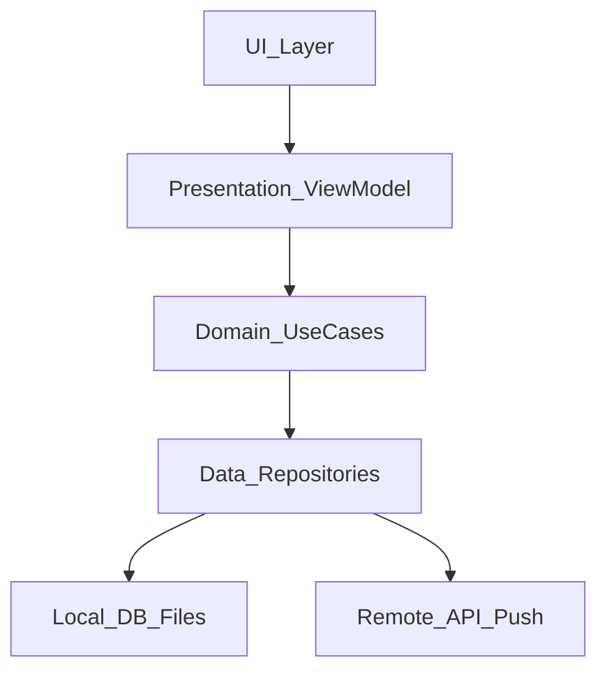
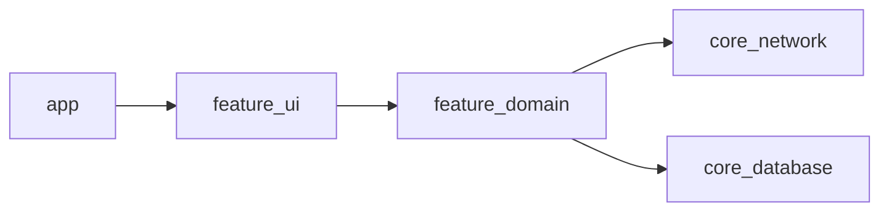

# 04 — Client Architecture

## Goal

Choose a layered client architecture you can sketch in under two minutes and defend under follow-ups.

## Reference layers

| Layer | Owns | Must not |
|-------|------|----------|
| UI | Rendering, navigation, a11y | Business rules, networking |
| Presentation | UI state, user intents | SQL, raw HTTP |
| Domain | Use cases, policies | Framework UI types |
| Data | Mapping DTO ↔ domain, caching | View-specific formatting |

## Pattern choice

| Pattern | Best when | Trade-off |
|---------|-----------|-----------|
| MVVM | Standard feature screens | Easy to dump logic into VM |
| MVI / unidirectional | Complex async state | More boilerplate |
| Clean + use cases | Large teams, shared logic | Ceremony for tiny screens |
| Modular feature APIs | Multi-team apps | Upfront module design |

**Interview default:** layered MVVM/MVI with repositories; name modules if scale warrants it.

## Dependency direction

Dependencies point **inward** toward domain. UI knows ViewModels; ViewModels know use cases/repos; repos know API/DB adapters.

## Threading model (say it aloud)

- UI on main
- DB and disk off main
- Network off main
- Single-writer for local DB recommended
- Structured concurrency: cancel on leave screen

`iOS:` MainActor / Swift concurrency (`async`/`await`). `Android:` main thread + `Dispatchers.IO` / Kotlin coroutines + **Flow/StateFlow** for UI state.

## Navigation and state restoration

- Treat process death as normal: persist “enough” to restore screen + draft.
- Deep links enter through a single router; validate auth before sensitive destinations.

## Staff signals

- Feature module boundaries and public API surfaces
- Shared “core” vs duplicated networking stacks
- Experiment hooks without forking architecture

## Checkpoint

You can draw UI → Presentation → Domain → Data → Local/Remote and place **caching** and **outbox** in Data without hesitation.
