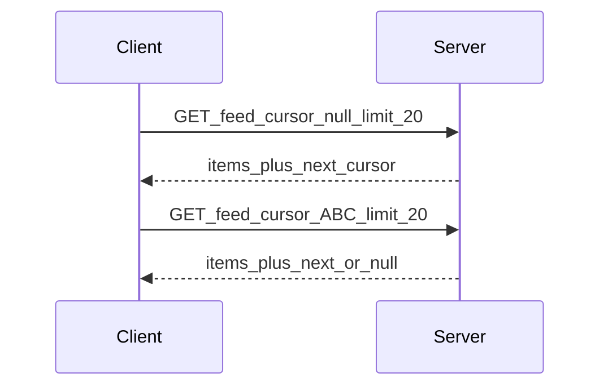
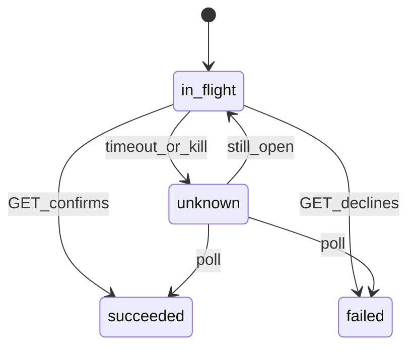

# 05 — Networking and APIs

## Goal

Design client–server contracts that survive flaky networks: pagination, retries, idempotency, and versioning.

## Transport choice

| Option | Use when | Avoid when |
|--------|----------|------------|
| REST/JSON | CRUD, wide tooling | Huge chattiness without batching |
| GraphQL | Flexible fields, BFF | Unbounded queries from client |
| gRPC | Internal typed RPCs, streaming | Browser-only constraints |
| WebSocket | Bidirectional realtime | Rare updates (prefer push/poll) |
| SSE | Server→client streams | Need client→server on same channel |

## Pagination

| Style | Pros | Cons |
|-------|------|------|
| Offset/limit | Simple | Duplicates/skips on inserts |
| Cursor / keyset | Stable feeds | Cursor opacity; harder random access |
| Page token opaque | Server flexibility | Client can’t invent pages |

**Interview default for feeds/chat history:** cursor-based.

## Retries and timeouts

- Timeouts: connect short; read sized to payload
- Retry only **idempotent** or **explicitly safe** calls
- Exponential backoff + jitter; cap attempts
- Honor `Retry-After` when present

## Idempotency

Client generates `Idempotency-Key` (UUID) for creates: send message, place order, start upload. Server dedupes; client can safely retry after uncertain failure.

## Auth on the wire

- Access token short-lived; refresh token rotated
- Single-flight refresh; queue requests during refresh
- On refresh failure → hard logout path

## Connectivity awareness

- Observe network type (wifi/cellular/none) for prefetch policy
- Queue writes when offline (see Ch 07)
- Degrade: smaller images, fewer prefetches on constrained nets

## Error model

Map to user-visible classes: retryable, needs-login, validation, conflict, fatal. Never show raw stack traces.

## Uncertain writes (payments)

After `POST` money moves, the client may get timeout with **unknown** outcome:

Do not retry a create without the **same idempotency key**. Prefer `GET` by `paymentId` / `clientMutationId` (Ch 21, 24).

## API evolution

- Additive fields preferred
- Client ignores unknown JSON keys
- Feature-detect via server flags when behavior changes

## Checkpoint

State pagination style, retry policy, and where idempotency keys are required—in one breath.
