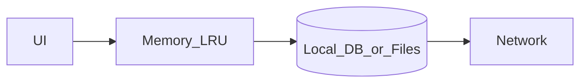

# 06 — Caching and Storage

## Goal

Place data in the right tier (memory, disk DB, blob files, remote) with clear invalidation rules.

## Cache tiers

| Tier | Latency | Volatility | Good for |
|------|---------|------------|----------|
| In-memory | µs–ms | Process lifetime | Decoded bitmaps, hot entities |
| SQLite / equivalent | ms | Durable | Feed pages, messages, metadata |
| File cache | ms | Durable | Images, video segments |
| Remote | 50–500ms+ | Source of truth (usually) | Freshness |

## Local storage choice

| Store | Choose when |
|-------|-------------|
| Key-value | Flags, small prefs, tokens (encrypted) |
| SQLite/Room/Core Data | Queryable relational state |
| Files / blob store | Media, large documents |
| Hybrid | Metadata in DB, bytes on disk |

## Eviction policies

| Policy | Typical use |
|--------|-------------|
| LRU | Image memory/disk caches |
| TTL | News articles, config |
| Size cap | Media disk budget (e.g., 300 MB) |
| Pinning | Offline downloads user requested |

## Invalidation strategies

| Strategy | When |
|----------|------|
| Write-through | User edits must not vanish |
| TTL refresh | Semi-static content |
| ETag / If-None-Match | Conditional GET |
| Event-driven | Push or websocket invalidate key |
| Version vector / updated_at | Sync pulls |

## Consistency mental model

- **UI reads local first** for speed; refresh in background when online
- Mark rows `stale` vs `pending_upload` explicitly
- Never treat memory cache as source of truth for user-authored data

## Money and balances (fintech exception)

| Data | Cache policy |
|------|----------------|
| Feed, articles, billets directory | Local-first + TTL OK |
| Wallet/spendable balance | Short TTL or fetch-on-open; show **as of** |
| Payment/transfer status | Durable attempt row + **server verify**; never invent `succeeded` |
| Card PAN/CVV | Do not cache; use hosted fields / tokens only |

Stale-balance spend is a production incident class—call this out in payments interviews (see Ch 21–24).

## Interview-reasonable budgets

| Asset | Default to mention |
|-------|--------------------|
| Memory image cache | 50–100 MB device-class aware |
| Disk image cache | 200–500 MB |
| Feed pages retained | Last N pages or time window |
| DB vacuum / prune | Background, wifi, charging if heavy |

## Checkpoint

For any entity, answer: **where it lives**, **how it expires**, **what happens on edit**.
