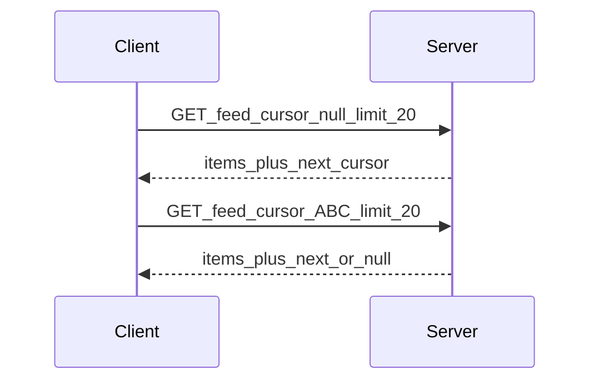
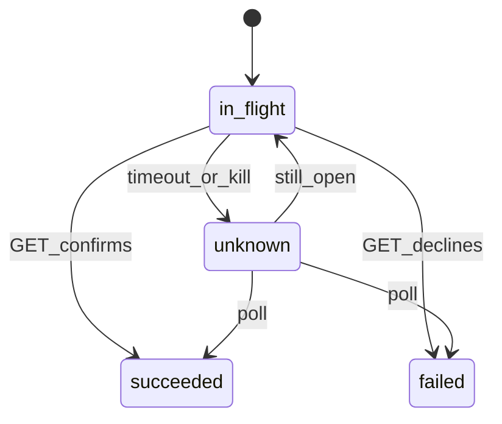

# 06 — Networking and APIs

## Goal

Design client–server contracts that survive flaky networks: pagination, retries, idempotency, and versioning.

## Transport choice

| Option | Use when | Avoid when |
|--------|----------|------------|
| REST/JSON | CRUD, wide tooling | Huge chattiness without batching |
| GraphQL | Flexible fields, BFF | Unbounded queries from client |
| gRPC | Internal typed RPCs, streaming | Browser-only constraints |
| WebSocket | Bidirectional realtime | Rare updates (prefer push/poll) |
| SSE | Server→client streams | Need client→server on same channel |

## Pagination

| Style | Pros | Cons |
|-------|------|------|
| Offset/limit | Simple | Duplicates/skips on inserts |
| Cursor / keyset | Stable feeds | Cursor opacity; harder random access |
| Page token opaque | Server flexibility | Client can’t invent pages |

**Interview default for feeds/chat history:** cursor-based.

## Retries and timeouts

- Timeouts: connect short; read sized to payload
- Retry only **idempotent** or **explicitly safe** calls
- Exponential backoff + jitter; cap attempts
- Honor `Retry-After` when present

## Idempotency

Client generates `Idempotency-Key` (UUID) for creates: send message, place order, start upload. Server dedupes; client can safely retry after uncertain failure.

## Auth on the wire

- Access token short-lived; refresh token rotated
- Single-flight refresh; queue requests during refresh
- On refresh failure → hard logout path

## Connectivity awareness

- Observe network type (wifi/cellular/none) for prefetch policy
- Queue writes when offline (see [Ch 08](08-offline-and-sync.md))
- Degrade: smaller images, fewer prefetches on constrained nets

## Error model

Map to user-visible classes: retryable, needs-login, validation, conflict, fatal. Never show raw stack traces.

## Uncertain writes (payments)

After `POST` money moves, the client may get timeout with **unknown** outcome:

Do not retry a create without the **same idempotency key**. Prefer `GET` by `paymentId` / `clientMutationId` ([Ch 38](../part-5-fintech/38-checkout-payment-sdk.md), [41](../part-5-fintech/41-txn-history-pending-recovery.md)).

## API evolution

- Additive fields preferred
- Client ignores unknown JSON keys
- Feature-detect via server flags when behavior changes

## Platform implementation

| Concern | Android | iOS | Flutter | React Native |
|---------|---------|-----|---------|--------------|
| HTTP client | OkHttp (connection pool, HTTP/2) + Retrofit or Ktor | `URLSession` (HTTP/2 and HTTP/3) | `dio` (interceptors) or `http`; `cronet_http` / `cupertino_http` to use the native stack | `fetch` / axios over the native stack; TurboModule for custom clients |
| Interceptors (auth, retry, headers) | OkHttp `Interceptor` / `Authenticator` | `URLProtocol` or a wrapper around `URLSession` | `dio` `Interceptor` (`QueuedInterceptor` for token refresh) | axios interceptors or a `fetch` wrapper |
| Cancellation | Cancel the coroutine (`viewModelScope`) | Cancel the `Task` (`.task {}` cancels on disappear) | `CancelToken` (`dio`) | `AbortController` |
| Connectivity | `ConnectivityManager.NetworkCallback` | `NWPathMonitor` | `connectivity_plus` | `@react-native-community/netinfo` |
| Timeouts | Connect / read / call timeouts on OkHttp | `timeoutIntervalForRequest` / `ForResource` | `BaseOptions` timeouts | `AbortSignal.timeout(ms)` |
| gRPC / WebSocket | grpc-kotlin, OkHttp WebSocket | grpc-swift, `URLSessionWebSocketTask` | `grpc`, `web_socket_channel` | Built-in `WebSocket`; gRPC via native module |
| Constrained networks | `isActiveNetworkMetered`, Data Saver status | `allowsConstrainedNetworkAccess`, `allowsExpensiveNetworkAccess` | Read via plugin | Read via NetInfo details |

Notes:

- **Single-flight token refresh** is the same everywhere: one refresh in flight, other requests wait on it, then retry once (`Authenticator` on OkHttp, an actor on iOS, `QueuedInterceptor` in `dio`, a shared promise in JS).
- **On Flutter and React Native, prefer the native HTTP stack** for certificate pinning, HTTP/3 and proxy settings. Pinning implemented in Dart or JS is easy to bypass and misses OS trust settings.

## Say it in the interview

> "REST over HTTP/2 with cursor pagination for lists. Every write carries an idempotency key generated once per user action, so retries after a timeout are safe. Retries use exponential backoff with jitter, only for idempotent requests and transient errors. One shared client handles auth: on a 401 a single refresh runs while other requests wait, then each retries once. For uncertain results — like a payment that timed out — the client shows a pending state and asks the server, instead of guessing."

## Checkpoint

State pagination style, retry policy, and where idempotency keys are required—in one breath.

## Exercises

1. Design the API for an infinite feed that also inserts new posts at the top while the user scrolls. Why does offset pagination break?
2. A "Place order" request times out after 30 s. List what the client does in the next minute, step by step.
3. Ten requests fire at app start and the access token has expired. Describe the refresh flow and what each request sees.
4. You must remove a field from a response used by app versions from the last two years. Plan the rollout.
