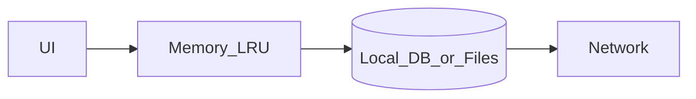

# 07 — Caching and Storage

## Goal

Place data in the right tier (memory, disk DB, blob files, remote) with clear invalidation rules.

## Cache tiers

| Tier | Latency | Volatility | Good for |
|------|---------|------------|----------|
| In-memory | µs–ms | Process lifetime | Decoded bitmaps, hot entities |
| SQLite / equivalent | ms | Durable | Feed pages, messages, metadata |
| File cache | ms | Durable | Images, video segments |
| Remote | 50–500ms+ | Source of truth (usually) | Freshness |

## Local storage choice

| Store | Choose when |
|-------|-------------|
| Key-value | Flags, small prefs, tokens (encrypted) |
| SQLite/Room/Core Data | Queryable relational state |
| Files / blob store | Media, large documents |
| Hybrid | Metadata in DB, bytes on disk |

## Eviction policies

| Policy | Typical use |
|--------|-------------|
| LRU | Image memory/disk caches |
| TTL | News articles, config |
| Size cap | Media disk budget (e.g., 300 MB) |
| Pinning | Offline downloads user requested |

## Invalidation strategies

| Strategy | When |
|----------|------|
| Write-through | User edits must not vanish |
| TTL refresh | Semi-static content |
| ETag / If-None-Match | Conditional GET |
| Event-driven | Push or websocket invalidate key |
| Version vector / updated_at | Sync pulls |

## Consistency mental model

- **UI reads local first** for speed; refresh in background when online
- Mark rows `stale` vs `pending_upload` explicitly
- Never treat memory cache as source of truth for user-authored data

## Money and balances (fintech exception)

| Data | Cache policy |
|------|----------------|
| Feed, articles, billets directory | Local-first + TTL OK |
| Wallet/spendable balance | Short TTL or fetch-on-open; show **as of** |
| Payment/transfer status | Durable attempt row + **server verify**; never invent `succeeded` |
| Card PAN/CVV | Do not cache; use hosted fields / tokens only |

Stale-balance spend is a production incident class—call this out in payments interviews (see [Ch 38](../part-5-fintech/38-checkout-payment-sdk.md)–[41](../part-5-fintech/41-txn-history-pending-recovery.md)).

## Interview-reasonable budgets

| Asset | Default to mention |
|-------|--------------------|
| Memory image cache | 50–100 MB device-class aware |
| Disk image cache | 200–500 MB |
| Feed pages retained | Last N pages or time window |
| DB vacuum / prune | Background, wifi, charging if heavy |

## Platform implementation

| Concern | Android | iOS | Flutter | React Native |
|---------|---------|-----|---------|--------------|
| Relational store | Room (SQLite, `Flow` queries) | Core Data / SwiftData / GRDB | drift (reactive queries), sqflite | op-sqlite, expo-sqlite, WatermelonDB (lazy, sync-friendly) |
| Key-value | DataStore | `UserDefaults` (small values only) | `shared_preferences` | MMKV (sync, fast), AsyncStorage (async, slower) |
| Files | `filesDir` (kept), `cacheDir` (OS may clear) | `Application Support` (set `isExcludedFromBackup` for re-downloadable data), `Caches` (purgeable) | `path_provider`: support / temporary directories | `expo-file-system` document / cache directories |
| Memory cache | `LruCache`, Coil / Glide memory cache | `NSCache` (auto-evicts under pressure) | `ImageCache`, hand-rolled LRU map | JS `Map` LRU (watch the JS heap), native image caches |
| HTTP cache | OkHttp `Cache` (honours `Cache-Control`, ETag) | `URLCache` | `dio_cache_interceptor` | Native HTTP cache behind `fetch`; TanStack Query for in-memory server state |
| Observe changes | Room `Flow`, `StateFlow` | `@Query` (SwiftData), `NSFetchedResultsController`, GRDB `ValueObservation` | drift `watch()` streams | WatermelonDB observables, TanStack Query invalidation |

Notes:

- **Don't put large blobs in key-value stores.** `UserDefaults`, `SharedPreferences`-style stores and AsyncStorage load whole files into memory.
- **iOS backup rules matter:** caches in `Documents` are uploaded to iCloud backup and can get an app rejected. Use `Application Support` with the exclude-from-backup flag, or `Caches`.

## Say it in the interview

> "Three tiers: a memory LRU for what's on screen, a local database for structured data the UI observes, and files for media. Each entity has a rule: feed pages use stale-while-revalidate with a TTL, the user's own edits are written through immediately, and balances or payment status are never served stale — they're fetched on open and labelled with an as-of time. Caches are scoped per user and cleared on logout."

## Checkpoint

For any entity, answer: **where it lives**, **how it expires**, **what happens on edit**.

## Exercises

1. For a news app, decide tier, TTL and invalidation for: headlines, article bodies, images, user bookmarks, the user's subscription status.
2. The memory cache uses 400 MB on a 3 GB device and the app is killed in the background. What changes?
3. Two screens show the same profile; one edits it. How does the other screen update without a refetch?
4. What must be deleted on logout, and in what order, so the next user never sees the previous user's data?
