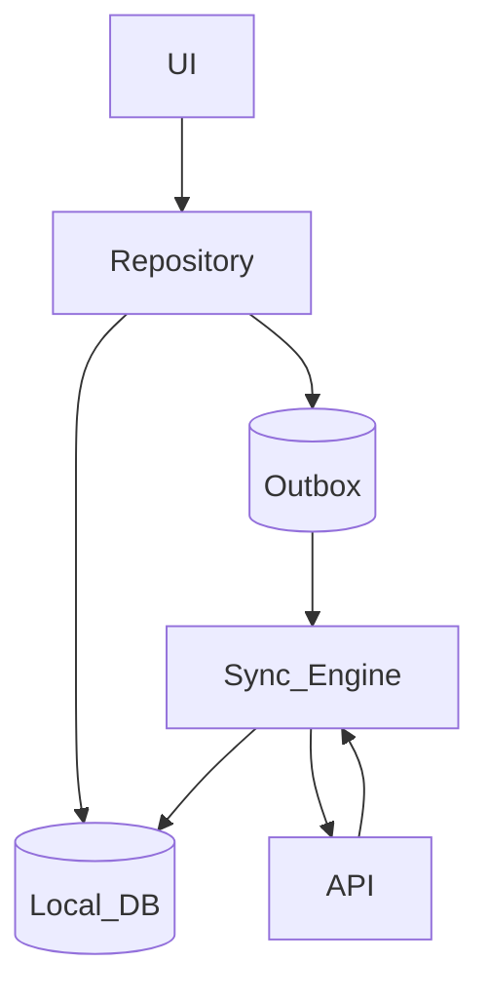
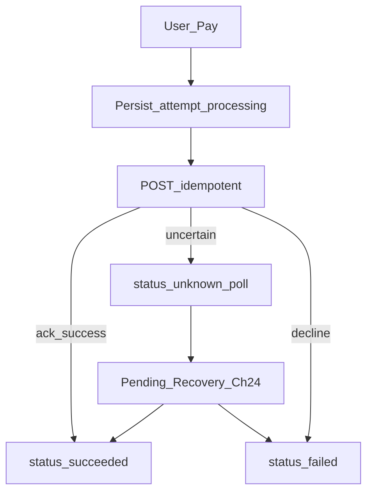

# 07 — Offline and Sync

## Goal

Design offline-first behavior: local writes, durable outbox, sync, and conflict resolution.

## Offline-first data flow

## Outbox pattern

1. User action → write domain row + outbox row in **one transaction**
2. UI reads local state immediately (optimistic)
3. Sync worker drains outbox when online
4. On success, mark ack; on conflict, resolve or surface UI

Survives process death by definition if outbox is durable.

## Sync styles

| Style | Pros | Cons |
|-------|------|------|
| Full snapshot | Simple | Expensive at scale |
| Delta / since timestamp | Efficient | Clock skew; deletions |
| Event log / version | Precise | More complex client |
| CRDT | Merge-friendly | Heavier; niche UX |

**Interview default:** delta sync + outbox for writes; tombstones for deletes.

## Conflict resolution

| Strategy | Example |
|----------|---------|
| Last-write-wins (LWW) | Profile display name |
| Server wins | Inventory counts |
| Client wins | Rare; justify |
| Field merge | Title vs body independently |
| CRDT / OT | Collaborative docs |
| Prompt user | Conflicting note body |

Always define **detection** (version/etag) before resolution.

## Sync triggers

- App foreground
- Network regained
- Push “sync now”
- Periodic background (OS-permitted)
- User pull-to-refresh

## Idempotency and ordering

- Outbox items carry client-generated IDs
- Preserve per-entity ordering when required (chat)
- Parallelize independent entities

## UX for sync

- Visible “pending / failed / synced” affordances where stakes are high
- Don’t block typing on network
- Partial failure: retry subset, don’t corrupt local truth

## When NOT to be local-first (fintech)

Outbox still helps—but **authority** flips for money:

| Domain | Local write meaning | Success UX |
|--------|---------------------|------------|
| Notes / likes / drafts | Local row is user truth until sync | Optimistic OK |
| Chat send | Local `pending` until ack | Show ticks from server/receipts |
| Wallet / checkout / UPI | Local row = **intent** (`processing`/`unknown`) | “Paid” only after server/PSP confirm |

Never mark `succeeded` offline. Prefer draft or explicit “send when online” for transfers (Ch 23).

## Checkpoint

Name your write path (outbox), read path (local-first **or** server-first for money), and conflict rule in one sentence each.
