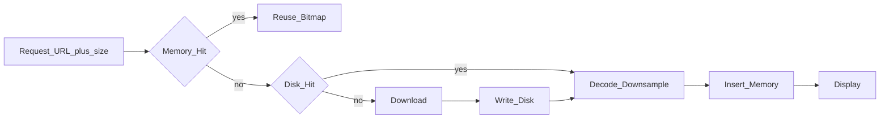
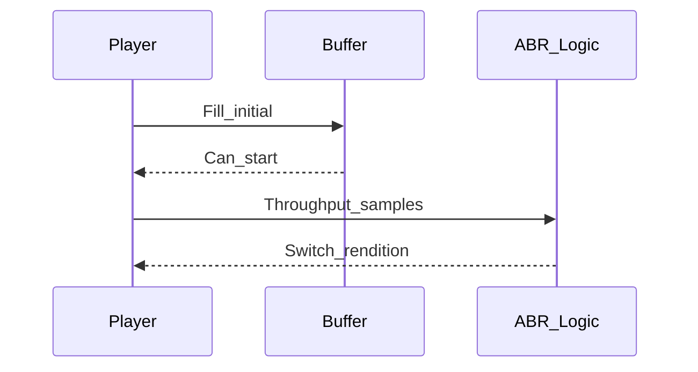
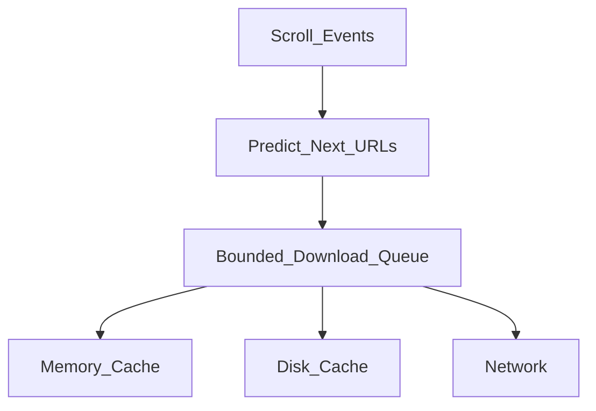

# 08 — Media: Images and Video

## Goal

Design media pipelines that respect memory, bandwidth, and scroll performance.

## Image loading pipeline

## Key image decisions

| Topic | Strong answer |
|-------|---------------|
| Target size | Decode to view size × screen scale, not full camera resolution |
| Format | WebP/AVIF when supported; JPEG fallback |
| Deduping | Coalesce in-flight requests by cache key |
| Cancellation | Cancel on recycle / leave screen |
| Placeholders | Low-res thumb or dominant color |
| Prefetch | Next N images in scroll direction; wifi-biased |

Cache key = URL + transformation params (size, crop).

## Scroll performance

- Prefetch slightly ahead; avoid stampeding
- Pause heavy decode when flinging (optional)
- Prefer async decode off main; bind on main

## Video (client view)

| Concern | Approach |
|---------|----------|
| Startup | Fast start with lower rung; upgrade ABR |
| ABR | Monitor buffer + bandwidth; switch rungs |
| Offscreen | Pause / unload player |
| Background audio | Explicit mode; OS audio session |
| Downloads | Separate durable queue; wifi defaults |

## Upload path (preview)

- Compress/transcode before upload when quality allows
- Chunked / resumable upload with session ID
- Checksum on complete
- Bind to outbox so kill doesn’t lose the job

## Cap concurrent image downloads (optional note)

Prefetch and decode pools share a bounded executor so scroll cannot stampede the network.

## Android UI: Views (XML) and Compose

Full toolkit comparison: [Android UI toolkits](04-client-architecture.md#android-ui-toolkits-views-xml-and-compose).

| Concern | Views (XML) | Compose |
|---------|-------------|---------|
| Image load | Coil/Glide into `ImageView` (`imageView.load(url)` / `Glide.with(view).load(url).into(iv)`); request tied to the view, cancelled on recycle | Coil `AsyncImage(model, contentDescription)`; request tied to composition, cancelled when the item leaves |
| Decode size | Measured `ImageView` size drives downsampling | Size comes from constraints — give list images a fixed `Modifier.size` / `aspectRatio` or the loader may decode too large |
| Placeholder / fade | `placeholder(..)`, `crossfade(true)` on the request | `placeholder =` painter, crossfade on the `ImageRequest` |
| Video surface | Media3 `PlayerView` in XML; `playerView.player = player` | `AndroidView { PlayerView(it) }`, or Media3 `media3-ui-compose` `PlayerSurface` + your own Compose controls |
| Offscreen pause | `onViewDetachedFromWindow` / `onViewRecycled` → pause or release | `DisposableEffect` `onDispose` → pause; pick the active item from `LazyListState.layoutInfo.visibleItemsInfo` |

**Mixed codebase:** the image loader and player are toolkit-agnostic — share one `ImageLoader` / player pool across Views and Compose so caches and the "one active player" rule hold across both.

## Budgets to mention

- Memory cache for bitmaps capped
- Concurrent image downloads limited (e.g., 4–6)
- Video buffer target seconds traded vs data use

## Checkpoint

For images: size-aware decode + two-tier cache + cancel. For video: buffer + ABR + lifecycle pause.
