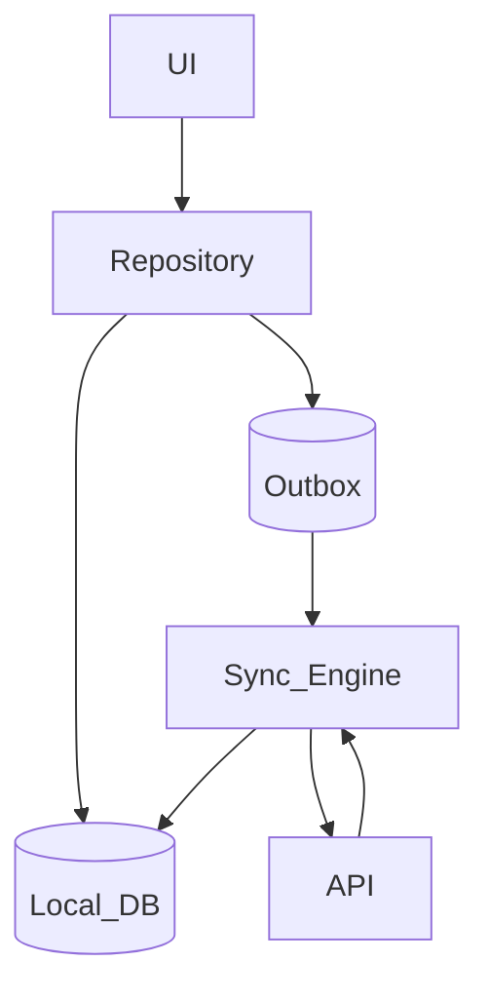
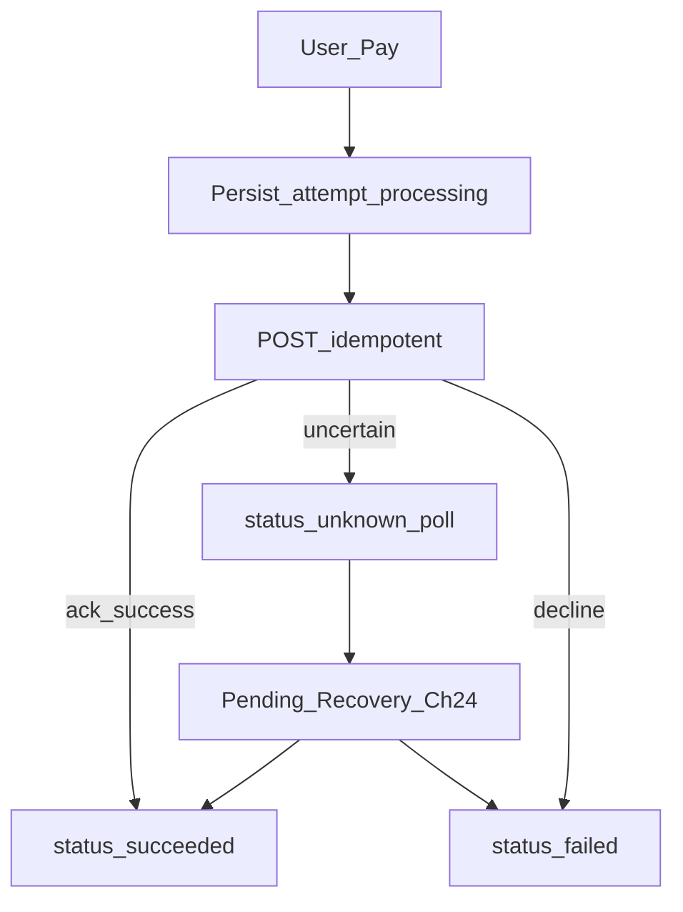

# 08 — Offline and Sync

## Goal

Design offline-first behavior: local writes, durable outbox, sync, and conflict resolution.

## Offline-first data flow

## Outbox pattern

1. User action → write domain row + outbox row in **one transaction**
2. UI reads local state immediately (optimistic)
3. Sync worker drains outbox when online
4. On success, mark ack; on conflict, resolve or surface UI

Survives process death by definition if outbox is durable.

## Sync styles

| Style | Pros | Cons |
|-------|------|------|
| Full snapshot | Simple | Expensive at scale |
| Delta / since timestamp | Efficient | Clock skew; deletions |
| Event log / version | Precise | More complex client |
| CRDT | Merge-friendly | Heavier; niche UX |

**Interview default:** delta sync + outbox for writes; tombstones for deletes.

## Conflict resolution

| Strategy | Example |
|----------|---------|
| Last-write-wins (LWW) | Profile display name |
| Server wins | Inventory counts |
| Client wins | Rare; justify |
| Field merge | Title vs body independently |
| CRDT / OT | Collaborative docs |
| Prompt user | Conflicting note body |

Always define **detection** (version/etag) before resolution.

## Sync triggers

- App foreground
- Network regained
- Push “sync now”
- Periodic background (OS-permitted)
- User pull-to-refresh

## Idempotency and ordering

- Outbox items carry client-generated IDs
- Preserve per-entity ordering when required (chat)
- Parallelize independent entities

## UX for sync

- Visible “pending / failed / synced” affordances where stakes are high
- Don’t block typing on network
- Partial failure: retry subset, don’t corrupt local truth

## When NOT to be local-first (fintech)

Outbox still helps—but **authority** flips for money:

| Domain | Local write meaning | Success UX |
|--------|---------------------|------------|
| Notes / likes / drafts | Local row is user truth until sync | Optimistic OK |
| Chat send | Local `pending` until ack | Show ticks from server/receipts |
| Wallet / checkout / UPI | Local row = **intent** (`processing`/`unknown`) | “Paid” only after server/PSP confirm |

Never mark `succeeded` offline. Prefer draft or explicit “send when online” for transfers ([Ch 40](../part-5-fintech/40-wallet-transfer.md)).

## Platform implementation

| Concern | Android | iOS | Flutter | React Native |
|---------|---------|-----|---------|--------------|
| Outbox table | Room table + DAO | Core Data / SwiftData / GRDB table | drift table | SQLite table (op-sqlite) or WatermelonDB |
| Flush when online | WorkManager with `NetworkType.CONNECTED` constraint, exponential backoff | Flush on foreground + `NWPathMonitor`; `BGAppRefreshTask` / `BGProcessingTask` opportunistically; background `URLSession` for big uploads | `workmanager` plugin + flush on resume; native transfer plugin for files | Flush on `AppState` active + NetInfo; `expo-background-task` / background-fetch opportunistically |
| Server nudges a sync | High-priority FCM data message → expedited work | Silent push → short fetch (best effort, throttled) | `firebase_messaging` background handler | `@react-native-firebase/messaging` `setBackgroundMessageHandler` |
| Reactive UI from local DB | Room `Flow` → `StateFlow` | `@Query` / `ValueObservation` → view model | drift `watch()` → Riverpod `StreamProvider` | WatermelonDB `withObservables` / TanStack Query |
| Sync engines (if allowed) | Custom, or a vendor SDK | Custom, CloudKit (Apple-only data) | PowerSync, custom | WatermelonDB sync protocol, PowerSync, custom |

Say aloud: *"Android can guarantee the outbox flush eventually through WorkManager. iOS can't promise when background code runs, so we flush on every foreground and network change, use background URLSession for attachments, and treat background refresh as a bonus."*

## Say it in the interview

> "The UI reads only from the local database, so it works offline. Writes go to the database and an outbox in one transaction; a sync worker pushes the outbox with idempotent operations, then pulls changes since the last server token. Conflicts use field-level last-writer-wins by server time, with custom merges where it matters. On Android the flush is guaranteed by WorkManager; on iOS we flush on foreground and network changes and use push nudges, because background time isn't guaranteed. Money is the exception: it's server-first, never local-first."

## Checkpoint

Name your write path (outbox), read path (local-first **or** server-first for money), and conflict rule in one sentence each.

## Exercises

1. Write the outbox table schema and the push/pull loop for a task app. Where do you save the server change token, and why there?
2. A user deletes a note on the phone while editing it on a tablet, both offline. What happens when both come online?
3. Your iOS app needs fresh data every morning at 8 am. Explain why a scheduled background task can't promise this and what you do instead.
4. List the cases where local-first is the wrong choice, with a reason for each.
