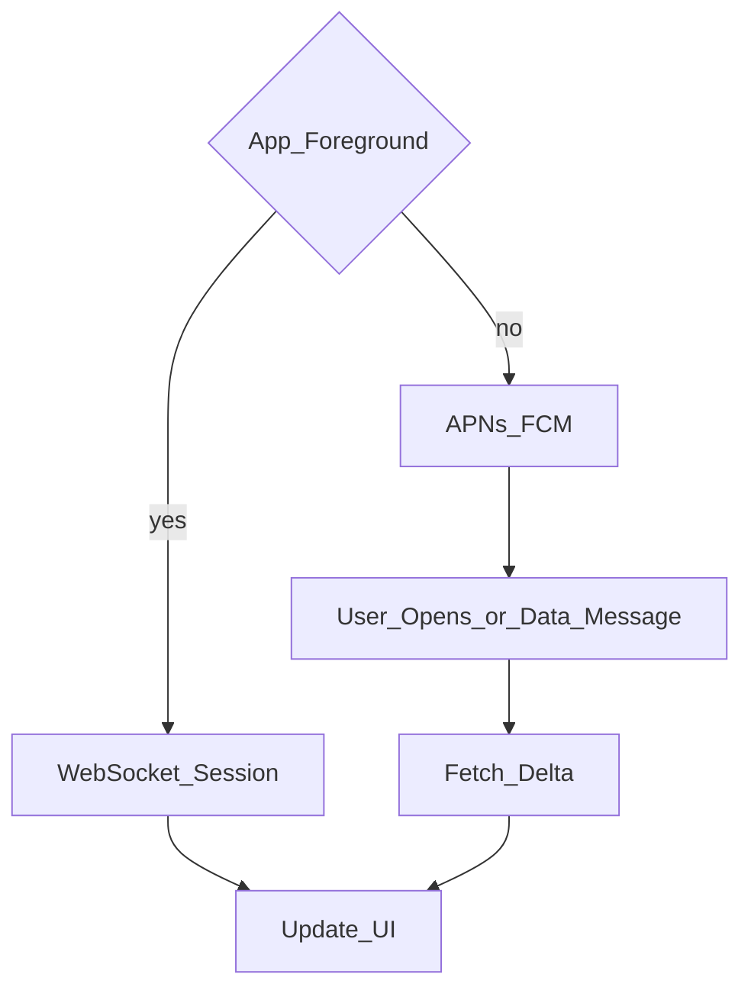
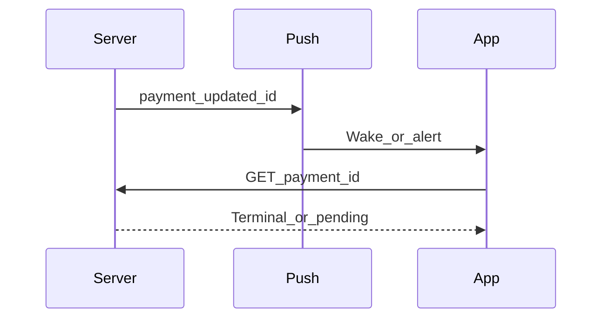

# 09 — Realtime and Push

## Goal

Pick the right realtime channel and design push notifications that are timely, private, and battery-aware.

## Realtime transports

| Mechanism | Latency | Battery | Complexity | Best for |
|-----------|---------|---------|------------|----------|
| Short polling | High | Poor if aggressive | Low | Rare updates |
| Long polling | Medium | Medium | Medium | Simple servers |
| SSE | Low (one-way) | Good | Medium | Feeds of events |
| WebSocket | Lowest bidirectional | Good if coalesced | Higher | Chat, collab, live maps |
| Push only | Event-driven | Best idle | Medium | Wake when needed |

**Hybrid default:** WebSocket while app foregrounded; push to wake when backgrounded; REST fallback.

## WebSocket client concerns

- Auth on connect; refresh + reconnect
- Heartbeats / ping; detect half-open
- Backoff reconnect with jitter
- Event ordering / gap detection (sequence numbers)
- Multiplex channels or single socket with routing keys

## Push notifications

| Topic | Strong practice |
|-------|-----------------|
| Providers | `iOS:` APNs `Android:` FCM |
| Payload size | Keep small; fetch body on open if needed |
| Collapse keys | Collapse redundant status updates |
| Sensitivity | Avoid PII in lock-screen body when possible |
| Data vs alert | Silent/data for sync hints; alert for user-visible |
| Permissions | Soft-ask education; settings deep link |

## Delivery guarantees

Push is **best-effort**. Critical state always reconciled via pull/sync when app becomes active.

## Fintech / money alerts

| Practice | Why |
|----------|-----|
| Prefer data/silent push to wake poller | Lock-screen may leak amounts |
| Collapse key = `paymentId` | Avoid notification storms |
| Alert body: “Payment update” vs full amount | Privacy policy dependent |
| On open: always `GET` status (Ch 24) | Push payload is not ledger truth |

## Typing indicators & ephemeral signals

- Local echo immediately
- Send throttled events (e.g., every 2–3s while typing)
- Auto-expire on receivers (timeout)
- Never persist as critical data

## Checkpoint

State foreground channel, background wake path, and that push is not source of truth.
