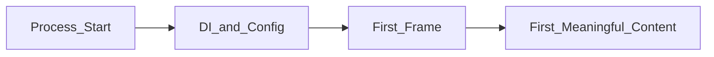
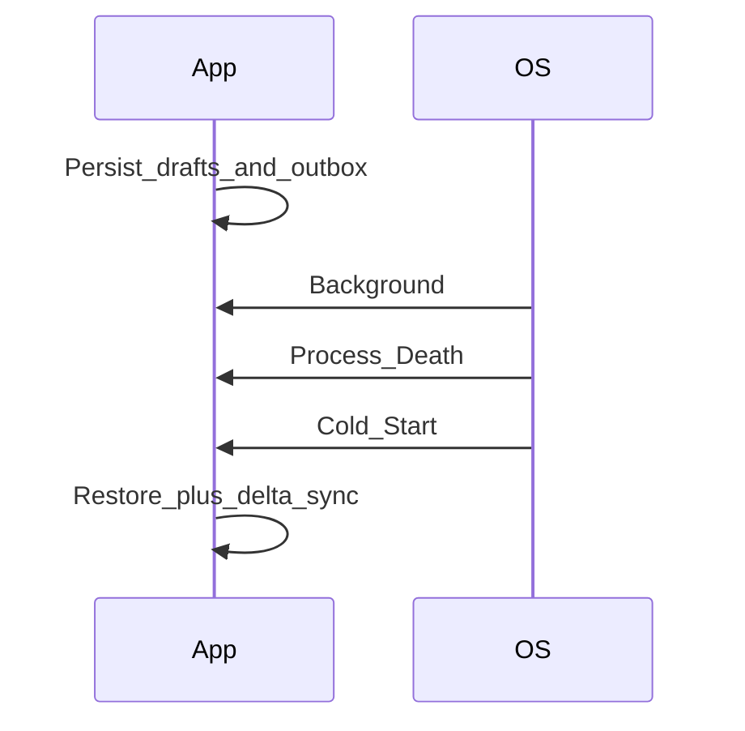

# 10 — Performance, Battery, and Lifecycle

## Goal

Budget for cold start, scroll jank, background work, and battery—and speak about them quantitatively enough for senior interviews.

## Cold start

| Phase | Tactics |
|-------|---------|
| Process start | Defer non-critical init; avoid disk on main |
| First frame | Minimal home shell; async hydrate |
| Content | Show cached data immediately; refresh |

Targets (interview-reasonable): warm content <1s when cached; cold uncached honest about network.

## Runtime UI performance

- Main thread: no network, no large JSON parse, no heavy image decode
- Lists: recycling, stable IDs, diffing
- Overdraw and nested layouts—mention if UI-heavy prompt
- Cap concurrent work (thread pools)

## Memory

- Leak awareness: listeners, static Context, abandoned players
- On trim: release memory caches, shrink decode pools
- Large bitmaps: downsample; recycle carefully per platform norms

## Battery

| Drain source | Mitigation |
|--------------|------------|
| Wakelocks / foreground services | Use sparingly; justify UX |
| Location | Adaptive accuracy; batch |
| Network radio | Coalesce; prefer unmetered for bulky sync |
| CPU polling loops | Event-driven; OS schedulers |

## Background work

| Job type | Scheduler |
|----------|-----------|
| Opportunistic sync | WorkManager / BGAppRefresh |
| User-initiated download | Foreground notification when required |
| Exact timing | Rare; alarm with care |

Respect OS deferral—design sync to be **restartable** and idempotent.

## App lifecycle hooks to mention

- Enter background: flush logs, persist drafts, disconnect expensive sockets if policy says so
- Return foreground: reconnect, delta sync
- Low memory / trim: drop caches
- Locale / theme changes: recreate safely

## Android UI: Views (XML) and Compose

Full toolkit comparison: [Android UI toolkits](04-client-architecture.md#android-ui-toolkits-views-xml-and-compose).

| Concern | Views (XML) | Compose |
|---------|-------------|---------|
| Jank source | Overdraw, deep/nested layouts (double measure from `RelativeLayout` / weights), inflating in `onBindViewHolder`, `notifyDataSetChanged()` | Excess recomposition, unstable params (mutable classes, `var`, types from non-Compose modules) defeating skipping; strong skipping is on by default since Kotlin 2.0.20 but immutable UI models still matter |
| Lists | `ListAdapter` (diff off main), stable IDs, `setHasFixedSize`, shared `RecycledViewPool` for nested lists | `key` + `contentType` on lazy items; no heavy work or allocation in item lambdas; `remember` derived values |
| Fast-changing state | Setters per frame are cheap; avoid `requestLayout` in scroll callbacks | Read scroll/animation state in a lambda modifier (`Modifier.offset { }`, `graphicsLayer { }`) so only layout/draw re-runs; `derivedStateOf` for thresholds |
| Startup | Inflation cost; `ViewStub` for rarely shown UI | Compose ships in the APK (not the OS) → JIT at first run; Baseline Profiles are essential; never judge perf on debug builds |
| Lifecycle | Collect in `repeatOnLifecycle(STARTED)`; null out binding in `onDestroyView` | `collectAsStateWithLifecycle()`; `DisposableEffect` / `LifecycleEventEffect`; `rememberSaveable` for process death |
| Tools | Layout Inspector, GPU overdraw debug, Perfetto, JankStats | Layout Inspector recomposition counts, composition tracing in Perfetto, compiler stability reports; Macrobenchmark + JankStats for both |

**Mixed codebase:** measure per screen, not per toolkit — the first Compose screen pays the runtime warm-up, so add it to the Baseline Profile before judging the migration.

## Checkpoint

Tie each expensive feature to a **budget** (start time, fps, battery) and a **deferral strategy**.
