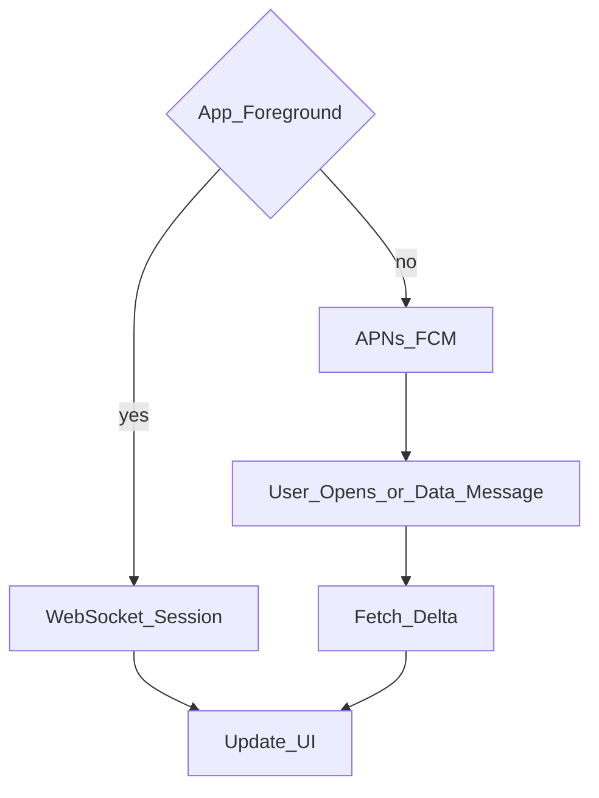
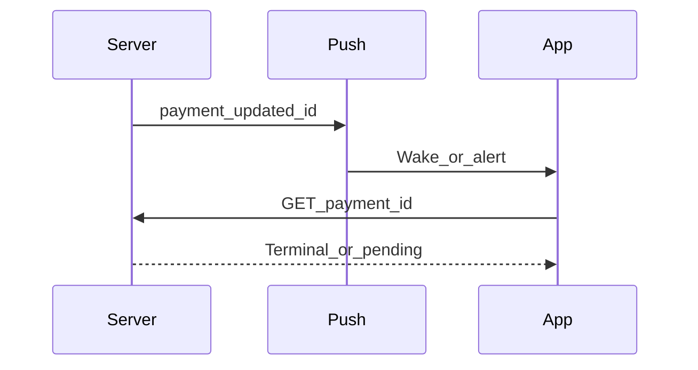

# 10 — Realtime and Push

## Goal

Pick the right realtime channel and design push notifications that are timely, private, and battery-aware.

## Realtime transports

| Mechanism | Latency | Battery | Complexity | Best for |
|-----------|---------|---------|------------|----------|
| Short polling | High | Poor if aggressive | Low | Rare updates |
| Long polling | Medium | Medium | Medium | Simple servers |
| SSE | Low (one-way) | Good | Medium | Feeds of events |
| WebSocket | Lowest bidirectional | Good if coalesced | Higher | Chat, collab, live maps |
| Push only | Event-driven | Best idle | Medium | Wake when needed |

**Hybrid default:** WebSocket while app foregrounded; push to wake when backgrounded; REST fallback.

## WebSocket client concerns

- Auth on connect; refresh + reconnect
- Heartbeats / ping; detect half-open
- Backoff reconnect with jitter
- Event ordering / gap detection (sequence numbers)
- Multiplex channels or single socket with routing keys

## Push notifications

| Topic | Strong practice |
|-------|-----------------|
| Providers | `iOS:` APNs `Android:` FCM |
| Payload size | Keep small; fetch body on open if needed |
| Collapse keys | Collapse redundant status updates |
| Sensitivity | Avoid PII in lock-screen body when possible |
| Data vs alert | Silent/data for sync hints; alert for user-visible |
| Permissions | Soft-ask education; settings deep link |

## Delivery guarantees

Push is **best-effort**. Critical state always reconciled via pull/sync when app becomes active.

## Fintech / money alerts

| Practice | Why |
|----------|-----|
| Prefer data/silent push to wake poller | Lock-screen may leak amounts |
| Collapse key = `paymentId` | Avoid notification storms |
| Alert body: “Payment update” vs full amount | Privacy policy dependent |
| On open: always `GET` status ([Ch 41](../part-5-fintech/41-txn-history-pending-recovery.md)) | Push payload is not ledger truth |

## Typing indicators & ephemeral signals

- Local echo immediately
- Send throttled events (e.g., every 2–3s while typing)
- Auto-expire on receivers (timeout)
- Never persist as critical data

## Platform implementation

| Concern | Android | iOS | Flutter | React Native |
|---------|---------|-----|---------|--------------|
| WebSocket | OkHttp `WebSocket`, Ktor | `URLSessionWebSocketTask`, Starscream | `web_socket_channel` | Built-in `WebSocket` |
| Keep socket only in foreground | `ProcessLifecycleOwner` `ON_START` / `ON_STOP` | `scenePhase` / `didEnterBackground` | `AppLifecycleListener` | `AppState` listener |
| Push provider | FCM | APNs (token via `registerForRemoteNotifications`) | `firebase_messaging` | `@react-native-firebase/messaging`, `expo-notifications` |
| Wake app to fetch | High-priority data message | Silent push (`content-available: 1`), throttled | Background message handler (runs a headless isolate) | Headless background handler |
| Modify content before display | Build the notification yourself from a data message | Notification Service Extension (decrypt, attach media, ~30 s) | Native NSE target on iOS; Android handled in Dart | Native NSE target on iOS (Expo config plugin) |
| Notification permission | `POST_NOTIFICATIONS` runtime permission (Android 13+) | `requestAuthorization`; provisional authorization for quiet delivery | `firebase_messaging.requestPermission()` | `messaging().requestPermission()` / `expo-notifications` |
| Live progress (order, ride) | Ongoing notification, Live Updates-style promoted notifications (Android 16) | Live Activities + Dynamic Island (ActivityKit, push-to-update) | Native Live Activity via channel / plugin | Native module / Expo module for Live Activities |

Notes: on iOS a force-quit app gets no silent pushes until the user opens it again, so the design has to work with **alert push + fetch on open** as the floor.

## Say it in the interview

> "While the screen is open we keep a WebSocket for live updates, resuming from the last sequence number after reconnects. When the app is backgrounded we close it and rely on push. Push is a hint: the payload carries ids, the app fetches the truth. On Android, high-priority data messages can trigger a short sync; on iOS, silent pushes are throttled and never arrive after a force-quit, so the design must still be correct with alert pushes and a fetch on open."

## Checkpoint

State foreground channel, background wake path, and that push is not source of truth.

## Exercises

1. Design typing indicators and online presence. What's sent, how often, and what happens on a flaky connection?
2. A push says "Payment successful ₹500". Why doesn't the app show that as the final status, and what does it do?
3. Compare WebSocket, SSE and polling for live order tracking. Which do you pick for foreground and why?
4. The user force-quit your iOS app yesterday. Which of your notifications still arrive, and which background behaviours stop?
