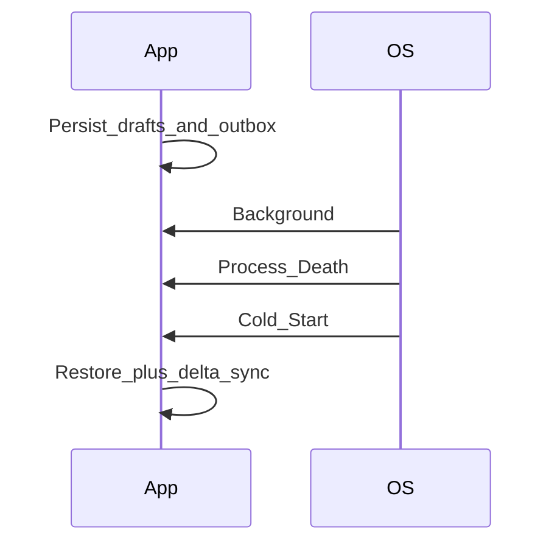

# 11 — Performance, Battery, and Lifecycle

## Goal

Budget for cold start, scroll jank, background work, and battery—and speak about them quantitatively enough for senior interviews.

## Cold start

| Phase | Tactics |
|-------|---------|
| Process start | Defer non-critical init; avoid disk on main |
| First frame | Minimal home shell; async hydrate |
| Content | Show cached data immediately; refresh |

Targets (interview-reasonable): warm content <1s when cached; cold uncached honest about network.

## Runtime UI performance

- Main thread: no network, no large JSON parse, no heavy image decode
- Lists: recycling, stable IDs, diffing
- Overdraw and nested layouts—mention if UI-heavy prompt
- Cap concurrent work (thread pools)

## Memory

- Leak awareness: listeners, static Context, abandoned players
- On trim: release memory caches, shrink decode pools
- Large bitmaps: downsample; recycle carefully per platform norms

## Battery

| Drain source | Mitigation |
|--------------|------------|
| Wakelocks / foreground services | Use sparingly; justify UX |
| Location | Adaptive accuracy; batch |
| Network radio | Coalesce; prefer unmetered for bulky sync |
| CPU polling loops | Event-driven; OS schedulers |

## Background work

| Job type | Scheduler |
|----------|-----------|
| Opportunistic sync | WorkManager / BGAppRefresh |
| User-initiated download | Foreground notification when required |
| Exact timing | Rare; alarm with care |

Respect OS deferral—design sync to be **restartable** and idempotent.

## App lifecycle hooks to mention

- Enter background: flush logs, persist drafts, disconnect expensive sockets if policy says so
- Return foreground: reconnect, delta sync
- Low memory / trim: drop caches
- Locale / theme changes: recreate safely

## Platform implementation

Cross-platform map: [Ch 05](../part-2-building-blocks/05-platforms-android-ios-flutter-react-native.md).

### Android: Views (XML) and Compose

Full toolkit comparison: [Android UI toolkits](04-client-architecture.md#android-ui-toolkits-views-xml-and-compose).

| Concern | Views (XML) | Compose |
|---------|-------------|---------|
| Jank source | Overdraw, deep/nested layouts (double measure from `RelativeLayout` / weights), inflating in `onBindViewHolder`, `notifyDataSetChanged()` | Excess recomposition, unstable params (mutable classes, `var`, types from non-Compose modules) defeating skipping; strong skipping is on by default since Kotlin 2.0.20 but immutable UI models still matter |
| Lists | `ListAdapter` (diff off main), stable IDs, `setHasFixedSize`, shared `RecycledViewPool` for nested lists | `key` + `contentType` on lazy items; no heavy work or allocation in item lambdas; `remember` derived values |
| Fast-changing state | Setters per frame are cheap; avoid `requestLayout` in scroll callbacks | Read scroll/animation state in a lambda modifier (`Modifier.offset { }`, `graphicsLayer { }`) so only layout/draw re-runs; `derivedStateOf` for thresholds |
| Startup | Inflation cost; `ViewStub` for rarely shown UI | Compose ships in the APK (not the OS) → JIT at first run; Baseline Profiles are essential; never judge perf on debug builds |
| Lifecycle | Collect in `repeatOnLifecycle(STARTED)`; null out binding in `onDestroyView` | `collectAsStateWithLifecycle()`; `DisposableEffect` / `LifecycleEventEffect`; `rememberSaveable` for process death |
| Tools | Layout Inspector, GPU overdraw debug, Perfetto, JankStats | Layout Inspector recomposition counts, composition tracing in Perfetto, compiler stability reports; Macrobenchmark + JankStats for both |

**Mixed codebase:** measure per screen, not per toolkit — the first Compose screen pays the runtime warm-up, so add it to the Baseline Profile before judging the migration.

### iOS, Flutter and React Native

| Concern | iOS (UIKit / SwiftUI) | Flutter | React Native |
|---------|-----------------------|---------|--------------|
| Jank source | Main-thread work, layout passes, image decode on main; Instruments **Hangs** + **Animation Hitches** | Build/layout/paint over budget on the UI thread, raster thread stalls; DevTools frame chart | Busy JS thread (renders, JSON parse), bridge-era chatty calls; Perf Monitor shows JS vs UI FPS |
| Lists | Diffable data source, cell prefetching; SwiftUI `List` with stable `id` | `ListView.builder` / slivers with `itemExtent`, `const` widgets | `FlashList` / tuned `FlatList` (`keyExtractor`, `getItemLayout`, memoized rows) |
| Fast-changing state | Isolate it in a small view / `@Observable` property so only that view updates | `ValueListenableBuilder` / `select` in Riverpod to rebuild a small subtree | Reanimated shared values (UI thread), avoid `setState` per frame |
| Startup | Pre-main (dyld, static initializers) + first frame; MetricKit launch metrics | Engine init + first frame; deferred components, avoid heavy `main()` work | Hermes bytecode, lazy TurboModules, inline requires, fewer providers at root |
| Lifecycle | `scenePhase`, `UIApplication` notifications | `AppLifecycleListener` | `AppState` |
| Tools | Instruments, MetricKit, Xcode Organizer | DevTools (performance, memory), `--profile` builds | Hermes sampling profiler, React DevTools profiler, Android Studio / Instruments for native |

Always profile **release/profile builds on a low-end device**. Debug builds of Flutter (JIT) and React Native (dev mode) are much slower and give misleading numbers.

## Say it in the interview

> "I'd set budgets first: cold start under 2 seconds on a mid-range device, no frame over 16 ms during scroll, and no background wakeups except through the OS schedulers. Startup defers everything not needed for the first frame. Lists use stable keys and pre-sized images. Heavy work runs off the main thread — coroutines, Swift tasks, Dart isolates, or native modules in React Native. I measure in release builds on a low-end device and track the same numbers in production."

## Checkpoint

Tie each expensive feature to a **budget** (start time, fps, battery) and a **deferral strategy**.

## Exercises

1. Cold start went from 1.4 s to 2.6 s after a release. How do you find the cause on Android and on iOS?
2. A React Native list stutters while a WebSocket streams prices. Explain why and give two fixes.
3. Your app is in Android's "rare" standby bucket. What does that do to your background work, and how do you design for it?
4. List what the app must save when it goes to the background, assuming it will be killed afterwards.
