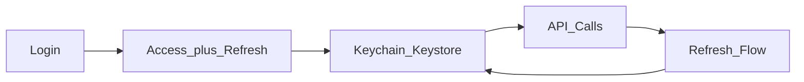
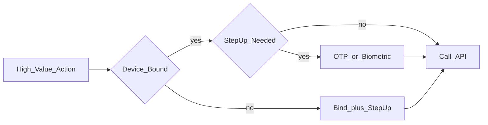

# 11 — Security and Privacy

## Goal

Cover the security topics interviewers expect on mobile without turning the interview into a crypto lecture.

## Threat mindset

| Threat | Example control |
|--------|-----------------|
| Stolen device | OS lock + encrypted storage; remote revoke refresh |
| MITM | TLS; optional pinning for high-risk apps |
| Malicious app on device | Don’t store secrets in plain prefs; use Keystore/Keychain |
| User screenshots | Flag sensitive windows when appropriate |
| Log leakage | Redact tokens/PII |

## Token storage

- Access token: memory + secure storage as needed; short TTL
- Refresh token: hardware-backed storage when available
- Biometric gate for high-value actions (step-up)

## Certificate pinning

| Choose pinning when | Avoid when |
|---------------------|------------|
| High-threat finance/health | You lack pin rotation / backup pins |
| Regulatory expectation | Pins baked without emergency disable |

Always discuss **backup pins** and remote kill-switch via config if you propose pinning.

## Local data protection

- Sensitive tokens: Keychain (iOS) / Keystore (Android)—hardware-backed when available
- Small prefs: **Encrypted DataStore + Tink/Keystore** on Android (prefer over deprecated EncryptedSharedPreferences); never plain SharedPreferences for secrets
- Structured app state: Room / Core Data / SQLite; SQLCipher if threat model requires
- Scrub clipboard after sensitive paste windows
- Separate app lock vs OS lock for extra UX when warranted

## AuthN / AuthZ on client

- Client enforces UX only; server enforces authorization
- Deep links validate session and entitlements
- Step-up auth for payments / export

## Privacy

- Minimize collected data; purpose limitation
- Permission UX: rationale screens
- Analytics: hash/truncate IDs; honor opt-out
- GDPR/CCPA-level “delete account” path if relevant to prompt

## Secure coding callouts

- WebView: restrict JS bridges; validate URLs
- Export / backup rules on Android
- SSL errors never ignored in production

## Fintech extras (cite in payments rounds)

| Topic | Client expectation |
|-------|--------------------|
| PCI scope | Hosted fields / PSP SDK; no PAN/CVV in app memory |
| Device binding | High-value actions require bound device (Ch 28) |
| Step-up | Biometric/PIN/OTP before bind, beneficiary, large pay |
| Screenshot | FLAG_SECURE / secure field on amount, OTP, card UI |
| Attestation | Play Integrity / DeviceCheck soft signals to risk; avoid naive hard-blocks alone |
| Push privacy | Prefer generic lock-screen copy for money alerts |

## Checkpoint

Mention secure token storage, TLS, server-side authz, and one privacy control in every sensitive design. For fintech, also name PCI boundary or device binding.
