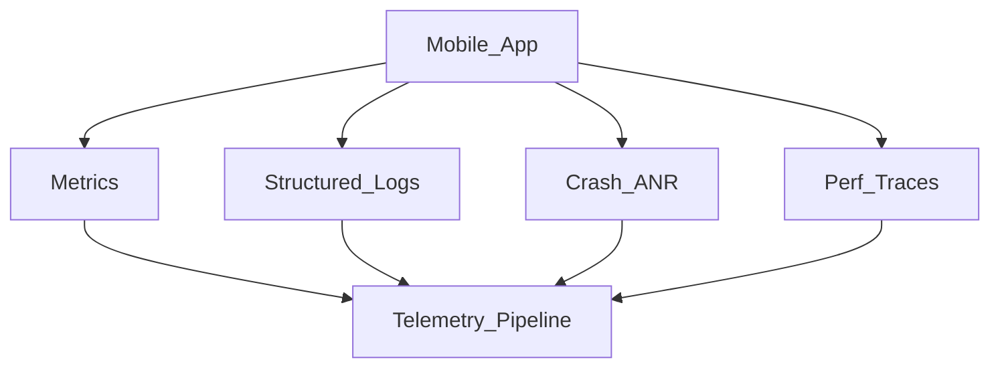
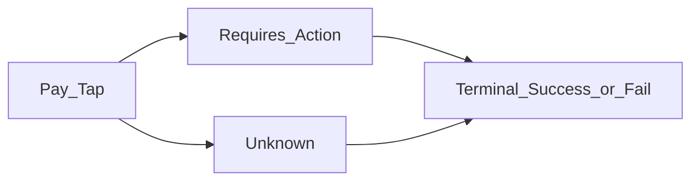

# 12 — Observability and Quality

## Goal

Show how you know the system works in production: metrics, logs, traces, feature flags, and quality gates.

## Telemetry pillars

## Metrics that matter (mobile)

| Area | Examples |
|------|----------|
| Reliability | Crash-free users, ANR rate |
| Performance | Cold start p50/p95, scroll hitch ratio, TTFD |
| Networking | Success rate, latency by route, retry counts |
| Sync | Outbox age, conflict rate, drain failures |
| Business | Send success, checkout conversion (if relevant) |
| Payments | pay_tap→terminal, unknown_age_p95, double_submit_blocked, rail_error_rate |

Use sampling for high-volume events; always attach app version, OS, device class.

## Logging hygiene

- Structured key/value logs
- No tokens, passwords, precise locations, message bodies (unless tiered/consented)
- Correlate with `session_id` / `trace_id`

## Feature flags and rollout

| Stage | Practice |
|-------|----------|
| Dev | Flag default off in prod |
| Canary | % rollout by user hash |
| Kill switch | Disable without app release when possible |
| Experiment | Pre-register metrics |

Risky changes: sync engine, auth, payment—flag aggressively.

## Quality strategy

- Unit: domain and sync reducers
- Integration: repository + fake API/DB
- UI: critical flows smoke
- Performance budgets in CI when possible
- Dogfood + staged rollout

## Client alert philosophy

Alert on **user pain**: spike in crash, sync failure, login failure—not on every 4xx.

## Interview close

End designs with: “I’d measure X/Y/Z and gate rollout on crash-free and sync success.”

## Checkpoint

Name three metrics and one kill-switch for your design.
