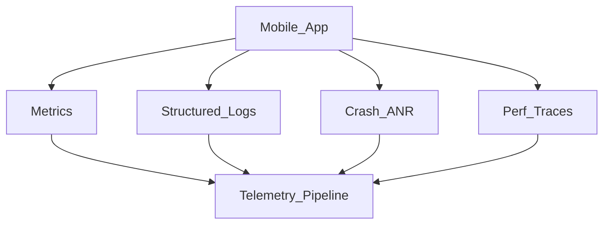
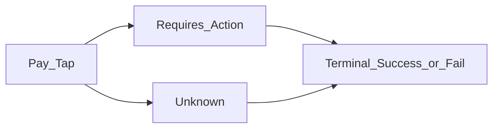

# 12 — Observability and Quality

## Goal

Show how you know the system works in production: metrics, logs, traces, feature flags, and quality gates.

## Telemetry pillars



## Metrics that matter (mobile)

| Area | Examples |
|------|----------|
| Reliability | Crash-free users, ANR rate |
| Performance | Cold start p50/p95, scroll hitch ratio, TTFD |
| Networking | Success rate, latency by route, retry counts |
| Sync | Outbox age, conflict rate, drain failures |
| Business | Send success, checkout conversion (if relevant) |
| Payments | pay_tap→terminal, unknown_age_p95, double_submit_blocked, rail_error_rate |

Use sampling for high-volume events; always attach app version, OS, device class.



## Logging hygiene

- Structured key/value logs
- No tokens, passwords, precise locations, message bodies (unless tiered/consented)
- Correlate with `session_id` / `trace_id`

## Feature flags and rollout

| Stage | Practice |
|-------|----------|
| Dev | Flag default off in prod |
| Canary | % rollout by user hash |
| Kill switch | Disable without app release when possible |
| Experiment | Pre-register metrics |

Risky changes: sync engine, auth, payment—flag aggressively.

## Quality strategy

- Unit: domain and sync reducers
- Integration: repository + fake API/DB
- UI: critical flows smoke
- Performance budgets in CI when possible
- Dogfood + staged rollout

## Android UI: Views (XML) and Compose

Full toolkit comparison: [Android UI toolkits](04-client-architecture.md#android-ui-toolkits-views-xml-and-compose).

| Concern | Views (XML) | Compose |
|---------|-------------|---------|
| UI tests | Espresso + `ActivityScenario` / `FragmentScenario`; IdlingResource for async | `compose-ui-test` (`createComposeRule` / `createAndroidComposeRule`); synchronizes with recomposition; `waitUntil` for async |
| Selectors | View IDs (`withId`) | Semantics: text, `contentDescription`, `Modifier.testTag`; `testTagsAsResourceId` to expose tags to UI Automator / Macrobenchmark |
| Screenshot tests | Paparazzi / Roborazzi render layouts on the JVM | Same tools render composables; `@Preview`-driven screenshot tests |
| Accessibility checks | Espresso `AccessibilityChecks.enable()` (ATF) | Assert on semantics; recent `compose-ui-test` versions can run the same ATF checks |
| Jank telemetry | JankStats + `PerformanceMetricsState` tags (screen, list scrolling) | Same JankStats API; tag state from a `DisposableEffect` |
| Screen breadcrumbs | `FragmentLifecycleCallbacks` / nav destination listener | `NavController.addOnDestinationChangedListener` (works for both) |

```kotlin
// Views (Espresso)
onView(withId(R.id.follow)).perform(click())
onView(withId(R.id.follow)).check(matches(withText(R.string.unfollow)))

// Compose (compose-ui-test)
composeRule.setContent { ProfileRoute() }
composeRule.onNodeWithText("Follow").performClick()
composeRule.onNodeWithText("Unfollow").assertIsDisplayed()
```

**Mixed codebase:** Espresso and Compose test APIs run in the same instrumented test, so one flow test can cross a Fragment and a `ComposeView`; keep crash/jank dashboards sliced by screen so a migration regression is visible.

## Client alert philosophy

Alert on **user pain**: spike in crash, sync failure, login failure—not on every 4xx.

## Interview close

End designs with: “I’d measure X/Y/Z and gate rollout on crash-free and sync success.”

## Checkpoint

Name three metrics and one kill-switch for your design.
