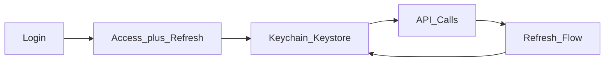
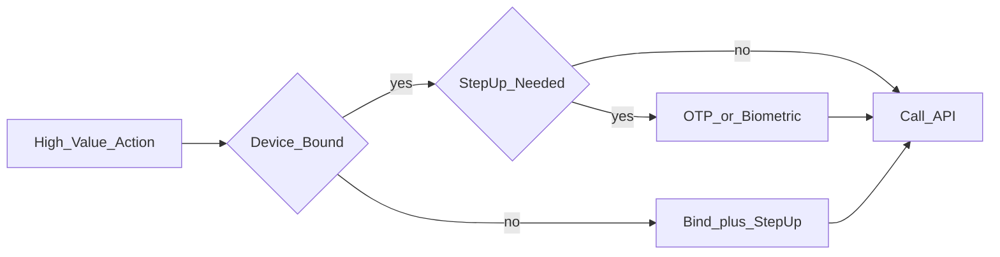

# 12 — Security and Privacy

## Goal

Cover the security topics interviewers expect on mobile without turning the interview into a crypto lecture.

## Threat mindset

| Threat | Example control |
|--------|-----------------|
| Stolen device | OS lock + encrypted storage; remote revoke refresh |
| MITM | TLS; optional pinning for high-risk apps |
| Malicious app on device | Don’t store secrets in plain prefs; use Keystore/Keychain |
| User screenshots | Flag sensitive windows when appropriate |
| Log leakage | Redact tokens/PII |

## Token storage

- Access token: memory + secure storage as needed; short TTL
- Refresh token: hardware-backed storage when available
- Biometric gate for high-value actions (step-up)

## Certificate pinning

| Choose pinning when | Avoid when |
|---------------------|------------|
| High-threat finance/health | You lack pin rotation / backup pins |
| Regulatory expectation | Pins baked without emergency disable |

Always discuss **backup pins** and remote kill-switch via config if you propose pinning.

## Local data protection

- Sensitive tokens: Keychain (iOS) / Keystore (Android)—hardware-backed when available
- Small prefs: **Encrypted DataStore + Tink/Keystore** on Android (prefer over deprecated EncryptedSharedPreferences); never plain SharedPreferences for secrets
- Structured app state: Room / Core Data / SQLite; SQLCipher if threat model requires
- Scrub clipboard after sensitive paste windows
- Separate app lock vs OS lock for extra UX when warranted

## AuthN / AuthZ on client

- Client enforces UX only; server enforces authorization
- Deep links validate session and entitlements
- Step-up auth for payments / export

## Privacy

- Minimize collected data; purpose limitation
- Permission UX: rationale screens
- Analytics: hash/truncate IDs; honor opt-out
- GDPR/CCPA-level “delete account” path if relevant to prompt

## Secure coding callouts

- WebView: restrict JS bridges; validate URLs
- Export / backup rules on Android
- SSL errors never ignored in production

## Fintech extras (cite in payments rounds)

| Topic | Client expectation |
|-------|--------------------|
| PCI scope | Hosted fields / PSP SDK; no PAN/CVV in app memory |
| Device binding | High-value actions require bound device ([Ch 44](../part-5-fintech/44-secure-auth-device-binding.md)) |
| Step-up | Biometric/PIN/OTP before bind, beneficiary, large pay |
| Screenshot | FLAG_SECURE / secure field on amount, OTP, card UI |
| Attestation | Play Integrity / DeviceCheck soft signals to risk; avoid naive hard-blocks alone |
| Push privacy | Prefer generic lock-screen copy for money alerts |

## Platform implementation

| Concern | Android | iOS | Flutter | React Native |
|---------|---------|-----|---------|--------------|
| Token storage | Keystore-backed encryption (Tink), not plain prefs | Keychain with `kSecAttrAccessibleAfterFirstUnlockThisDeviceOnly` (or `WhenUnlocked…`) | `flutter_secure_storage` (Keychain / Keystore) | `react-native-keychain`, `expo-secure-store` |
| Hardware keys | StrongBox / TEE keys via `KeyGenParameterSpec`, key attestation | Secure Enclave keys (`SecKeyCreateRandomKey` with `kSecAttrTokenIDSecureEnclave`), App Attest | Native via channel / plugin | Native module |
| Biometrics | `BiometricPrompt` with `CryptoObject` | LocalAuthentication; Keychain item with `.biometryCurrentSet` access control | `local_auth` | `react-native-biometrics`, `expo-local-authentication` |
| Pinning | Network Security Config `<pin-set>` or OkHttp `CertificatePinner` | `NSPinnedDomains` in Info.plist or `URLSessionDelegate` trust evaluation | Native config preferred; `SecurityContext` in Dart is easier to bypass | Native config / module (TrustKit) |
| App integrity | Play Integrity API | App Attest + DeviceCheck | Plugins over both | Modules over both |
| Screenshot / recents protection | `FLAG_SECURE` | Blur on `willResignActive` / `sceneWillResignActive`; detect capture via `isCaptured` | `FLAG_SECURE` via plugin; iOS overlay natively | Native module for both |
| Code exposure | R8 / ProGuard obfuscation | Compiled; strip symbols | `--obfuscate --split-debug-info` | Hermes bytecode is decompilable: no secrets in JS, ever |

Notes: in Flutter and React Native, **the shared code is easier to read** after extraction (Dart snapshot, Hermes bytecode). Keep keys server-side, do crypto in native or OS-provided APIs, and assume the client is inspectable.

## Say it in the interview

> "Tokens live in the Keychain or Keystore-backed storage, never in plain preferences, and refresh tokens rotate. All traffic is TLS, with pinning only where we have a rotation plan. The client is treated as hostile: authorization happens on the server, and in Flutter or React Native there are no secrets in Dart or JS because they can be extracted. Sensitive screens are hidden in the app switcher, logs are scrubbed of PII, and for payments the app never touches card numbers — the PSP's hosted fields do."

## Checkpoint

Mention secure token storage, TLS, server-side authz, and one privacy control in every sensitive design. For fintech, also name PCI boundary or device binding.

## Exercises

1. Threat-model a "send money" screen: list five attacks and the client-side mitigation for each.
2. You find an API key in your React Native bundle. What can an attacker do with it, and how do you remove the need for it?
3. Design biometric unlock so that a new fingerprint added by someone else can't unlock the app.
4. Plan certificate pinning, including what happens when the certificate rotates unexpectedly.
