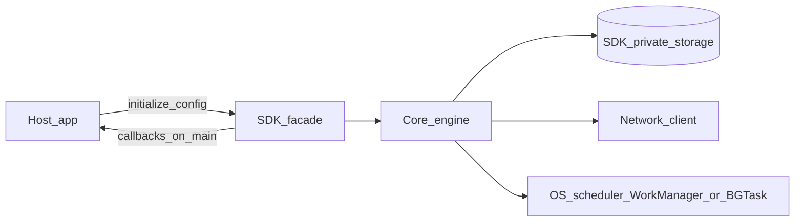

# 14 — SDK and Library Design

## Goal

Design code that **other teams or other companies embed** in their apps: an image loader, analytics, payments, feature flags, a downloader. Library questions are now a large share of Android and iOS system design rounds (Part 4). The bar is different from app design: the host owns the process, the UI, the threads and the release schedule, so the library must be small, predictable and hard to misuse.

## App design vs library design

| Dimension | App | Library / SDK |
|-----------|-----|---------------|
| Who calls you | Your own UI | Unknown host code, any thread, any time |
| Lifecycle | You own `Application` / `AppDelegate` | Host decides when to initialize, may never call `shutdown` |
| Failure | Show an error screen | **Never crash the host**; degrade and report |
| Dependencies | Pick what you like | Every transitive dependency is a conflict risk for the host |
| Release | Ship weekly | Hosts upgrade months later; old versions live for years |
| Size and startup | Your budget | Taken from someone else's budget — measure and publish it |
| Data | Your backend | Host's users: privacy, consent and data minimization are the host's legal problem too |

## Public API surface

Keep it **small, typed and hard to misuse**.

- **One entry point** with explicit configuration: `Analytics.initialize(context, config)` / `Analytics.configure(with:)`. No hidden global setup in static initializers.
- **Immutable config objects with safe defaults** (builder or data class), validated at init. Fail loudly in debug, quietly (log + disable) in release.
- **Explicit threading contract:** "all methods are thread-safe and return immediately; callbacks are delivered on the main thread unless you pass an executor".
- **Typed results, not exceptions across the boundary:** `Result<T, SdkError>` / sealed classes / Swift enums with associated values. Errors carry a stable `code` the host can switch on.
- **Async in the host's idiom:** `suspend` + `Flow` for Kotlin, `async` + `AsyncSequence` for Swift, plus a callback variant for Java/Objective-C hosts if you must support them.
- **No leaking internals:** Kotlin `internal`, `explicitApi()` mode; Swift `public` only where intended, `@_spi` for partner-only APIs. Everything public is a promise.

```kotlin
// Kotlin: explicit API, config with defaults, typed result
public class Downloads private constructor(private val engine: Engine) {
    public suspend fun enqueue(request: DownloadRequest): Result<DownloadId>
    public fun observe(id: DownloadId): Flow<DownloadState>

    public companion object {
        public fun initialize(context: Context, config: DownloadsConfig = DownloadsConfig()): Downloads
    }
}

public data class DownloadsConfig(
    val maxConcurrent: Int = 3,
    val requireUnmeteredNetwork: Boolean = false,
    val logger: SdkLogger = SdkLogger.None,   // host decides where logs go
)
```

```swift
// Swift: same contract
public final class Downloads: Sendable {
    public static func configure(_ config: DownloadsConfig = .init()) -> Downloads
    public func enqueue(_ request: DownloadRequest) async throws(DownloadError) -> DownloadID
    public func updates(for id: DownloadID) -> AsyncStream<DownloadState>
}
```

## Initialization and lifecycle



- **Lazy and cheap init:** record config, don't do I/O on the caller's thread. Defer disk and network work to a background queue. Measure init time and publish it.
- **No auto-init by default.** `ContentProvider` auto-init (Android) and `+load` (Objective-C) run before the host can configure consent or opt out. If you offer auto-init (App Startup library), make it disable-able.
- **Survive being initialized twice, or not at all.** Calls before init should queue (bounded) or no-op with a debug warning, never crash.
- **Process death:** persist anything that must survive (queued events, downloads) in the SDK's own storage namespace. Re-attach to OS work (WorkManager tags, background `URLSession` identifier) on next init.

## Threading and resources

| Rule | Why |
|------|-----|
| Own a small, bounded dispatcher / queue | Don't flood the host's shared pools (`Dispatchers.IO` is shared, GCD global queues are shared) |
| Never block the main thread, never call host callbacks while holding a lock | Prevents ANRs / hangs and deadlocks in host code |
| Cap memory and disk; evict on pressure | You're a guest in the host's budget |
| Respect host networking where possible (shared OkHttp client / `URLSession` configuration) | One connection pool, host proxies, pinning and interceptors apply |
| Battery: batch work, use OS schedulers with constraints | Your wakeups count against the host's standby bucket / background budget |

## Dependencies, size and compatibility

- **Minimize transitive dependencies.** Each one can clash with the host's version (OkHttp, Protobuf, Kotlin stdlib, coroutines). Prefer the platform APIs; if a dependency is unavoidable, accept a range rather than pinning, or shade/relocate it (Android) for truly private use.
- **Binary size budget:** measure the size a host app gains (APK/AAB delta via `apkanalyzer`, iOS app thinning size report). Offer modules (`core`, `ui`, `compose`) so hosts pay for what they use.
- **Distribution:**
  - Android: AAR on Maven Central / private Maven; consumer ProGuard/R8 rules shipped inside the AAR.
  - iOS: Swift Package Manager (source or binary `XCFramework`), CocoaPods only for legacy hosts (trunk is read-only from late 2026). Ship a **privacy manifest** (`PrivacyInfo.xcprivacy`) declaring required-reason APIs and collected data.
  - Flutter: federated plugin on pub.dev (Dart API + per-platform implementations).
  - React Native: npm package with native code, autolinking, an Expo config plugin, and New Architecture (TurboModule / Fabric) support.
- **Minimum OS versions:** state them; supporting very old versions costs code paths and testing.

## Versioning and evolution

- **Semantic versioning,** with a public changelog and a migration guide for every major.
- **Binary compatibility checks in CI:** Kotlin Binary Compatibility Validator / Metalava API files; Swift API digester / library evolution mode for binary frameworks.
- **Deprecate before removing:** at least one minor release with `@Deprecated(replaceWith = …)` / `@available(*, deprecated, renamed: …)`.
- **Server-side compatibility:** old SDK versions stay in the field for years. The backend must accept them, and you need a **remote kill switch / minimum version** to stop a dangerous version.
- **Feature flags inside the SDK** (Ch 34) let you roll out risky behaviour to a percentage of hosts' users.

## Observability for an SDK

- Pluggable `logger` with levels; **no logs by default in release**, never log PII.
- SDK-level metrics (init time, error codes, queue depth) reported only if the host's config and the user's consent allow it.
- **Crash isolation:** catch exceptions at the boundary of every public method and background task; report them as SDK errors tagged with SDK version. A crash inside your code is a crash of the host app.
- A **debug/diagnostics screen** or `dump()` method helps integrators.

## Privacy and consent

- The host decides consent. Provide `setConsent(...)` / `optOut()` and honour it before any network call.
- Collect the minimum; document exactly what is sent (store data-safety forms and Apple privacy labels depend on it).
- No device identifiers without a reason (IDFA needs App Tracking Transparency; Android advertising ID needs a declared purpose).

## Platform implementation

| Concern | Android | iOS | Flutter | React Native |
|---------|---------|-----|---------|--------------|
| Package | AAR (Maven) with consumer R8 rules | SwiftPM package / XCFramework + privacy manifest | Federated plugin (pub.dev) | npm package + native code, TurboModule / Expo Module, config plugin |
| API visibility | Kotlin `explicitApi()`, `internal` | `public` / `package` access level (Swift 5.9+), `@_spi` | Library `export` only the public API | Only export the typed public API from `index.ts` |
| API compatibility check | Binary Compatibility Validator / Metalava | API digester, library evolution (`BUILD_LIBRARY_FOR_DISTRIBUTION`) | `dart_apitool` / semver checks | TypeScript declaration diffs, codegen spec for native modules |
| Init | Explicit `initialize(context, config)`; optional App Startup initializer | `configure(...)` from `application(_:didFinishLaunchingWithOptions:)` | `Plugin.initialize(config)` in `main()` after `WidgetsFlutterBinding.ensureInitialized()` | `init(config)` at app root; native init in `MainApplication` / `AppDelegate` if needed |
| Background work | WorkManager with SDK-prefixed tags | `BGTaskScheduler` identifiers in host `Info.plist`, background `URLSession` id | Delegate to native SDK cores | Delegate to native SDK cores |
| Thread for callbacks | Main by default, configurable `Executor` | `@MainActor` callbacks or `AsyncStream` | Dart futures/streams on the main isolate | Promises / event emitters on the JS thread |

Rule for cross-platform SDKs: **build one native core per OS** and wrap it for Flutter and React Native. Writing the core separately in Dart and TypeScript means four implementations of the same bugs.

## Say it in the interview

> "Because this is a library, the host owns everything: the process, threads, network stack and consent. So the public API is one explicit initialize call with an immutable config, all methods are thread-safe and non-blocking, results are typed, and nothing inside the SDK can crash the host. I'd keep dependencies to the platform APIs, publish the size and init-time cost, run binary-compatibility checks in CI, and keep a server-side minimum-version switch because old SDK versions live for years."

## Checkpoint

For any library, state: **entry point and config**, **threading contract**, **what it persists and where**, **dependencies and size**, **how it's versioned and killed remotely**.

## Exercises

1. Design the public API (5–8 methods) for an analytics SDK. Which methods must be safe to call before `initialize`?
2. A host app reports a crash with your SDK at the top of the stack. List the changes that would have prevented it from crashing the host.
3. Your Android SDK depends on OkHttp 4; a host is on OkHttp 5. What are your options, and which do you choose?
4. Plan the Flutter and React Native wrappers for an existing native payment SDK: what lives in Dart / TS, what stays native, and how errors cross the boundary.
