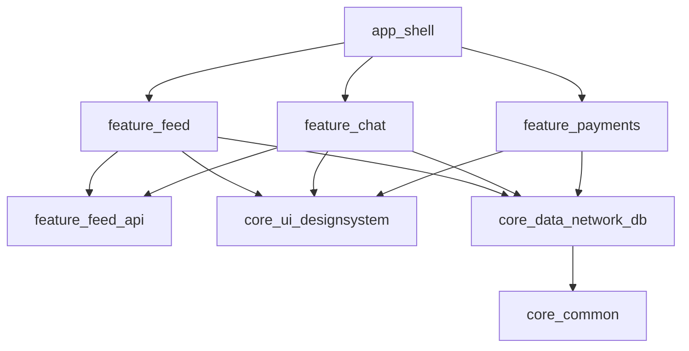
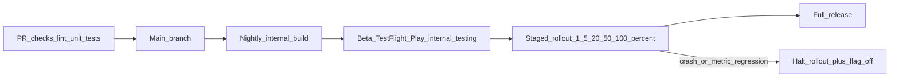

# 15 — Modularization, Build and Release

## Goal

Answer the staff-level questions that come after the feature design: *"How would 40 engineers work on this?"*, *"How do you ship it safely?"*, *"How big is the app and how fast does it start?"* Interviewers use these to separate senior from staff.

## Why modularize

| Benefit | Mechanism |
|---------|-----------|
| Faster builds | Only changed modules recompile; build cache hits |
| Ownership | One team owns a feature module end to end (CODEOWNERS) |
| Enforced boundaries | Features can't reach into each other's internals |
| Reuse | Design system, networking, analytics shared once |
| On-demand delivery | Android dynamic feature modules; Flutter deferred components |

## A module graph that scales

Rules to say aloud:

- **Feature modules never depend on other feature modules.** They depend on a small `-api` module (interfaces, routes, models) when they must talk.
- **The app shell wires features together** (DI graph, navigation).
- **Core modules are stable and low-level:** design system, networking, persistence, analytics, feature flags.
- **Navigation by route / deep link**, not by importing another feature's screen class.

## Dependency injection across modules

- Android: Hilt modules per feature module; the app module aggregates. Feature `-api` modules expose interfaces; implementations bound in the feature module.
- iOS: a composition root in the app target; feature packages receive dependencies via initializers or an environment container.
- Flutter: Riverpod providers declared in each feature package; overrides at the root for tests and flavours.
- React Native: feature folders/packages in a monorepo; dependencies through context providers at the root.

## Build performance

| Lever | Android | iOS | Flutter | React Native |
|-------|---------|-----|---------|--------------|
| Incremental / cache | Gradle build cache, configuration cache, remote cache | Xcode build system, explicit modules; remote caching via Bazel / Tuist cache | `flutter build` incremental; native parts as above | Metro cache; native parts as above |
| Module boundaries | Gradle modules, `api` vs `implementation` | Swift packages / framework targets | Dart packages in a melos/pub workspace | Monorepo packages (pnpm/yarn workspaces) |
| Code generation cost | KSP over kapt | Macros (watch build times), SwiftGen | `build_runner` (cache outputs, run per package) | Codegen for TurboModules at build time |
| CI | Shard tests, run affected modules only | Parallel test plans, cached derived data | `--coverage` per package, affected-only | Jest sharding, Detox on a device farm |

## Release pipeline

- **Release train:** cut a branch on a fixed cadence (weekly / biweekly); only fixes go into the release branch.
- **Staged rollout:** Play Console percentage rollout (can halt); App Store phased release (7-day automatic ramp, can pause, not percentage-controlled per day). Watch crash-free users, ANR/hang rate, key funnels per stage.
- **Feature flags decouple deploy from release** (Ch 34): code ships dark, turned on by cohort. Kill switches for risky paths (payments, sync).
- **Rollback reality:** you can't roll back a mobile binary. You can halt a rollout, flip a flag, or ship a hotfix. So every risky change needs a flag.
- **Minimum supported version / force upgrade:** server-driven check at launch for security or protocol breaks; soft prompt first, hard block only when necessary.
- **Over-the-air updates:** React Native (EAS Update) and Flutter (Shorebird) can patch Dart/JS without a store release, within store rules. Treat OTA like a deploy: staged, monitored, compatible with the installed native binary.

## App size

| Lever | Android | iOS | Flutter | React Native |
|-------|---------|-----|---------|--------------|
| Shrink code | R8 full mode, remove unused resources | Dead-code stripping, `-Osize` where acceptable | `--split-debug-info`, `--obfuscate`, tree-shaken icons | Hermes bytecode, remove unused native modules |
| Deliver per device | Android App Bundle splits (ABI, density, language) | App thinning (asset catalogs, slicing) | AAB / thinning apply to the native shell | AAB / thinning apply to the native shell |
| On-demand | Play Feature Delivery, Play Asset Delivery | On-Demand Resources (legacy), Background Assets | Deferred components (Android) | Download remote assets after install |
| Measure | `apkanalyzer`, Play Console size reports | App Store Connect size report, `xcodebuild` app thinning report | `flutter build --analyze-size` | Bundle visualizer + native size reports |

Rule of thumb to quote: install conversion drops as download size grows, especially on cellular and in emerging markets — set a size budget and fail CI when it's exceeded.

## Startup as a release gate

- Track cold start (Android: `reportFullyDrawn`, Macrobenchmark; iOS: MetricKit launch time, `XCTApplicationLaunchMetric`).
- Ship **Baseline Profiles** on Android (and Startup Profiles for DEX layout); on iOS, reduce dynamic frameworks and static initializers.
- Flutter: avoid heavy work before `runApp`; React Native: inline requires, lazy TurboModules, smaller initial bundle.

## Platform implementation

| Concern | Android | iOS | Flutter | React Native |
|---------|---------|-----|---------|--------------|
| Module unit | Gradle module | Swift package / Xcode target | Dart package | Workspace package |
| Build system | Gradle (convention plugins), Bazel at scale | Xcode / SwiftPM, Tuist or Bazel at scale | Flutter tool + Gradle/Xcode for native | Metro + Gradle/Xcode |
| Distribution | Play Console tracks | TestFlight → App Store | Both stores | Both stores + OTA channel |
| Staged rollout | Percentage rollout, halt | Phased release (7 days), pause | Per-store | Per-store + staged OTA |
| Crash gate | Play vitals ANR/crash thresholds | Organizer crash/hang metrics | Native + Dart crash reports | Native + JS crash reports |

## Say it in the interview

> "I'd split by feature, with features depending only on core modules and small API modules, and the app shell wiring navigation and DI. Every risky feature ships behind a remote flag, the binary goes out on a weekly train through beta and a staged rollout gated on crash-free rate and the feature's own funnel, and because we can't roll back a binary, the flag is the rollback."

## Checkpoint

Name: **module boundaries**, **who owns what**, **how a change reaches users** (train, beta, staged rollout, flag), **how you stop a bad release**, **size and startup budgets**.

## Exercises

1. Draw the module graph for an app with feed, chat, profile and payments, where chat needs to open a profile. Which `-api` modules exist?
2. A release shows a 0.5% crash-rate increase at the 5% rollout stage on Android only. Walk through the next hour.
3. Your Flutter app is 45 MB to download. List four ways to bring it under 30 MB and the trade-off of each.
4. When is an over-the-air JS/Dart update the wrong tool, even if store rules allow it?
