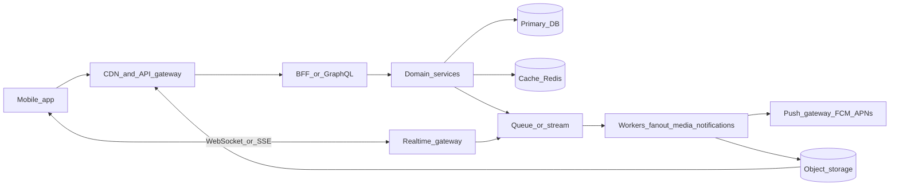

# 17 — The Backend You're Expected to Sketch

## Goal

Mobile system design rounds are client-focused, but most interviewers expect you to sketch the server side in **5–10 minutes**: the services, the data flow, and the parts that shape the client (pagination, push fan-out, realtime, uploads). This chapter gives you just enough backend to draw a credible box diagram and defend the API, without turning the interview into a backend round.

## The default diagram

Say: *"Client talks to an API gateway behind a CDN; a backend-for-frontend shapes responses for mobile; domain services own the data; async work (fan-out, media processing, notifications) goes through a queue; media lives in object storage served by the CDN; realtime goes through a dedicated gateway."*

## Pieces that change the client design

| Backend piece | What the client gets from it | What to say |
|---------------|------------------------------|-------------|
| **BFF / GraphQL** | One request per screen, mobile-shaped payloads, fewer round trips on high-latency networks | "A BFF lets us version the mobile contract independently and trim payloads" |
| **Cursor pagination** | Stable pages while new items arrive | Opaque cursor, `limit`, server decides ordering; no offset pagination for feeds |
| **Feed generation** | Fan-out on write (precomputed timelines) vs fan-out on read (merge at request time) | Hybrid: fan-out on write for most users, on read for celebrities; client doesn't care beyond the cursor |
| **Idempotency store** | Safe retries for writes | Server stores `Idempotency-Key → result` for 24 h; same key returns the same result |
| **Uploads** | Direct-to-storage uploads | Client asks the API for a **pre-signed URL**, uploads to object storage (resumable / multipart), then confirms; API never proxies bytes |
| **Media processing** | Transcodes, thumbnails, HLS renditions | Async workers; client shows "processing" until a callback/push/poll says ready |
| **Push fan-out** | Notifications | Token registry per user/device; workers batch-send through FCM / APNs; handle invalid-token feedback; respect quiet hours and per-user rate limits |
| **Realtime gateway** | WebSocket / SSE connections | Stateless gateway nodes, pub/sub (Redis / Kafka) behind; client reconnects with `last_event_id` / sequence number to resume |
| **Sync endpoints** | Delta sync | `GET /changes?since=token` returning upserts + tombstones + new token; server-side conflict rules |
| **Rate limiting** | 429 + `Retry-After` | Client backs off with jitter and surfaces a friendly message |
| **Config / flags** | Remote config, kill switches | Cached at the edge; client fetches on launch with ETag |

## Data and consistency in one minute

- **Source of truth is the server** for shared data (and always for money). The client's DB is a cache plus an outbox.
- **Read-your-writes** after a client action: return the created object in the response so the client doesn't depend on a replicated read.
- **Ordering:** server-assigned sequence numbers per conversation / feed for realtime; the client sorts by them, not by device clocks.
- **Eventual consistency is fine for counters** (likes, views); not for balances or order status.

## Back-of-envelope (light)

Mobile rounds rarely need deep capacity maths. Have three numbers ready:

| Example | Estimate |
|---------|----------|
| Feed app, 10M DAU, 20 feed opens/day, 20 items/page | ~2.3k page requests/s average; plan for 5–10× peak |
| Chat, 1M concurrent sockets | Shard across gateway nodes (tens of thousands of connections each); heartbeat every 30–60 s |
| Push campaign to 5M devices | Batch through FCM / APNs over minutes, not seconds; stagger to avoid a thundering herd of app opens |

## What not to do

- Don't spend more than ~10 minutes on the backend unless the interviewer pushes.
- Don't name ten databases. "Relational DB for orders, Redis for hot data, object storage for media, a queue for async work" is enough.
- Don't design the backend so the client must call five services per screen; that's what the BFF is for.

## Platform implementation

The backend is the same for every client stack. What differs is how each client consumes it:

| Concern | Android | iOS | Flutter | React Native |
|---------|---------|-----|---------|--------------|
| Typed API client | Retrofit / Ktor + kotlinx.serialization; Apollo Kotlin for GraphQL | `URLSession` + `Codable`; swift-openapi-generator; Apollo iOS | `dio` + `json_serializable` / `freezed`; `graphql_flutter`, ferry | Generated TS client (OpenAPI) / Apollo Client / urql |
| Schema-driven codegen | OpenAPI / protobuf (Wire) / GraphQL codegen | OpenAPI generator / SwiftProtobuf | `openapi_generator` / protobuf | `openapi-typescript`, GraphQL Code Generator |
| Pre-signed uploads | WorkManager upload to the URL | Background `URLSession` upload task | Native transfer plugin | Native upload module |
| Realtime resume | Reconnect with last sequence on `ON_START` | Reconnect on `scenePhase == .active` | Reconnect on `resumed` | Reconnect on `AppState` active |

## Say it in the interview

> "Server side, briefly: a gateway behind a CDN, a mobile BFF, domain services with a relational DB and Redis, a queue for fan-out and media processing, object storage for uploads via pre-signed URLs, and a realtime gateway for live updates. The two contracts that matter for the client are cursor pagination and idempotency keys on every write."

## Checkpoint

Can you draw the backend in under two minutes, and name **how the client paginates**, **how it uploads**, **how it gets realtime updates**, and **how retries stay safe**?

## Exercises

1. Sketch the backend for the stories feature (Ch 26) in five boxes, including how a 60-second video becomes playable.
2. Explain fan-out on write vs read for a feed with a few accounts that have 50M followers.
3. Design the `/changes` delta-sync endpoint for offline notes (Ch 22): request, response, tombstones, and how the token works.
4. Your push campaign makes 2M users open the app within a minute. What breaks on the backend and the client, and how do you prevent it?
