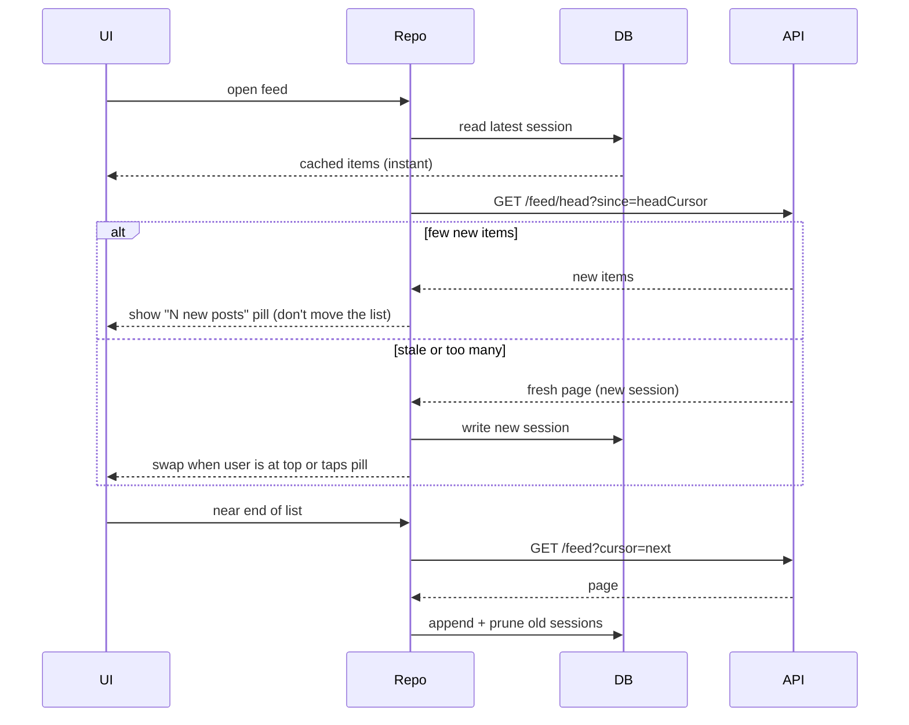
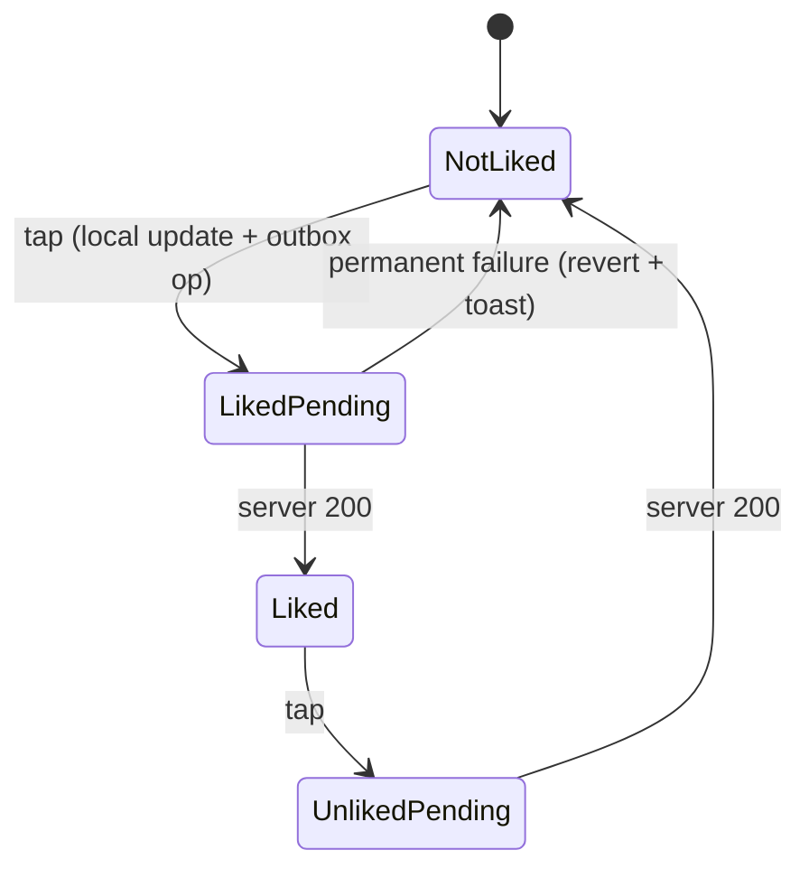

# 18 — Model Solution: Social Feed

The most common mobile system design prompt. Everyone can draw a list and an API; the interview is won on **cached first paint**, **pagination that survives new posts**, a **media pipeline that doesn't jank**, **optimistic actions that reconcile**, and a clear story for **ranking, ads and "seen" state** without designing the ranking system.

## Timed outline (45–60 min)

| Min | Focus |
|-----|--------|
| 0–6 | Scope: home feed, posts with images/video, like, comment count, pull-to-refresh; defer stories/DMs |
| 6–12 | NFRs + client architecture + backend in brief (feed service, fan-out) |
| 12–22 | API contract (cursor pages, item envelope) + local data model |
| 22–34 | Loading strategy: cache → refresh → paginate; new-posts pill; gaps and dedupe |
| 34–44 | Media pipeline, autoplay, optimistic like with outbox |
| 44–55 | Offline, failures, platform implementation, trade-offs, metrics |

## Clarify and scope

**Prompt:** "Design the home feed of a social app like Instagram, X or LinkedIn."

| Question | Assumed answer → design impact |
|----------|--------------------------------|
| Ranked or chronological? | **Ranked by the server**; client never re-ranks (needs global signals) |
| Content types? | Text, single image, carousel, short video, ads, "suggested for you" modules → typed item envelope |
| Interactions in MVP? | Like (optimistic), open comments, share sheet; comment writing deferred |
| Scale? | 100M DAU; median session 10–15 min; ~200 items seen per session |
| Offline? | Show last cached feed; likes queue; no new content |
| Video? | Muted autoplay in feed; full player on tap (Ch 21) |

**MVP:** cached first paint; infinite scroll with cursor pagination; pull-to-refresh; "new posts" pill instead of jumping the list; images and muted autoplay video; optimistic like/unlike with offline queue; impression ("seen") logging; ads as server-inserted items.

**Defer:** stories (Ch 26), comments write path, creation/upload (Ch 25), DMs (Ch 19), ranking model internals, ads auction.

## NFRs

| NFR | Target / rule |
|-----|---------------|
| First paint | Cached content < 500 ms after launch; network page < 1.5 s on 4G |
| Scroll | No dropped frames at 60/120 Hz; no image decode or JSON parse on the main thread |
| Data usage | Image sizes match the view; video prefetch only on Wi-Fi or within a cellular budget |
| Battery | No background feed refresh more than ~hourly; autoplay stops when off screen |
| Correctness | No duplicate posts across pages; like state converges with the server |
| Memory | Bounded caches; long sessions (500+ items) don't grow memory unbounded |
| Storage | Feed cache capped (e.g. last 200 items + 300 MB media) |

## Architecture

```mermaid
flowchart TB
  subgraph Client
    ui[Feed_UI_list]
    vm[Feed_state_holder]
    repo[Feed_repository]
    db[(Local_DB_items_pages_outbox)]
    img[Image_pipeline]
    player[Shared_video_player]
    sync[Outbox_worker]
    imp[Impression_logger]
    ui --> vm --> repo
    repo --> db
    ui --> img
    ui --> player
    sync --> db
    ui --> imp
  end
  gw[API_gateway_BFF]
  feed[Feed_service_ranking]
  graph[Social_graph]
  posts[Post_store]
  ads[Ads_service]
  likes[Engagement_service]
  cdn[Media_CDN]
  repo --> gw
  sync --> gw
  imp --> gw
  img --> cdn
  player --> cdn
  gw --> feed
  feed --> graph
  feed --> posts
  feed --> ads
  gw --> likes
```

### Backend in brief

| Piece | What to say |
|-------|-------------|
| Feed generation | Hybrid fan-out: on write for most authors (precomputed inbox per user), on read for very large accounts; ranking at read time over candidates |
| Ads | Ads service returns slots; the feed service merges them into the page — the client renders typed items, it doesn't place ads |
| Engagement | Likes stored per (user, post) with idempotent upsert; counts are eventually consistent (cached counters) |
| Media | Uploaded originals transcoded to sizes/formats; served from CDN with immutable URLs |

Spend ≤ 5 minutes here (Ch 17).

## API contract

| Endpoint | Purpose |
|----------|---------|
| `GET /v1/feed?cursor=&limit=20` | Next page (older items) |
| `GET /v1/feed/head?since=<headCursor>` | New items above the current top (for the pill) |
| `PUT /v1/posts/{id}/like` / `DELETE …/like` | Idempotent like/unlike (`Idempotency-Key`) |
| `POST /v1/impressions` | Batched seen events |

```text
GET /v1/feed?cursor=c_9f2&limit=20
→ 200
{ "items": [
    { "type": "post", "id": "p_1", "rankToken": "rt_a", "author": { "id": "u_7", "name": "Ana", "avatar": "…" },
      "text": "…", "media": [ { "type": "image", "url": "https://cdn/…/{w}.webp", "w": 1080, "h": 1350,
      "blurhash": "LEHV6n…" } ], "likeCount": 1204, "likedByMe": false, "createdAt": "…" },
    { "type": "ad", "id": "ad_88", "creative": { … }, "tracking": { "impressionUrl": "…" } },
    { "type": "module", "id": "m_3", "kind": "suggested_people", "items": [ … ] } ],
  "nextCursor": "c_a01", "headCursor": "h_771", "feedSessionId": "fs_42" }

PUT /v1/posts/p_1/like      Idempotency-Key: 3b1e…
→ 200 { "likedByMe": true, "likeCount": 1205 }
```

- **Opaque cursors** encode the ranked snapshot (feed session); the server guarantees no duplicates within a session.
- `{w}` in media URLs lets the client request the width it needs from a fixed set (e.g. 320/640/1080) to keep CDN hit rates high.
- **Unknown `type`** → client skips the item (forward compatibility).

## Data model

```text
FeedItem:   id, type(post|ad|module), position(in session), sessionId, payload(JSON), fetchedAt
Post:       id, authorId, text, media[], likeCount, likedByMe, createdAt          (normalized table)
Media:      postId, index, type, urlTemplate, width, height, blurhash, durationMs?
FeedPage:   sessionId, cursor, nextCursor, fetchedAt
OutboxOp:   opId, kind(like|unlike), postId, createdAt, attempts
Impression: itemId, sessionId, visibleMs, at                                       (batched, then deleted)
```

- Store **posts normalized** so a like on a post shown twice (feed + profile) updates both.
- Keep feed order as `(sessionId, position)`; a new refresh starts a new session.

## Feed loading strategy



1. **Open:** render the cached session immediately (stale is better than a spinner).
2. **Refresh in parallel:** ask for head items. Never insert above the user's scroll position; show a **"New posts" pill** that scrolls to top and swaps sessions.
3. **Paginate** when 5–10 items from the end; one page request in flight; prefetch the next page's first images.
4. **Pull-to-refresh** starts a new session; keep the old list visible until the new page arrives.
5. **Prune:** keep the latest 1–2 sessions, ~200 items.

**Why not offset pagination:** new posts at the head shift offsets, causing duplicates and gaps.

## Media pipeline

- **Size from layout:** compute the cell width, pick the nearest server width bucket, request `url(w)`. Aspect ratio comes from the API (`w`, `h`) so the cell reserves space before the image loads — no layout jumps.
- **Placeholders:** blurhash decoded off the main thread, cached per post.
- **Caches:** memory LRU (bytes) + disk; key = url + size; cancel requests when cells are recycled (Ch 28).
- **Prefetch:** next ~6–10 images in the scroll direction at low priority; pause on fling, cancel when direction reverses; stricter budget on cellular.
- **Concurrency:** 4–6 parallel image downloads.

## Video autoplay

- **One shared player** (or a pool of two) reused across cells; attach its surface to the **most visible** video cell (≥ 60% visible), muted.
- Pause when < 50% visible, on scroll fling, when the app backgrounds, and when the system's data saver is on.
- Preload only the first segment of the next video; HLS with low starting bitrate.
- Tap opens the full player (Ch 21) and hands over the playback position.

## Optimistic like with outbox



1. In one DB transaction: flip `likedByMe`, adjust `likeCount`, insert an outbox op (`opId`).
2. Worker sends `PUT/DELETE …/like` with `Idempotency-Key = opId`.
3. **Coalesce** like→unlike→like on the same post before sending: only the final state matters.
4. Server response overwrites the count (server truth); transient errors retry with backoff; permanent errors (post deleted) revert and remove the post.

## Impressions and "seen"

- An item counts as seen when ≥ 50% visible for ≥ 1 s (ads use their own viewability rules).
- Batch impressions (e.g. every 20 or 30 s) with the `feedSessionId`; the server uses them to avoid re-showing seen posts on refresh.
- Fire ad tracking URLs once per impression id (dedupe locally).

## Performance

- Diff updates by stable id; rows are immutable view models.
- Parse JSON and build view models off the main thread.
- Flatten row layouts; avoid nested scrolling except carousels (fixed height).
- Long sessions: the list virtualizes, but also cap in-memory view models and drop decoded images for far-away rows.

## Offline

| Situation | Behaviour |
|-----------|-----------|
| Launch offline | Cached session + "You're offline" banner; pull-to-refresh shows a friendly error |
| Like offline | Applied locally, queued; synced on reconnect |
| Scroll past cache end offline | "You're all caught up offline" footer instead of a spinner |
| Media not cached | Blurhash placeholder; retry when online |

## Failures

| Failure | Handling |
|---------|----------|
| Page request fails | Keep list; footer retry button; exponential backoff for auto-retry |
| Duplicate item across pages | Dedupe by id within a session before insert |
| Deleted post still cached | 404 on interaction → remove locally; server also sends tombstones on refresh |
| Token expired mid-scroll | Single-flight refresh, retry once (Ch 06) |
| Process death | Session and scroll anchor (item id + offset) restored from DB/saved state |
| Ads SDK slow | Ad slot renders a placeholder with a timeout, then collapses |
| Memory pressure | Trim image memory cache; release the video player when off screen |

## Security & privacy

- Private accounts: the feed only contains authorized posts; the client doesn't cache content from accounts the user has blocked since the last refresh (server returns removals).
- Media URLs signed or unguessable for private content; disk cache cleared on logout.
- Impression data tied to a session id, not raw device identifiers; respect tracking consent for ads.

## Platform implementation

Cross-platform map: [Ch 05](../part-2-building-blocks/05-platforms-android-ios-flutter-react-native.md).

### Android: Views (XML) and Compose

Full toolkit comparison: [Android UI toolkits](../part-2-building-blocks/04-client-architecture.md#android-ui-toolkits-views-xml-and-compose).

| Concern | Views (XML) | Compose |
|---------|-------------|---------|
| Paged list | `RecyclerView` + Paging 3 `PagingDataAdapter` (`DiffUtil.ItemCallback` on post id); `withLoadStateFooter` for spinner/retry | `LazyColumn` + `collectAsLazyPagingItems()`; `key = itemKey { it.id }`; `loadState.append` drives the footer |
| Mixed row types (post, ad, video) | `getItemViewType` + ViewHolder per type; `ConcatAdapter` for header | `contentType` per row so compositions are reused per type |
| Optimistic like | DiffUtil `getChangePayload` → rebind only the like button | Immutable item model; only the changed row recomposes |
| Scroll restore | `cachedIn(viewModelScope)` + adapter `stateRestorationPolicy` | `cachedIn(viewModelScope)` + `rememberLazyListState()` (saveable) |
| Video autoplay | Scroll listener + attach/detach callbacks pick the most-visible row | `snapshotFlow { listState.layoutInfo.visibleItemsInfo }` picks the active row |
| Pull to refresh | `SwipeRefreshLayout` → `adapter.refresh()` | Material 3 `PullToRefreshBox` → `items.refresh()` |

=== "Views (XML)"

    ```kotlin
    class FeedAdapter : PagingDataAdapter<Post, PostVH>(PostDiff) {  // PostDiff: DiffUtil.ItemCallback on id
        override fun onCreateViewHolder(parent: ViewGroup, viewType: Int) = PostVH.create(parent)
        override fun onBindViewHolder(holder: PostVH, position: Int) =
            holder.bind(getItem(position))                         // null = placeholder
    }

    viewLifecycleOwner.lifecycleScope.launch {
        viewLifecycleOwner.repeatOnLifecycle(Lifecycle.State.STARTED) {
            vm.posts.collectLatest(adapter::submitData)
        }
    }
    ```

=== "Compose"

    ```kotlin
    val posts = vm.posts.collectAsLazyPagingItems()
    LazyColumn {
        items(
            count = posts.itemCount,
            key = posts.itemKey { it.id },
            contentType = posts.itemContentType { "post" },
        ) { i -> posts[i]?.let { PostRow(it) } ?: PostPlaceholder() }
    }
    ```

**Mixed codebase:** the same `Flow<PagingData<Post>>` (with `cachedIn`) feeds both; migrate the feed screen whole — a `ComposeView` per RecyclerView row works but doubles the list machinery.

### iOS, Flutter and React Native

| Concern | iOS (UIKit / SwiftUI) | Flutter | React Native |
|---------|-----------------------|---------|--------------|
| Paged list | `UICollectionView` + diffable data source (snapshot keyed by post id); SwiftUI `List` + `.onAppear` of the last rows to load the next cursor | `ListView.builder` / `PagedListView` (`infinite_scroll_pagination`); load next page near the end | `FlashList` / `FlatList` with `onEndReached` + TanStack Query `useInfiniteQuery` |
| Mixed row types | Cell registration per type in compositional layout; SwiftUI `switch` on item kind | `switch` on item type in `itemBuilder`; keep row widgets `const` where possible | `getItemType` on `FlashList` so recycled views match the row type |
| Optimistic like | Update the snapshot item (`reconfigureItems`) → only that cell refreshes | Immutable post model + `select` so only that row rebuilds | `queryClient.setQueryData` optimistic update with rollback in `onError` |
| Scroll restore | Persist the visible post id; restore with `scrollToItem` | `PageStorageKey` on the list | Keep the screen mounted in the tab navigator; `initialScrollIndex` for deep returns |
| Video autoplay | `collectionView.indexPathsForVisibleItems` + visibility ratio; one shared `AVPlayer` | `visibility_detector` picks the most-visible item | `onViewableItemsChanged` with `viewabilityConfig` |
| Pull to refresh | `UIRefreshControl` / `.refreshable {}` | `RefreshIndicator` | `refreshing` + `onRefresh` props |

=== "SwiftUI"

    ```swift
    struct FeedView: View {
        @State var model: FeedModel            // @Observable: posts, loadNextPageIfNeeded(_:), refresh()
        var body: some View {
            List(model.posts) { post in        // Post: Identifiable (stable id)
                PostRow(post: post)
                    .onAppear { model.loadNextPageIfNeeded(current: post) }
            }
            .refreshable { await model.refresh() }
        }
    }
    ```

=== "Flutter"

    ```dart
    ListView.builder(
      itemCount: posts.length + (hasMore ? 1 : 0),
      itemBuilder: (context, i) {
        if (i >= posts.length) {
          ref.read(feedProvider.notifier).loadNextPage();   // guarded: one load in flight
          return const LoadingRow();
        }
        return PostRow(key: ValueKey(posts[i].id), post: posts[i]);
      },
    )
    ```

=== "React Native"

    ```tsx
    const q = useInfiniteQuery({
      queryKey: ['feed'],
      queryFn: ({ pageParam }) => api.feed(pageParam),
      initialPageParam: null as string | null,
      getNextPageParam: (last) => last.nextCursor,
    });
    const posts = q.data?.pages.flatMap((p) => p.items) ?? [];

    <FlashList
      data={posts}
      keyExtractor={(p) => p.id}
      renderItem={({ item }) => <PostRow post={item} />}
      onEndReached={() => q.hasNextPage && !q.isFetchingNextPage && q.fetchNextPage()}
      refreshing={q.isRefetching}
      onRefresh={q.refetch}
    />
    ```

## Trade-offs

| Decision | Alternative | Why pick |
|----------|-------------|----------|
| Cursor + server session | Offset | No duplicates or gaps when new posts arrive |
| "New posts" pill | Auto-insert at top | Never moves content under the user's finger |
| Normalized post table | Store pages as blobs | One update fixes every screen showing the post |
| Optimistic like + outbox | Wait for server | Instant UI; converges via server truth |
| Shared video player | Player per cell | Memory and decoder limits on low-end devices |
| Server-inserted ads | Client-side ad placement | One ranked stream, simpler client, consistent pacing |

## Metrics

| Metric | Why |
|--------|-----|
| Time to first content (cached / network) | Core perceived performance |
| Slow / frozen frames on feed | Scroll quality |
| Pages per session, session length | Engagement (product) |
| Image cache hit rate, bytes per session | Efficiency and data cost |
| Like sync failure rate, outbox age p95 | Correctness of optimistic actions |
| Video start time, rebuffer ratio in feed | Media quality |

## Staff stretch

- **Prefetch on Wi-Fi + charging** a fresh first page so the next launch is instant even after a long gap.
- **Feed cache versioning** so a server-side layout change can invalidate old cached items.
- **Remote config** for page size, prefetch depth and autoplay rules per device class.
- **Experiment hooks:** log `rankToken` with impressions and actions so ranking experiments can be evaluated.

## Follow-ups

- What happens to the user's position when 30 new posts arrive while they read?
- How do you show the same post's like state consistently on the feed and the profile?
- How would you support a carousel with mixed images and videos?
- How do you stop a low-end phone from running out of memory after 20 minutes of scrolling?
- How does "seen" state influence what the next refresh shows?

## See also

- [Ch 28 — Image loading library](../part-4-libraries-and-sdks/28-image-loading-library.md)
- [Ch 09 — Media: images and video](../part-2-building-blocks/09-media-images-video.md)
- [Ch 08 — Offline and sync](../part-2-building-blocks/08-offline-and-sync.md)
- [Ch 21 — Video player](21-video-player.md)
- [Ch 17 — Backend for mobile](../part-2-building-blocks/17-backend-for-mobile.md)
