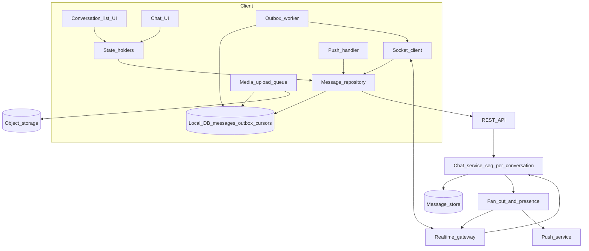
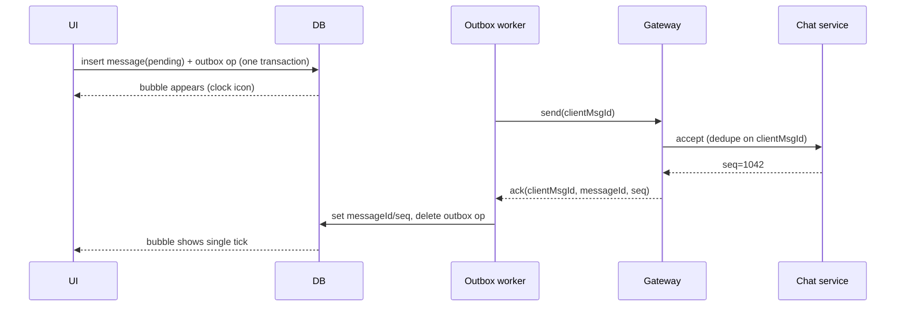

# 19 — Model Solution: Messaging / Chat

Chat looks simple — a list of bubbles and a text box — but it's a distributed-systems problem on a flaky device: **messages must never be lost or duplicated, order must be stable, receipts must converge, and the app must behave when it's killed, offline or woken by a push**. Win the interview on the send pipeline, sequence numbers and the foreground/background transport split.

## Timed outline (45–60 min)

| Min | Focus |
|-----|--------|
| 0–6 | Scope: 1:1 + small groups, text + images, receipts, typing; defer calls and E2EE details |
| 6–12 | NFRs, client architecture, backend in brief (chat service, gateway, push) |
| 12–22 | API + events contract, local data model, ids and sequence numbers |
| 22–34 | Send pipeline with outbox; receive path; ordering and gap fill |
| 34–44 | Receipts and unread counts, typing, push + background, media messages |
| 44–55 | Offline, failures, security, platform implementation, trade-offs, metrics |

## Clarify and scope

**Prompt:** "Design a messaging app like WhatsApp, Messenger or Slack DMs."

| Question | Assumed answer → design impact |
|----------|--------------------------------|
| 1:1 or groups? | 1:1 and groups up to ~256 members → per-conversation ordering, fan-out on the server |
| Content? | Text, images, replies; voice/video calls deferred |
| Receipts? | Sent / delivered / read per message (aggregated "read by N" in groups) |
| Multi-device? | Phone + tablet/web → messages and read state sync across a user's devices |
| History? | Server keeps history; client caches recent conversations and pages older ones |
| Encryption? | Mention E2EE as a stretch; MVP uses TLS + server storage |

**MVP:** conversation list with unread counts; conversation screen with history paging; send text and images with optimistic display; per-message status; typing indicator; push when backgrounded; offline send queue; multi-device read sync.

**Defer:** calls, reactions, edit/delete-for-everyone (mention the event model handles it), E2EE key management, search across history (local FTS as a stretch), bots.

## NFRs

| NFR | Target / rule |
|-----|---------------|
| Send feedback | Message appears instantly; server ack p95 < 1 s on good networks |
| Delivery | At-least-once transport, **exactly-once display** (dedupe by ids) |
| Ordering | Stable per conversation; never reorders after display except for pending → sent placement |
| Durability | A message the user sent is never lost: persisted before any network call |
| Latency to receiver | < 1 s foreground (socket), seconds via push in background |
| Battery | Socket only while foreground; no polling in background |
| Storage | Recent N conversations × last M messages cached; media cache capped |

## Architecture



### Backend in brief

| Piece | What to say |
|-------|-------------|
| Realtime gateway | Holds WebSocket connections, stateless; routes by user id via pub/sub |
| Chat service | Assigns a **monotonic `seq` per conversation** on accept; idempotent on `clientMsgId`; persists, then fans out |
| Fan-out | For each member device: online → socket event; offline → push (collapsed per conversation) |
| History | Paged by `seq`; per-user cursors for read/delivered state |

## API and event contract

| Call / event | Purpose |
|--------------|---------|
| `WS send {clientMsgId, conversationId, body, replyTo?}` | Send (REST `POST /v1/conversations/{id}/messages` as fallback) |
| `WS ack {clientMsgId, messageId, seq, serverTime}` | Server accepted |
| `WS message {conversationId, messageId, seq, senderId, body, serverTime}` | New message |
| `WS receipt {conversationId, userId, deliveredUpTo, readUpTo}` | Cursor-style receipts |
| `WS typing {conversationId, userId, until}` | Ephemeral |
| `GET /v1/conversations?since=<syncToken>` | Conversation list delta |
| `GET /v1/conversations/{id}/messages?beforeSeq=&limit=50` | Older history |
| `GET /v1/conversations/{id}/messages?afterSeq=` | Gap fill / catch-up |
| `POST /v1/conversations/{id}/read {readUpToSeq}` | Mark read (fan-out to other devices) |

```text
send:    { "type": "send", "clientMsgId": "c_01HF…", "conversationId": "cv_9", "body": "On my way" }
ack:     { "type": "ack", "clientMsgId": "c_01HF…", "messageId": "m_552", "seq": 1042, "serverTime": "…" }
message: { "type": "message", "conversationId": "cv_9", "messageId": "m_553", "seq": 1043,
           "senderId": "u_2", "body": "👍", "serverTime": "…" }
receipt: { "type": "receipt", "conversationId": "cv_9", "userId": "u_2", "deliveredUpTo": 1042, "readUpTo": 1041 }
```

**Receipts as cursors** ("read up to seq 1041") instead of per-message events: one event covers many messages and is naturally idempotent.

## Data model

```text
Conversation: id, type(dm|group), title, members[], lastSeq, lastMessagePreview, lastServerTime,
              unreadCount, myReadUpTo, muted, draft?
Message:      conversationId, clientMsgId(unique), messageId?(server), seq?(server), senderId, body,
              replyTo?, attachments[], localCreatedAt, serverTime?, state(pending|sent|failed)
MemberCursor: conversationId, userId, deliveredUpTo, readUpTo
OutboxOp:     opId(=clientMsgId), conversationId, payload, attempts, nextAttemptAt
SyncCursor:   conversationId, highestContiguousSeq       (for gap detection)
Attachment:   localUri, remoteUrl?, uploadState, width, height, thumbBlurhash
```

- **Two ids:** `clientMsgId` (generated on device, UUIDv7) is the idempotency key and the stable UI key; `messageId`/`seq` come from the server.
- **Display order:** sent messages by `seq`; pending messages after the last sent one, by local time.
- **Per-message status** is derived: `pending/failed` from the outbox; `sent` when `seq` exists; `delivered/read` by comparing `seq` with member cursors.

## Send pipeline



1. **Persist first** (message + outbox in one transaction). The UI observes the DB, so the bubble appears immediately.
2. **Send in order per conversation** (one in-flight message per conversation, or pipelined with ordered acks) so `seq` follows the user's typing order.
3. **Retry** on timeout with backoff; the server dedupes `clientMsgId`, so a retry after a lost ack returns the original `seq`.
4. **Fallback to REST** if the socket is down but HTTP works (captive portals, proxies).
5. After N attempts or a permanent error → `failed` with a "Tap to retry" affordance; never silently drop.

## Receive path, ordering and gaps

- On `message` event: upsert by `messageId` (dedupe), insert by `seq`.
- Track `highestContiguousSeq` per conversation. If an event arrives with `seq > highest + 1`, request `afterSeq=highest` to fill the gap before marking the conversation fully synced.
- On reconnect / app foreground: for each recently active conversation, fetch `afterSeq=highestContiguousSeq`; the conversation list delta tells you which conversations changed.
- **Never order by device clocks.** Display times use `serverTime`.

## Receipts and unread counts

- Receiver sends `delivered` when a message is persisted locally (including from push), and `read` when the conversation is visible and the message has been on screen.
- Client keeps `MemberCursor` per member; ticks are computed: delivered if `peer.deliveredUpTo ≥ seq`, read if `peer.readUpTo ≥ seq`. Groups show "read by N".
- **Unread count** = messages with `seq > myReadUpTo` from others. Reading on one device sends `read` to the server, which fans out to the user's other devices so badges clear everywhere.
- Privacy setting "read receipts off" → still send `readUpTo` for multi-device sync, but the server doesn't forward it to others.

## Typing indicator

- Send `typing` at most once every ~3 s while the user types, with `until = now + 5 s`. The receiver hides it after `until`. Never persisted, never queued offline.

## Background and push

- **Foreground:** socket connected; push for the open conversation is suppressed (the server knows the device is online, or the client ignores it).
- **Background:** socket closed after a few seconds. The server sends push: Android data message (or notification + data) → the app stores the message and shows a notification; iOS alert push with `mutable-content` → Notification Service Extension fetches/decrypts the preview and writes to the shared App Group store.
- **Notification grouping** by conversation; collapse/replace so a burst of 20 messages doesn't create 20 notifications.
- **Inline reply** from the notification goes through the same outbox (must work from a cold start).
- On open: full catch-up (gap fill) because push is a hint and can be dropped.

## Media messages

1. Pick image → compress/downscale → create the message with a local attachment (shows immediately with progress).
2. Upload via pre-signed URL on the OS transfer service (survives backgrounding, Ch 25).
3. Send the message referencing the uploaded media id. Order is preserved because the message is sent only after the upload finishes (the bubble stays in place as pending).
4. Receivers get a thumbnail/blurhash in the event and download full media on view.

## Offline

| Situation | Behaviour |
|-----------|-----------|
| Send offline | Bubble with clock icon; outbox flushes on reconnect in order |
| Open app offline | Cached conversations and messages; "Waiting for network" title |
| Read offline | Local read cursor updates; `read` sent later |
| Long offline gap | Catch-up pages per conversation; conversation list delta first so the UI updates quickly |

## Failures

| Failure | Handling |
|---------|----------|
| Ack lost, client retries | Server returns the same `messageId`/`seq` (dedupe on `clientMsgId`) |
| Duplicate event (socket + push) | Upsert by `messageId` |
| Gap in `seq` | Fetch missing range before treating the conversation as synced |
| Socket flaps on bad network | Backoff with jitter; REST fallback for sends; heartbeat every 30–60 s |
| App killed mid-send | Outbox survives; worker resumes on next launch (Android: WorkManager can flush in background) |
| Token expired on socket | Server closes with auth code → refresh once → reconnect |
| Message to a removed group member | Server rejects → `failed` with reason |
| Clock skew | Ordering uses `seq`, times use `serverTime` |

## Security & privacy

- TLS everywhere; messages encrypted at rest on device for sensitive apps (SQLCipher / Data Protection `complete`).
- Notification previews respect "hide content" settings; NSE decrypts on device when E2EE is used.
- **E2EE (stretch):** per-device identity keys, session keys (Signal protocol style), server stores only ciphertext; multi-device means encrypting per recipient device; key change warnings; backups are the hard part.
- Abuse: report/block flows; rate limits on sends; links scanned server-side (or on device under E2EE).

## Platform implementation

Cross-platform map: [Ch 05](../part-2-building-blocks/05-platforms-android-ios-flutter-react-native.md).

### Android: Views (XML) and Compose

Full toolkit comparison: [Android UI toolkits](../part-2-building-blocks/04-client-architecture.md#android-ui-toolkits-views-xml-and-compose).

| Concern | Views (XML) | Compose |
|---------|-------------|---------|
| Bottom-anchored list | `LinearLayoutManager` with `reverseLayout = true` (newest at index 0) or `stackFromEnd = true` | `LazyColumn(reverseLayout = true)` with newest-first data |
| Stable rows across send → ack | Stable IDs from `clientId`; DiffUtil payload for status ticks | `key = { it.clientId }` so the optimistic row doesn't jump when the server id arrives |
| Keyboard (IME) | Edge-to-edge (enforced at targetSdk 35): handle `WindowInsetsCompat.Type.ime()` via `ViewCompat.setOnApplyWindowInsetsListener`; `WindowInsetsAnimationCompat` for smooth sync | `enableEdgeToEdge()` + `Modifier.imePadding()` (or `WindowInsets.ime`) on the list/composer |
| Auto-scroll on new message | Only if already at bottom: `scrollToPosition(0)` | Same rule: `LaunchedEffect(newestId)` → `animateScrollToItem(0)` when `firstVisibleItemIndex` is near 0 |
| Load older | Paging / scroll listener near the top edge | Paging, or observe `listState` near the end (top, since reversed) |

```kotlin
@Composable
fun MessageList(messages: List<Msg>) {                 // newest first
    val listState = rememberLazyListState()
    LazyColumn(state = listState, reverseLayout = true,
        modifier = Modifier.fillMaxSize().imePadding()) {
        items(messages, key = { it.clientId }) { m -> MessageRow(m) }
    }
    val newestId = messages.firstOrNull()?.clientId
    LaunchedEffect(newestId) {
        if (listState.firstVisibleItemIndex <= 1) listState.animateScrollToItem(0)
    }
}
```

**Mixed codebase:** chat screens are usually migrated last (heavy custom rows, IME edge cases); a Compose composer bar in a `ComposeView` under an XML `RecyclerView` is a safe first step.

### iOS, Flutter and React Native

| Concern | iOS (UIKit / SwiftUI) | Flutter | React Native |
|---------|-----------------------|---------|--------------|
| Bottom-anchored list | Inverted `UICollectionView` (flip transform) or `defaultScrollAnchor(.bottom)` (iOS 17+) | `ListView.builder(reverse: true)` | `FlatList` / `FlashList` with `inverted` |
| Stable rows across send → ack | Item id = client message id; server id stored as a field, never as the diff key | `ValueKey(clientId)` | `keyExtractor` returns the client id |
| Keyboard | `keyboardLayoutGuide` (UIKit), SwiftUI safe-area keyboard avoidance | `Scaffold` `resizeToAvoidBottomInset`, `MediaQuery.viewInsets` | `KeyboardAvoidingView` or `react-native-keyboard-controller` (smoother, interactive dismiss) |
| Auto-scroll on new message | Scroll only if already at bottom; otherwise show a "new messages" pill | Same rule with `ScrollController.position` | Same rule with `onScroll` offset |
| Load older | Prefetch when the top rows appear; keep position by anchoring the first visible id | `NotificationListener<ScrollNotification>` near the end of the reversed list | `onEndReached` on the inverted list |
| Background delivery | APNs alert + Notification Service Extension to decrypt / fetch preview | `firebase_messaging` + native NSE target | `@react-native-firebase/messaging` + native NSE target |

Notes: socket open only in foreground on all stacks. On iOS, reply-from-notification uses a notification category action handled by the app, so the send path must work from a cold launch.

## Trade-offs

| Decision | Alternative | Why pick |
|----------|-------------|----------|
| Socket in foreground + push in background | Always-on socket | Battery and OS limits; push is free when backgrounded |
| `clientMsgId` + server `seq` | Server ids only | Offline sends, idempotent retries, stable UI keys |
| Receipts as cursors | Per-message receipt events | Fewer events, idempotent, easy multi-device sync |
| Per-conversation `seq` | Global ordering / timestamps | No clock skew, cheap gap detection |
| Upload media before sending the message | Send message, attach later | Receivers never see broken messages |

## Metrics

| Metric | Why |
|--------|-----|
| Send success rate; ack latency p50/p95 | Core reliability |
| Outbox age p95; messages stuck in `failed` | Hidden data loss |
| Socket connect success, reconnects per session | Transport health |
| Push → message visible latency | Background delivery |
| Gap-fill requests per session | Ordering/delivery bugs |
| Duplicate display rate (should be ~0) | Dedupe correctness |

## Staff stretch

- **E2EE rollout** with key transparency and multi-device; encrypted backups.
- **Local full-text search** (FTS5) over cached messages, with server search for older history.
- **Backpressure:** cap outbox size per conversation; warn the user when a huge backlog builds.
- **Large groups/channels:** switch from fan-out-on-write to fan-out-on-read and lazy receipts.
- Feature flag for socket vs long-poll fallback per network type; alert on outbox age.

## Follow-ups

- The ack for a message is lost and the client retries. What does the receiver see?
- How do you show "delivered" on one device and "read" on another for the same user?
- How do messages arrive and get stored while the iOS app is suspended?
- How do you keep order when an image message is sent before a text message?
- What changes if you add end-to-end encryption with multiple devices per user?

## See also

- [Ch 10 — Realtime and push](../part-2-building-blocks/10-realtime-and-push.md)
- [Ch 33 — Push notification system](../part-4-libraries-and-sdks/33-push-notification-system.md)
- [Ch 08 — Offline and sync](../part-2-building-blocks/08-offline-and-sync.md)
- [Ch 25 — Photo capture and upload](25-photo-camera-upload.md)
