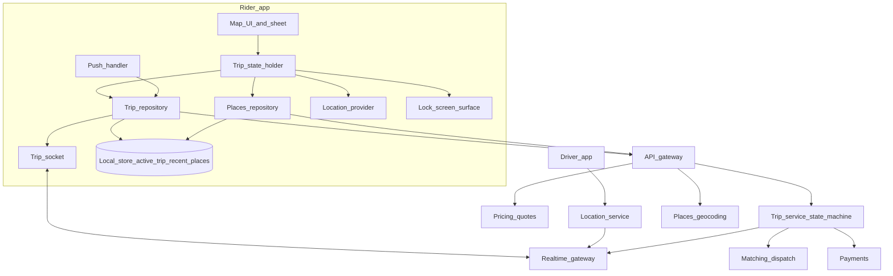
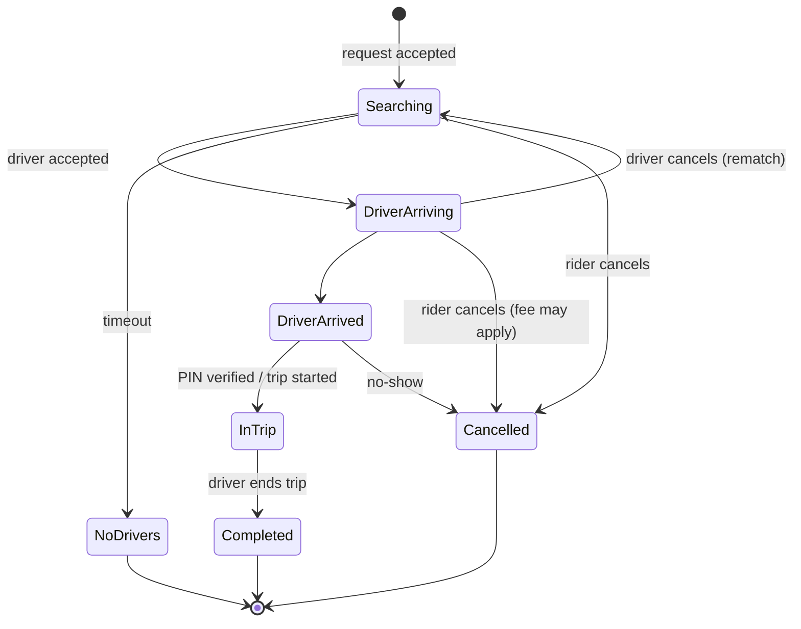
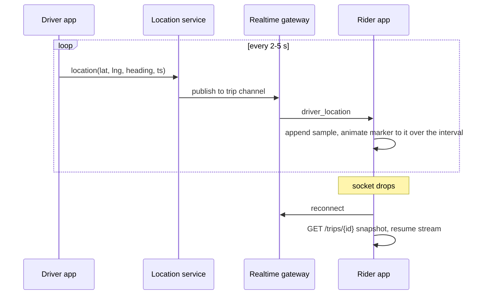

# 20 — Model Solution: Ride Hailing

Ride hailing combines maps, live location, a long-running state machine and money. The strong answer is built around the **trip state machine owned by the server**, **location that costs as little battery as possible**, **smooth driver tracking from sparse updates**, and **recovering an active trip after the app is killed or the network drops**.

## Timed outline (45–60 min)

| Min | Focus |
|-----|--------|
| 0–6 | Scope: rider app — pickup/drop-off, quote, request, match, track, pay, rate; driver app out of scope |
| 6–12 | NFRs, client architecture, backend in brief (trip, matching, location, pricing) |
| 12–22 | API + realtime contract, data model, trip state machine |
| 22–34 | Location strategy, place search, quote and idempotent request |
| 34–44 | Live tracking: socket stream, interpolation, ETA; lock-screen surfaces |
| 44–55 | Recovery, failures, safety/privacy, platform implementation, trade-offs, metrics |

## Clarify and scope

**Prompt:** "Design the rider app for a ride-hailing service like Uber, Lyft or Ola."

| Question | Assumed answer → design impact |
|----------|--------------------------------|
| Which app? | Rider app; driver app is another client (mention its location upload briefly) |
| Ride types? | Several products (economy, premium, auto) with upfront fares |
| Payment? | Saved card / wallet / UPI charged at trip end; cash optional → payment is server-driven (Ch 38) |
| Scheduled rides? | Deferred |
| Markets? | Many cities, poor networks in some → small payloads, recovery matters |
| Safety? | Share trip, SOS, PIN to start trip — at least mention |

**MVP:** set pickup (current location or search) and drop-off; product list with upfront fare and ETA; request with idempotency; searching state with cancel; driver assigned with car details; live driver location and ETA; in-trip view; trip end with fare, payment status and rating; trip restored after app kill; lock-screen live status.

**Defer:** scheduled rides, multi-stop, pooling, driver app internals, surge pricing algorithm, dispatch/matching algorithm.

## NFRs

| NFR | Target / rule |
|-----|---------------|
| Status freshness | Trip state changes visible ≤ 2 s in foreground; push in background |
| Driver marker | Smooth motion from updates every 2–5 s; no teleporting |
| Battery | Rider GPS only while setting pickup or during an active trip; no background location in MVP |
| Correctness | One trip per request (idempotent); fare shown is the server's quote |
| Recovery | Active trip restored on cold start within 1 s from cache, then reconciled |
| Data | Location stream payloads tiny (lat/lng/heading/ts); map tiles cached by the SDK |
| Privacy | Precise rider location shared with the driver only for the active trip |

## Architecture



### Backend in brief

| Piece | What to say |
|-------|-------------|
| Trip service | Single writer of trip state; emits events with a monotonic `version` |
| Matching | Finds nearby drivers using a geo index (geohash/H3 cells); offers to one driver at a time with timeouts |
| Location service | Driver apps upload location every few seconds; fan-out to the one rider watching that trip |
| Pricing | Upfront quote with `quoteId` and expiry; final fare may adjust for route changes, explained to the user |
| Payments | Charges at trip end through the PSP; status comes back asynchronously |

## API and realtime contract

| Call / event | Purpose |
|--------------|---------|
| `GET /v1/places/autocomplete?q=&lat=&lng=&session=` | Place suggestions (session token for billing) |
| `GET /v1/places/{id}` | Coordinates for a selected place |
| `POST /v1/quotes {pickup, dropoff}` | Products with fare, ETA, `quoteId`, `expiresAt` |
| `POST /v1/trips {quoteId, productId, paymentMethodId}` + `Idempotency-Key` | Request a ride |
| `GET /v1/trips/active` | Restore after relaunch |
| `GET /v1/trips/{id}` | Snapshot (state, version, driver, ETA, route) |
| `POST /v1/trips/{id}/cancel` | Cancel (fee preview by state) |
| `WS /v1/trips/{id}/stream` | `state` and `driver_location` events while the trip screen is visible |

```text
POST /v1/trips      Idempotency-Key: 0f3c…
{ "quoteId": "q_77", "productId": "economy", "paymentMethodId": "pm_card_1" }
→ 201 { "tripId": "t_901", "state": "searching", "version": 1 }
→ 409 { "code": "QUOTE_EXPIRED" }   → refetch quote, show new fare, ask again

stream events:
{ "type": "state", "tripId": "t_901", "version": 4, "state": "driver_arriving",
  "driver": { "name": "Ravi", "rating": 4.9, "vehicle": "White Swift · MH12 AB 1234", "photo": "…" },
  "pickupEtaSec": 240, "pin": "4821" }
{ "type": "driver_location", "tripId": "t_901", "lat": 18.5204, "lng": 73.8567, "heading": 92,
  "speedMps": 8.1, "ts": 1731234567000 }
```

## Data model

```text
Place:         id, name, address, lat, lng, source(recent|search|current)
Quote:         quoteId, products[ {id, name, fareMinor, currency, etaSec} ], expiresAt
Trip:          tripId, version, state, pickup, dropoff, productId, fareEstimateMinor, finalFareMinor?,
               driver?{name, rating, vehicle, photoUrl, phoneMasked}, pin?, pickupEtaSec?, dropoffEtaSec?,
               routePolyline?, payment{state(pending|captured|failed), method}, updatedAt
DriverSample:  lat, lng, heading, speedMps, ts                          (memory ring buffer)
ActiveTripRef: tripId, lastVersion                                       (persisted for recovery)
TripRequestAttempt: idempotencyKey, quoteId, createdAt, tripId?          (persisted until resolved)
```

## Trip state machine



- The **server owns transitions**; the client renders the state it's told, using `version` to ignore stale events (an event with a lower version than the current one is dropped).
- The UI is a pure function of `(state, driver, ETA, location)` — easy to restore after a kill.
- Payment is a **sub-state** after `Completed` (`pending → captured | failed`), not a trip state.

## Location strategy

| Phase | Accuracy | Updates | Why |
|-------|----------|---------|-----|
| App open, choosing pickup | High, single fix then balanced | On movement > 10 m | Accurate pin without draining battery |
| Searching / driver arriving | Balanced | Every 10–30 s while visible | Driver needs a fresh pickup point if the rider walks |
| In trip | Low or none | — | Driver's location is the trip's location |
| App backgrounded | None (MVP) | — | No background location permission needed |

- **Permission denied / approximate only:** let the user drop a pin or search an address; never block the flow.
- **Pickup point snapping:** suggest a nearby legal pickup point from the server (avoid highways, use venue gates).

## Place search

- Debounce 250 ms, cancel the previous request, show recent and saved places first (local).
- Use an autocomplete **session token** so the provider bills one session per search.
- Cache selected places locally for "recent destinations"; offline → recents only.

## Quote and request

1. Pickup + drop-off chosen → `POST /quotes` → product list with fares and pickup ETAs.
2. User picks a product → `POST /trips` with a new **idempotency key** persisted in `TripRequestAttempt` before sending.
3. On timeout or app kill: on relaunch, `GET /trips/active` (or resend with the same key) — never create a second trip.
4. `QUOTE_EXPIRED` → show the updated fare and ask again (never silently charge more).

## Live tracking



- **Interpolate:** animate the marker from the previous sample to the new one over the update interval (linear or along the route polyline), rotate to `heading`. Drop samples older than the newest one received (out-of-order delivery).
- **Snap to route** only when the driver is close to it; otherwise show the raw position (wrong snapping is worse than jitter).
- **ETA:** server-computed, shown as minutes; the client may tick it down locally between updates but always accepts the server's value.
- **Camera:** fit pickup + driver while arriving; follow the car during the trip; let the user pan freely and offer a "recenter" button.
- **Socket only while visible.** Backgrounded → close the socket; state changes come by push and the lock-screen surface.

## Lock screen and background

- **iOS Live Activity / Dynamic Island** and an **Android ongoing notification** show the state and ETA, updated by push (ActivityKit push tokens; FCM data messages that update the notification).
- Push for key transitions: driver assigned, driver arrived, trip completed, payment failed.
- No background location for the rider in MVP — say why (battery, permission friction, review).

## Recovery after kill or network loss

1. On launch, read `ActiveTripRef` → render the cached trip screen immediately.
2. `GET /trips/active` → reconcile (state may have moved on: completed, cancelled).
3. Reopen the stream if the trip is still active.
4. A pending `TripRequestAttempt` without a `tripId` → resolve with the idempotency key before showing the home screen.

## Payment at trip end

- `Completed` shows the final fare and a payment status (`pending` → `captured` / `failed`), never "Paid" from the client side.
- Failed payment → blocking "update payment method" flow before the next ride; retries are server-side with the same idempotency key.

## Offline

| Situation | Behaviour |
|-----------|-----------|
| No network before requesting | Recent places only; request button disabled with a reason |
| Network drops while searching | Keep the searching UI; reconnect and fetch the snapshot; don't re-request |
| Network drops during the trip | Show the last known position with "Reconnecting…"; trip continues server-side |
| SMS fallback (some markets) | Driver details by SMS if the app can't connect — mention as a market-specific option |

## Failures

| Failure | Handling |
|---------|----------|
| Request times out | Same idempotency key on retry; `GET /trips/active` on relaunch |
| Duplicate / stale socket events | Ignore events with `version` ≤ current |
| Location samples out of order | Drop samples older than the newest `ts` |
| Driver cancels | State returns to `Searching` with a message; no rider action needed |
| No drivers | Clear message, suggest another product or retry |
| GPS jumps (urban canyon) | Use accuracy radius; ignore fixes with poor accuracy for pickup |
| Map SDK fails to load | Show status, driver card and ETA without the map |
| Payment fails after trip | Server-driven state; block next request until resolved |

## Safety and privacy

- **Share trip status** with contacts via a link (server-generated, expires at trip end).
- **PIN to start** the trip prevents getting into the wrong car.
- **SOS** button calls local emergency services and shares location with the safety team.
- **Masked phone numbers** for rider–driver calls.
- Precise rider location only for the active trip; location history retention policy; no location in logs.

## Platform implementation

Cross-platform map: [Ch 05](../part-2-building-blocks/05-platforms-android-ios-flutter-react-native.md).

### Android: Views (XML) and Compose

Full toolkit comparison: [Android UI toolkits](../part-2-building-blocks/04-client-architecture.md#android-ui-toolkits-views-xml-and-compose).

| Concern | Views (XML) | Compose |
|---------|-------------|---------|
| Map host | `SupportMapFragment` (lifecycle handled) or `MapView` (you forward every lifecycle callback) + `getMapAsync` | maps-compose `GoogleMap(cameraPositionState = ...)` — lifecycle wired for you |
| Driver marker | Keep one `Marker`; animate `position` with a `ValueAnimator` interpolating `LatLng` | `MarkerState` per driver; drive `position` from an animation in a `LaunchedEffect` |
| Camera modes | `map.animateCamera(CameraUpdateFactory.newLatLngBounds(..))` | `cameraPositionState.animate(CameraUpdateFactory...)` inside a coroutine |
| Trip state UI | Fragment/ViewStub per state, toggled from collected state | `when (trip.status)` in one composable — the state machine maps 1:1 |
| Sheet over map | `CoordinatorLayout` + `BottomSheetBehavior` | Material 3 `BottomSheetScaffold` |

**Mixed codebase:** maps-compose and the Views SDK are the same Maps SDK underneath; a Compose trip sheet over an XML `SupportMapFragment` (or vice versa) is fine while migrating — keep one ViewModel owning trip + camera mode.

### iOS, Flutter and React Native

| Concern | iOS (UIKit / SwiftUI) | Flutter | React Native |
|---------|-----------------------|---------|--------------|
| Map host | MapKit (`MKMapView` / SwiftUI `Map`) or Google Maps SDK | `google_maps_flutter` / `apple_maps_flutter` (platform views) | `react-native-maps` |
| Driver marker | Annotation with animated coordinate (`UIView.animate` / `withAnimation`) | Marker updates; interpolate positions in Dart, avoid rebuilding the whole map | `AnimatedRegion` / Reanimated driven marker |
| Camera modes | `MKMapCamera`, `setVisibleMapRect` to fit pickup + driver | `CameraUpdate.newLatLngBounds` | `fitToCoordinates`, `animateCamera` |
| Trip state UI | View state from the trip state machine; Live Activity for lock-screen ETA | Same; native Live Activity via plugin | Same; native module for Live Activity |
| Sheet over map | `UISheetPresentationController` detents / `.presentationDetents` | `DraggableScrollableSheet` | `@gorhom/bottom-sheet` |
| Location (rider) | `CLLocationManager` when-in-use; `CLLocationUpdate.liveUpdates()` (iOS 17+) | `geolocator` | `expo-location` |

Notes: maps on Flutter and React Native are native views embedded in the shared UI. Keep marker updates throttled (1–2 Hz) and do interpolation on the UI thread to avoid jank.

## Trade-offs

| Decision | Alternative | Why pick |
|----------|-------------|----------|
| Server-owned state machine with versions | Client-driven transitions | One source of truth; stale events are easy to drop |
| Socket while visible + push in background | Always-on socket / polling | Battery and OS limits; push already exists |
| Interpolate between sparse samples | High-frequency driver uploads | Smooth UI without draining the driver's battery and data |
| No rider background location | Track rider in background | Permission friction, battery, review; not needed for MVP |
| Upfront quote with expiry | Estimate only | Price certainty; explicit re-confirmation if it changes |

## Metrics

| Metric | Why |
|--------|-----|
| Request → driver assigned time; no-driver rate | Core marketplace health (client sees it first) |
| Request success rate; duplicate trip rate (should be 0) | Idempotency correctness |
| Socket uptime during active trips; reconnects | Tracking reliability |
| Marker update gap p95 | Smoothness |
| Location permission grant rate; manual pin usage | Funnel friction |
| Crash-free sessions during active trips | The worst moment to crash |

## Staff stretch

- **Geo-sharded realtime** (per-city gateways) and degraded mode when tracking is unavailable.
- **Battery-adaptive driver uploads** (faster when close to pickup, slower on highways).
- **Offline-first receipts** and support entry points from trip history.
- **Remote kill switch** for live tracking or Live Activities if an OS update causes battery regressions.

## Follow-ups

- The app is killed while the user is searching for a driver. What happens on relaunch?
- How do you make the car move smoothly with updates every 4 seconds?
- Why doesn't the rider app need background location?
- The fare changed between quote and request. What does the user see?
- How would the design change for the driver app, which must upload location in the background?

## See also

- [Ch 23 — Maps and location](23-maps-location.md)
- [Ch 10 — Realtime and push](../part-2-building-blocks/10-realtime-and-push.md)
- [Ch 38 — Checkout / payment SDK](../part-5-fintech/38-checkout-payment-sdk.md)
- [Ch 11 — Performance, battery and lifecycle](../part-2-building-blocks/11-performance-battery-lifecycle.md)
