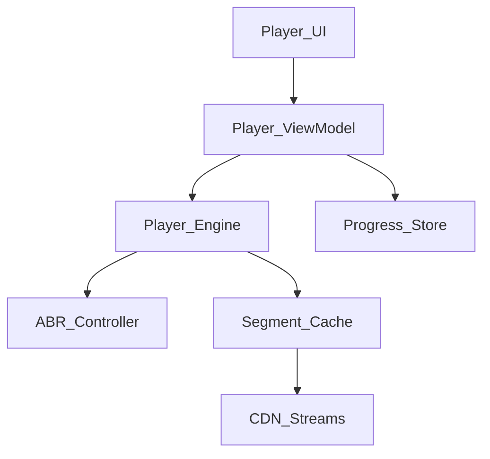
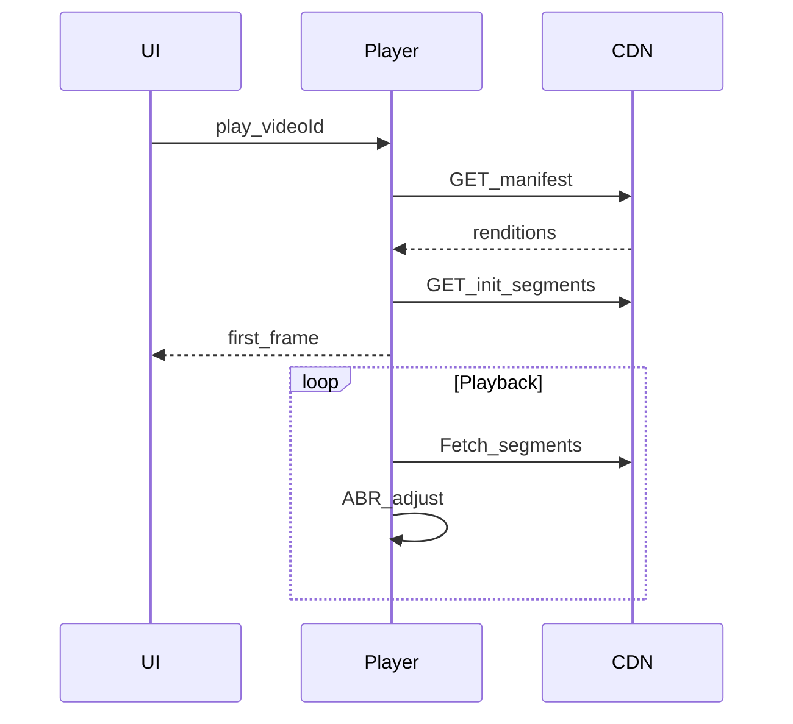

# 21 — Model Solution: Video Player

## Timed outline

| Min | Focus |
|-----|--------|
| 0–6 | MVP: play stream, seek, basic controls |
| 6–18 | Architecture, startup path |
| 18–40 | ABR, buffering, lifecycle, downloads optional |
| 40–55 | Offline, background audio, failures |

## Clarify and scope

**MVP:** play HLS/DASH (or progressive) video, play/pause, seek, fullscreen, remember position.

**Optional stretch:** offline download, background audio, picture-in-picture, captions.

## NFRs

- Time-to-first-frame competitive on typical broadband/LTE
- Minimize rebuffer events
- Pause when offscreen / interrupted
- Data use awareness on cellular

## High-level architecture



## Data model

```text
Video: id, title, manifestUrl, duration, posterUrl, captionsUrl?
PlaybackPosition: videoId, positionMs, updatedAt
DownloadJob?: videoId, status, bytes, filePath
```

## Startup path

1. Show poster + spinner.
2. Fetch manifest (or use embedded).
3. Select initial rung conservatively (or stored bandwidth estimate).
4. Buffer target T seconds then start.
5. Parallel: load captions, analytics session.



## Adaptive bitrate (ABR)

- Inputs: recent throughput, buffer health, error rate
- Actions: switch up carefully; switch down aggressively on starvation
- Avoid oscillation (dwell time / hysteresis)
- On cellular: lower ceiling via user setting (“data saver”)

## Progress tracking

- Persist position every ~5–10s and on pause/background
- On resume: seek to max(0, position − 1s)
- Server sync optional for cross-device; local first

## Offline downloads (stretch)

- User queues download → durable job
- Prefer wifi; expose cellular toggle
- Store segments or single file; license/expiry if DRM
- Integrity check on complete
- Playback uses local manifest/file path

## Background audio / interruptions

- Configure audio session / focus
- Handle phone calls: pause; resume policy explicit
- Headphones unplug: pause
- PiP: retain engine; teardown when user dismisses

## UI implementation

- Controls auto-hide; large seek targets
- Buffering spinner distinct from pause
- Error states: retry, lower quality, offline message
- Accessibility: captions, announce state changes

## Failures

| Case | Behavior |
|------|----------|
| Manifest 404 | Fatal error + related content |
| Segment timeout | Retry; ABR downshift |
| DRM license fail | Clear message; don’t loop |
| App backgrounded | Pause or continue per product; release decoder if needed |
| Memory pressure | Reduce buffer; release unused players |

## Platform implementation

Cross-platform map: [Ch 05](../part-2-building-blocks/05-platforms-android-ios-flutter-react-native.md).

### Android: Views (XML) and Compose

Full toolkit comparison: [Android UI toolkits](../part-2-building-blocks/04-client-architecture.md#android-ui-toolkits-views-xml-and-compose).

| Concern | Views (XML) | Compose |
|---------|-------------|---------|
| Surface | Media3 `androidx.media3.ui.PlayerView` in XML; `app:surface_type` (SurfaceView default; TextureView only if you must animate/transform) | `AndroidView(factory = { PlayerView(it) })`, or `media3-ui-compose` `PlayerSurface` with Compose controls |
| Player ownership | Create in `onStart`, release in `onStop` (API 24+); background → `MediaSessionService` owns it | Hold outside the composable body (`remember` + `DisposableEffect` release, or a ViewModel/service); never build in the body |
| Controls | `PlayerView` controller (`controllerShowTimeoutMs`), custom `controller_layout_id` | Keep `PlayerView` controls via interop, or build controls from player state |
| Fullscreen / rotation | Player outlives the view → reattach `playerView.player` after recreation | Same: player survives recomposition/config change; only the surface is recreated |
| PiP | `enterPictureInPictureMode(params)`; hide controls in `onPictureInPictureModeChanged` | Same Activity API; expose PiP mode as state and hide controls |

=== "Views (XML)"

    ```xml
    <androidx.media3.ui.PlayerView
        android:id="@+id/player_view"
        android:layout_width="match_parent"
        android:layout_height="wrap_content"
        app:surface_type="surface_view"
        app:show_buffering="when_playing" />
    ```

    ```kotlin
    override fun onStart() {
        super.onStart()
        player = ExoPlayer.Builder(requireContext()).build().also {
            binding.playerView.player = it
            it.setMediaItem(MediaItem.fromUri(url)); it.prepare()
        }
    }
    override fun onStop() { super.onStop(); player?.release(); player = null }
    ```

=== "Compose"

    ```kotlin
    @Composable
    fun VideoScreen(uri: String) {
        val context = LocalContext.current
        val player = remember { ExoPlayer.Builder(context).build() }
        DisposableEffect(player) { onDispose { player.release() } }
        LaunchedEffect(uri) { player.setMediaItem(MediaItem.fromUri(uri)); player.prepare() }
        AndroidView(
            factory = { PlayerView(it) },
            update = { it.player = player },
            onRelease = { it.player = null },
        )
    }
    ```

**Mixed codebase:** `PlayerView` via `AndroidView` is the pragmatic default — the player, `MediaSession`, and ABR logic don't change with the toolkit.

### iOS, Flutter and React Native

| Concern | iOS (UIKit / SwiftUI) | Flutter | React Native |
|---------|-----------------------|---------|--------------|
| Surface | `AVPlayerLayer` / `AVPlayerViewController` / SwiftUI `VideoPlayer` | `video_player` (texture) or `media_kit`; `better_player`-style wrappers | `react-native-video` / `expo-video` |
| Player ownership | One `AVPlayer` per screen owned by the model, not the view | Controller owned by state (Riverpod), disposed in `dispose` | Player owned by a hook/context; release on unmount |
| Controls | `AVPlayerViewController` system controls, or custom overlay | Custom overlay or `chewie` | Built-in controls or custom overlay |
| Fullscreen / rotation | Supported orientations per scene; `AVPlayerViewController` handles fullscreen | `SystemChrome.setPreferredOrientations`, immersive mode | `expo-screen-orientation`; library fullscreen API |
| PiP | `AVPictureInPictureController` + background audio mode | Native PiP via plugin; needs native config | `expo-video` / `react-native-video` PiP props + native config |
| Background audio | `AVAudioSession` category `.playback`, Now Playing info, remote commands | `audio_service` (media session on both OSs) | `react-native-track-player` / library background mode |
| HLS / DRM | `AVPlayer` native HLS, FairPlay | Native players underneath; DRM via platform | ExoPlayer / AVPlayer underneath; FairPlay & Widevine via library config |

Notes: Flutter and React Native both delegate decoding to ExoPlayer (Media3) and AVPlayer. Adaptive bitrate, DRM and offline downloads are native features; the shared layer only controls them.

## Trade-offs

| Decision | Alternative | Why |
|----------|-------------|-----|
| HLS/DASH ABR | Single MP4 | Network variability |
| Local position | Server-only | Instant resume |
| One player instance | Multi decode | Memory/battery |

## Metrics

TTFF, rebuffer ratio, startup failure, bitrate distribution, completion rate, download success.

## Staff stretch

- Multi-player eviction under memory pressure
- Experiment ABR aggressiveness behind flag
- Download license expiry + offline playback audit

## Follow-ups

- Live streaming DVR window
- Prefetch next episode
- Encrypted media / DRM sketch
