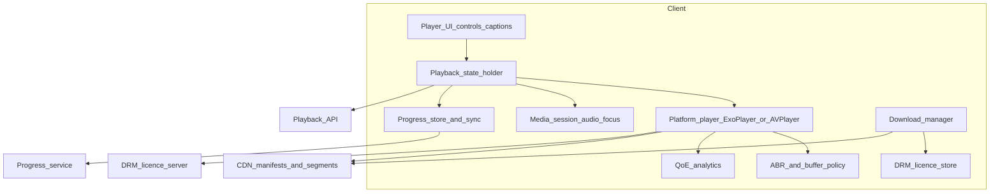
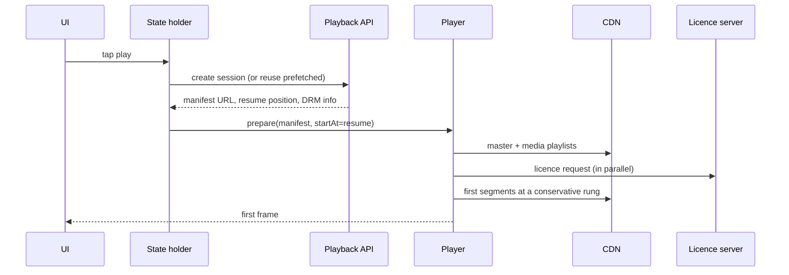

# 21 — Model Solution: Video Player

A video app is judged in the first second (time to first frame) and in every stall after that (rebuffering). The client doesn't decode video by hand — it orchestrates the platform player (ExoPlayer / Media3, AVPlayer) — so the interview is about **startup path, adaptive bitrate, buffering policy, lifecycle and audio focus, resume across devices, DRM and offline downloads**.

## Timed outline (45–60 min)

| Min | Focus |
|-----|--------|
| 0–6 | Scope: on-demand streaming (episodes/movies), resume, quality, captions; defer live and creator upload |
| 6–12 | NFRs, client architecture, backend/CDN in brief (transcode ladder, manifests) |
| 12–20 | API + data model; playback session; position sync |
| 20–34 | Startup path, ABR and buffering, prefetch of the next episode |
| 34–44 | Lifecycle: background audio, PiP, interruptions, rotation; DRM; downloads |
| 44–55 | Failures, analytics (QoE), platform implementation, trade-offs, metrics |

## Clarify and scope

**Prompt:** "Design a video streaming app like YouTube, Netflix or a short-video player."

| Question | Assumed answer → design impact |
|----------|--------------------------------|
| On-demand or live? | On-demand in MVP; live adds a DVR window and low-latency HLS (stretch) |
| Long or short form? | Long form (episodes) → resume, next episode, downloads; short form shares the player but adds preloading |
| Paid content? | Yes → DRM (Widevine/FairPlay) and concurrent-stream limits |
| Offline? | Download episodes for flights → license expiry, storage management |
| Devices? | Phones and tablets; casting to TV as a stretch |
| Accessibility? | Captions/subtitles and audio descriptions required |

**MVP:** catalogue → details → play; adaptive streaming (HLS/DASH); quality cap on cellular; play/pause/seek with thumbnails; captions and audio tracks; resume position synced across devices; next-episode autoplay; background audio + PiP; offline downloads with DRM licences.

**Defer:** live streaming, creator upload/transcoding UI, comments, casting internals, recommendations.

## NFRs

| NFR | Target / rule |
|-----|---------------|
| Time to first frame (TTFF) | < 1 s on good networks for cached manifests; < 2 s typical |
| Rebuffering | Rebuffer ratio < 0.5% of watch time; avoid stalls after startup |
| Quality | Highest sustainable bitrate without oscillation; cap by device screen and data saver |
| Data | Cellular cap (e.g. 480p/1.5 Mbps by default); downloads on Wi-Fi by default |
| Battery | Hardware decoding; screen-off audio uses minimal work |
| Resume | Position saved every ~10 s and on pause/exit; correct across devices |
| Memory | One decoder in use at a time (plus a preloaded one for short-form); release on background when not playing |

## Architecture



### Backend in brief

| Piece | What to say |
|-------|-------------|
| Transcoding | Each title encoded into a **bitrate ladder** (e.g. 240p → 4K) with 2–6 s segments, CMAF so HLS and DASH share segments |
| Manifests | Master manifest lists renditions; per-device filtering (codecs, max resolution, DRM) at the playback API |
| CDN | Segments are immutable and cache well; signed URLs/tokens for paid content |
| Licence server | Issues DRM licences per device with rules (offline allowed, expiry, max downloads) |
| Progress service | Stores `(user, title, positionMs, updatedAt)`; last writer wins by server time |

## API contract

| Endpoint | Purpose |
|----------|---------|
| `POST /v1/playback/sessions {titleId, deviceCaps}` | Returns manifest URL, DRM info, resume position, playback session id, stream-limit check |
| `POST /v1/progress {titleId, positionMs, sessionId}` | Save position (batched/debounced) |
| `GET /v1/progress?titleIds=` | Resume positions for rows on the home screen |
| `POST /v1/downloads {titleId, quality}` | Authorize a download; returns manifest + offline licence rules |
| `POST /v1/playback/sessions/{id}/heartbeat` | Concurrent-stream enforcement and QoE beacon |

```text
POST /v1/playback/sessions
{ "titleId": "ep_204", "deviceCaps": { "codecs": ["avc","hevc"], "maxRes": "1080p", "drm": ["widevine_l1"],
  "hdr": false, "network": "cellular" } }
→ 200
{ "sessionId": "ps_88", "manifestUrl": "https://cdn/…/ep_204/master.m3u8?token=…",
  "drm": { "type": "widevine", "licenseUrl": "https://lic/…" },
  "resumeMs": 1312000, "captions": [ {"lang": "en", "url": "…"}, {"lang": "hi", "url": "…"} ],
  "nextTitleId": "ep_205", "maxBitrateKbps": 1500 }
```

## Data model

```text
Title:            id, name, durationMs, posterUrl, seriesId?, seasonEpisode?
PlaybackSession:  sessionId, titleId, manifestUrl, drm, startedAt
Progress:         titleId, positionMs, durationMs, updatedAt, dirty         (local, synced)
Download:         titleId, quality, state(queued|downloading|paused|done|failed|expired), bytesDone, bytesTotal,
                  licenceExpiresAt, playbackWindowEndsAt?, filePath
QoE event:        sessionId, type(startup|stall|bitrate_change|error|end), atMs, bitrateKbps, bufferMs, details
```

## Startup path



Ways to cut TTFF (say several):

- **Prefetch the playback session** when the details screen opens (or when the row is focused), so tapping play skips one round trip.
- **Start at a conservative rung** using the last measured bandwidth for this network type, then ramp up.
- **Small startup buffer** (e.g. 1–2 s) and a larger steady-state buffer (e.g. 30 s).
- **Fetch the licence in parallel** with the first segments; cache offline-capable licences.
- **Reuse the warm player** instance and keep the surface attached between episodes.
- **Poster + blurred frame** while loading; never a black screen.

## Adaptive bitrate and buffering

- **Inputs:** recent segment throughput (weighted average), buffer level, dropped frames, screen size, data saver.
- **Policy:** switch **down quickly** when the buffer drains, **up slowly** after the buffer is healthy for a while (hysteresis avoids oscillation). Buffer-based approaches (like BOLA) are more stable than pure throughput guesses.
- **Caps:** never exceed the view's resolution (a 1080p rendition in a small inline player wastes data); cellular cap from settings.
- **Buffer limits:** min ~15 s, max ~30–60 s for VOD; smaller on low-memory devices.
- The platform players implement ABR (ExoPlayer `AdaptiveTrackSelection`, AVPlayer's built-in logic); you tune parameters (`preferredPeakBitRate`, `setMaxVideoSize`, buffer durations) rather than writing ABR from scratch.

## Next episode and short-form preloading

- Near the end credits, prefetch the next episode's session and first segments; show "Next episode in 10 s".
- **Short-form feeds:** keep one active player and one preloaded player for the next item; preload only the first segment; release players far from the viewport.

## Resume and progress sync

1. Save position locally every ~10 s, on pause, seek end and background (cheap local write).
2. Debounced sync to the server (every 30 s while playing + on exit); mark rows `dirty` until acknowledged.
3. On play, use the server's `resumeMs` unless the local value is newer and dirty.
4. Treat > 95% watched as finished (start next episode / restart from 0).

## Lifecycle, audio focus and PiP

| Event | Behaviour |
|-------|-----------|
| App backgrounded, video content | Pause, save position; release the decoder if memory is low |
| App backgrounded, audio-capable content (podcast, music video) | Continue as background audio with media-session controls |
| PiP entered | Keep playing in a floating window; minimal controls |
| Phone call / other app takes audio focus | Pause; resume only if it was a short interruption and the user didn't pause |
| Headphones disconnected | Pause (platform "becoming noisy" event) |
| Rotation / fullscreen | Player instance survives; only the layout changes |
| Screen lock | Audio continues only in background-audio mode |

## DRM

- **Widevine** (Android, levels L1/L3 decide max resolution) and **FairPlay** (iOS). The player requests licences from your licence server with a session token.
- Secure surfaces prevent screen recording of protected content.
- Offline licences carry rules: **download expiry** (e.g. 30 days), **playback window** after first play (e.g. 48 h), device limits.
- Licence renewal on reconnect; expired downloads show "Renew" rather than failing silently.

## Offline downloads

1. Authorize: `POST /downloads` checks entitlement and device limits.
2. Download the chosen rendition's segments (plus audio/captions) via the platform download manager (`DownloadService` / `AVAssetDownloadURLSession`), which survives app suspension.
3. Persist an offline licence; verify completeness; show storage used per title.
4. Play from local storage through the same player; report progress when online.
5. Auto-delete watched downloads (setting); warn on low storage.

## Captions and accessibility

- WebVTT / TTML side-loaded or in-manifest; user styling (size, background) honours system caption settings.
- Audio descriptions as an alternate audio track.
- Controls reachable by screen readers; seek by 10 s accessibility actions; announce buffering.

## Offline

| Situation | Behaviour |
|-----------|-----------|
| No network, downloaded title | Plays from disk; progress synced later |
| No network, streaming title | Clear message and link to downloads |
| Network drops mid-play | Play from buffer; ABR downshifts; resume fetching when back |
| Licence expired offline | "Connect to renew" message |

## Failures

| Failure | Handling |
|---------|----------|
| Segment 404/timeout | Retry with backoff; switch rendition; skip to next segment only as a last resort |
| Manifest error | Retry once; error screen with retry |
| Licence denied (device limit, geo) | Specific message; no retry loop |
| Decoder error (unsupported codec / profile) | Fall back to a lower-profile rendition (e.g. AVC instead of HEVC) |
| Stream limit exceeded | Server rejects session; show which devices are watching |
| Memory pressure | Lower buffer size; release preloaded players |
| Clock/device time changed (offline licence) | Licence server validates; secure clock in DRM |

## Analytics (QoE)

- Per session: TTFF, startup failure, stalls (count, duration), bitrate timeline, dropped frames, errors, watch time.
- Beacons batched; heartbeats double as concurrent-stream enforcement.
- QoE metrics by CDN, region, device, network type drive CDN and ladder decisions.

## Security & privacy

- Signed, short-lived segment/manifest URLs; tokens bound to session.
- DRM + secure surfaces for paid content; block screen capture where required.
- Watch history is personal data: allow clearing, respect profiles (kids profiles).

## Platform implementation

Cross-platform map: [Ch 05](../part-2-building-blocks/05-platforms-android-ios-flutter-react-native.md).

### Android: Views (XML) and Compose

Full toolkit comparison: [Android UI toolkits](../part-2-building-blocks/04-client-architecture.md#android-ui-toolkits-views-xml-and-compose).

| Concern | Views (XML) | Compose |
|---------|-------------|---------|
| Surface | Media3 `androidx.media3.ui.PlayerView` in XML; `app:surface_type` (SurfaceView default; TextureView only if you must animate/transform) | `AndroidView(factory = { PlayerView(it) })`, or `media3-ui-compose` `PlayerSurface` with Compose controls |
| Player ownership | Create in `onStart`, release in `onStop` (API 24+); background → `MediaSessionService` owns it | Hold outside the composable body (`remember` + `DisposableEffect` release, or a ViewModel/service); never build in the body |
| Controls | `PlayerView` controller (`controllerShowTimeoutMs`), custom `controller_layout_id` | Keep `PlayerView` controls via interop, or build controls from player state |
| Fullscreen / rotation | Player outlives the view → reattach `playerView.player` after recreation | Same: player survives recomposition/config change; only the surface is recreated |
| PiP | `enterPictureInPictureMode(params)`; hide controls in `onPictureInPictureModeChanged` | Same Activity API; expose PiP mode as state and hide controls |

=== "Views (XML)"

    ```xml
    <androidx.media3.ui.PlayerView
        android:id="@+id/player_view"
        android:layout_width="match_parent"
        android:layout_height="wrap_content"
        app:surface_type="surface_view"
        app:show_buffering="when_playing" />
    ```

    ```kotlin
    override fun onStart() {
        super.onStart()
        player = ExoPlayer.Builder(requireContext()).build().also {
            binding.playerView.player = it
            it.setMediaItem(MediaItem.fromUri(url)); it.prepare()
        }
    }
    override fun onStop() { super.onStop(); player?.release(); player = null }
    ```

=== "Compose"

    ```kotlin
    @Composable
    fun VideoScreen(uri: String) {
        val context = LocalContext.current
        val player = remember { ExoPlayer.Builder(context).build() }
        DisposableEffect(player) { onDispose { player.release() } }
        LaunchedEffect(uri) { player.setMediaItem(MediaItem.fromUri(uri)); player.prepare() }
        AndroidView(
            factory = { PlayerView(it) },
            update = { it.player = player },
            onRelease = { it.player = null },
        )
    }
    ```

**Mixed codebase:** `PlayerView` via `AndroidView` is the pragmatic default — the player, `MediaSession`, and ABR logic don't change with the toolkit.

### iOS, Flutter and React Native

| Concern | iOS (UIKit / SwiftUI) | Flutter | React Native |
|---------|-----------------------|---------|--------------|
| Surface | `AVPlayerLayer` / `AVPlayerViewController` / SwiftUI `VideoPlayer` | `video_player` (texture) or `media_kit`; `better_player`-style wrappers | `react-native-video` / `expo-video` |
| Player ownership | One `AVPlayer` per screen owned by the model, not the view | Controller owned by state (Riverpod), disposed in `dispose` | Player owned by a hook/context; release on unmount |
| Controls | `AVPlayerViewController` system controls, or custom overlay | Custom overlay or `chewie` | Built-in controls or custom overlay |
| Fullscreen / rotation | Supported orientations per scene; `AVPlayerViewController` handles fullscreen | `SystemChrome.setPreferredOrientations`, immersive mode | `expo-screen-orientation`; library fullscreen API |
| PiP | `AVPictureInPictureController` + background audio mode | Native PiP via plugin; needs native config | `expo-video` / `react-native-video` PiP props + native config |
| Background audio | `AVAudioSession` category `.playback`, Now Playing info, remote commands | `audio_service` (media session on both OSs) | `react-native-track-player` / library background mode |
| HLS / DRM | `AVPlayer` native HLS, FairPlay | Native players underneath; DRM via platform | ExoPlayer / AVPlayer underneath; FairPlay & Widevine via library config |

Notes: Flutter and React Native both delegate decoding to ExoPlayer (Media3) and AVPlayer. Adaptive bitrate, DRM and offline downloads are native features; the shared layer only controls them.

## Trade-offs

| Decision | Alternative | Why pick |
|----------|-------------|----------|
| HLS/DASH with ABR (CMAF) | Progressive MP4 | Adapts to the network; one segment set for both protocols |
| Platform players | Custom decoder/player | Hardware decoding, DRM, battery, maintained by OS vendors |
| Conservative start, ramp up | Start high | Faster first frame, fewer early stalls |
| Local-first progress + sync | Server-only progress | Instant resume, works offline |
| OS download managers | Custom downloader | Survive suspension; DRM-aware on iOS (`AVAssetDownloadURLSession`) |

## Metrics

| Metric | Why |
|--------|-----|
| TTFF p50/p95 | First impression |
| Rebuffer ratio; stalls per hour | Main QoE complaint |
| Average bitrate and resolution delivered | Quality |
| Startup failure rate; playback error rate by code | Reliability |
| Download success rate; licence errors | Offline reliability |
| Completion rate; next-episode autoplay take rate | Product engagement |

## Staff stretch

- **Live streaming:** low-latency HLS, DVR window, catch-up; live edge handling.
- **Per-title encoding ladders** and device-aware manifests to save CDN cost.
- **Multi-CDN switching** driven by client QoE.
- **Casting** (Chromecast / AirPlay): the phone becomes a remote; playback session moves to the receiver.

## Follow-ups

- How do you get time to first frame under one second?
- Why does quality go down fast but up slowly?
- What happens to a downloaded episode after 30 days without internet?
- How does resume work when the user switches from phone to TV mid-episode?
- How would preloading work in a vertical short-video feed?

## See also

- [Ch 09 — Media: images and video](../part-2-building-blocks/09-media-images-video.md)
- [Ch 36 — File downloader library](../part-4-libraries-and-sdks/36-file-downloader-library.md)
- [Ch 26 — Stories](26-stories.md)
- [Ch 11 — Performance, battery and lifecycle](../part-2-building-blocks/11-performance-battery-lifecycle.md)
