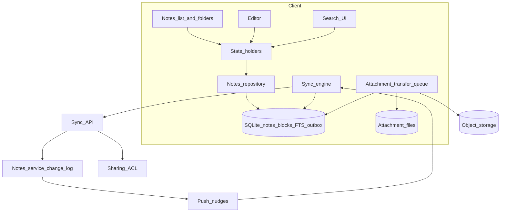
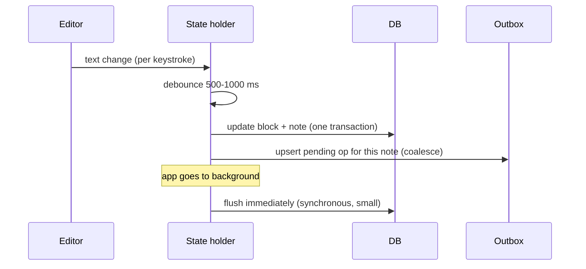

# 22 — Model Solution: Offline Notes

A notes app (Apple Notes, Google Keep, Notion-lite) is the classic **local-first** design: the user types with zero connectivity, nothing is ever lost, and every device converges. Ch 31 covers the reusable sync engine; this chapter is the **product** answer — editor saving, conflicts the user can understand, search, attachments, sharing, and the onboarding of a second device.

## Timed outline (45–60 min)

| Min | Focus |
|-----|--------|
| 0–6 | Scope: notes + folders, rich-ish text, checklists, images, search, multi-device; defer real-time co-editing |
| 6–12 | NFRs, local-first architecture, backend in brief |
| 12–22 | API (push/pull), data model (notes, blocks, outbox, tombstones) |
| 22–34 | Editor save path, sync loop, conflict resolution and conflict UX |
| 34–44 | Search (FTS), attachments, sharing, first sync on a new device |
| 44–55 | Failures, security, platform implementation, trade-offs, metrics |

## Clarify and scope

**Prompt:** "Design a notes app that works fully offline and syncs across a user's phone, tablet and web."

| Question | Assumed answer → design impact |
|----------|--------------------------------|
| Content? | Title + body with basic formatting, checklists, inline images → block-based body |
| Devices? | Same user on several devices; occasional sharing with others |
| Concurrent editing? | Rare; no live cursors in MVP → field/block-level merge, conflicted copy as the fallback |
| Size? | Thousands of notes per user, attachments up to ~20 MB each |
| Search? | Instant full-text search offline |
| Security? | Optional locked notes (encrypted with a user passphrase / biometrics) |

**MVP:** create/edit/delete/pin/archive notes and folders offline; autosave; sync across devices; conflict handling that never loses text; offline full-text search; image attachments; trash with restore; share a note read/write with another user.

**Defer:** real-time collaborative cursors (CRDT/OT stretch), handwriting, web clipper, version history UI (store versions server-side, expose later).

## NFRs

| NFR | Target / rule |
|-----|---------------|
| Offline | 100% of create/edit/delete/search work offline |
| Durability | Keystrokes saved locally within ~1 s and on app background; never lost on kill |
| Convergence | All devices reach the same content after sync; no silent data loss on conflict |
| Sync latency | Edits visible on another online device within seconds (push nudge) |
| Search | < 100 ms for 10k notes on a mid-range device |
| Storage | Attachments cached with a cap; originals on the server |
| Battery | Sync batched; no tight polling |

## Architecture



### Backend in brief

| Piece | What to say |
|-------|-------------|
| Notes service | Stores notes/blocks with a server `version` per note and an append-only **change log** per user/space; issues change tokens |
| Sync API | Push ops (idempotent by `opId`), pull changes since a token (upserts + tombstones) |
| Sharing | ACL per note; shared notes appear in each member's change log |
| Attachments | Pre-signed uploads to object storage; notes reference attachment ids |
| Push nudges | "Your space changed" data push to other devices → they pull |

## API contract

| Endpoint | Purpose |
|----------|---------|
| `POST /v1/sync/push {ops[]}` | Apply local ops; per-op result `applied(version)` / `conflict(server)` / `rejected` |
| `GET /v1/sync/pull?since=<token>&limit=500` | Upserts, tombstones, next token |
| `POST /v1/attachments` | Pre-signed upload URL + attachment id |
| `GET /v1/attachments/{id}` | Download URL (signed) |
| `POST /v1/notes/{id}/shares {email, role}` | Share |

```text
POST /v1/sync/push
{ "ops": [
  { "opId": "op_01HG…", "kind": "update", "noteId": "n_42", "baseVersion": 17,
    "patch": { "title": "Groceries", "blocks": { "upsert": [ { "id": "b_3", "type": "check", "text": "Milk", "checked": true, "pos": "a1" } ],
               "delete": ["b_9"] } } } ] }
→ 200 { "results": [ { "opId": "op_01HG…", "status": "applied", "version": 18 } ] }
   or { "opId": "…", "status": "conflict", "server": { "version": 19, "title": "Groceries 🛒", "blocks": [ … ] } }

GET /v1/sync/pull?since=tok_8812
→ 200 { "upserts": [ {note…} ], "tombstones": [ "n_7" ], "nextToken": "tok_8840", "hasMore": false }
```

## Data model

```text
Note:      id(UUID, client-generated), folderId, title, pinned, archived, deletedAt?, version, updatedAt(server),
           localUpdatedAt, dirtyFields[], locked
Block:     id, noteId, type(paragraph|heading|check|image|bullet), text, marks(JSON), checked?, attachmentId?,
           pos(fractional index string), version, dirty
Folder:    id, name, parentId?, pos, version
OutboxOp:  opId, noteId, kind(create|update|delete|move), patch, baseVersion, createdAt, attempts
SyncState: token, lastPullAt
Attachment:id, noteId, localPath?, remoteState(pending|uploading|uploaded|failed), bytes, mime, width?, height?
FTS:       notes_fts(noteId, title, body_text)   (contentless/external content table kept in sync by triggers)
```

- **Block-based body:** merges happen per block instead of per note, so two devices editing different paragraphs don't conflict.
- **Fractional indexes** (`pos` strings like `a0`, `a0V`, `a1`) let blocks be reordered or inserted without renumbering everything.
- **Tombstones:** deletes are rows with `deletedAt` until the server confirms and the trash retention ends.

## Editor save path



- **Debounced autosave** (≈ 0.5–1 s) plus **flush on background/close**; no "Save" button.
- **Coalesce** consecutive edits into one pending op per note (latest patch wins until sent), keeping the original `baseVersion`.
- Undo/redo is an in-memory editor stack; saved state is what's in the DB.
- Large notes: save only changed blocks.

## Sync loop

1. Triggers: launch, foreground, network regained, after edits (debounced ~2 s), push nudge, periodic background (Ch 08 platform rules).
2. **Push** outbox ops in order; idempotent by `opId`.
3. **Pull** changes since the token; apply upserts and tombstones in one transaction together with the new token.
4. Repeat while `hasMore`; one sync run at a time.

The engine internals (coalescing, token handling, resets, schema evolution) are the same as Ch 31's library — say "I'd reuse our sync engine" and spend the time on conflicts and UX.

## Conflict resolution

| Situation | Resolution |
|-----------|------------|
| Different blocks edited on two devices | Auto-merge per block |
| Same block's `checked` toggled | Last writer (server time) wins — low stakes |
| Same block's text edited on both | **Keep both:** the server version stays; the local version is inserted as a new block marked "Edited on Pixel 8 at 10:42" (or a conflicted copy of the note for big divergences) |
| Note deleted on one device, edited on another | Edit wins: restore the note from trash with the edit, tell the user |
| Folder moved and renamed concurrently | Field-level merge (folder vs name) |

**Rule:** never discard typed text silently. Users forgive a duplicate paragraph; they never forgive a lost one.

**Collaborative stretch:** for true co-editing, model block text as a CRDT (e.g. Yjs/Automerge-style sequences) so concurrent typing merges character-by-character. Cost: metadata size, memory, complexity; worth it only if live collaboration is in scope.

## Search

- SQLite **FTS5** table over title + plain-text body; updated in the same transaction as the note (or by triggers).
- Prefix queries for type-ahead (`milk*`), ranked by BM25 with a recency boost; snippets with highlighted matches.
- Debounce input ~150 ms; run queries off the main thread.
- Locked notes are excluded from the index (or indexed only in memory while unlocked).
- System search integration: Core Spotlight (iOS) / App Search (Android) for titles only, respecting privacy.

## Attachments

1. Insert image block with a local file reference immediately (shows offline).
2. Background transfer: get pre-signed URL → upload on the OS transfer service (Ch 25) → mark uploaded → push the block op with `attachmentId`.
3. Other devices download thumbnails eagerly, full-size lazily; LRU cache with a cap; "Download all for offline" option per folder.
4. Deleting a note keeps attachments until the trash is emptied.

## Sharing

- Share a note with a role (viewer/editor); shared notes appear in collaborators' pull results.
- Permission changes arrive as changes; a revoked note is removed locally (with a message).
- Edits by collaborators merge the same way as edits from the user's other devices.

## First sync on a new device

- Pull in pages (e.g. 500 notes), **titles and first lines first** so the list appears quickly; bodies and attachments follow.
- Show progress; let the user search what's synced so far.
- Prefer Wi-Fi for attachments.

## Offline

| Situation | Behaviour |
|-----------|-----------|
| Everything | Works: create, edit, delete, move, search, attach (upload later) |
| Sync status | Small per-note indicator only when something is pending for a long time or failed |
| Shared note offline | Editable; merges on reconnect |
| Open an uncached attachment offline | Placeholder "Available when online" |

## Failures

| Failure | Handling |
|---------|----------|
| Kill during typing | Debounced saves + background flush; at most ~1 s lost in the worst case |
| Push succeeds, response lost | Retry; server dedupes `opId` |
| Crash mid-pull | Token saved with data atomically; resume from the last token |
| Server compacted the change log | `resetRequired` → full re-download, keeping local dirty notes |
| Attachment upload fails repeatedly | Block shows "Upload failed, tap to retry"; note text still syncs |
| Storage full | Stop caching attachments; warn the user; text saves still prioritized |
| Schema migration on update | Versioned migrations; preserve unknown fields from newer servers |

## Security & privacy

- Database encrypted at rest for sensitive use (SQLCipher / iOS Data Protection `complete`); attachments in protected storage.
- **Locked notes:** content encrypted with a key derived from the user's passphrase (Argon2/PBKDF2) and optionally unlocked by biometrics (key in Keychain/Keystore); the server stores ciphertext.
- Logout warns about unsynced changes, then wipes DB, files and tokens.
- Shared-note ACLs enforced server-side; signed attachment URLs.

## Do not copy this pattern to money

Local-first with optimistic "done" is right for notes. For wallets, checkout or UPI it's unsafe: persist the **intent**, show **processing / unknown**, and confirm with the server (Ch 37–41).

## Platform implementation

Cross-platform map: [Ch 05](../part-2-building-blocks/05-platforms-android-ios-flutter-react-native.md).

### Android: Views (XML) and Compose

Full toolkit comparison: [Android UI toolkits](../part-2-building-blocks/04-client-architecture.md#android-ui-toolkits-views-xml-and-compose).

| Concern | Views (XML) | Compose |
|---------|-------------|---------|
| Notes list | `RecyclerView` + `ListAdapter` on a Room `Flow` | `LazyColumn` / `LazyVerticalStaggeredGrid` on the same `Flow` via `collectAsStateWithLifecycle()`, `key = note.id` |
| Editor text | `EditText` + debounced save; never `setText` from the DB flow while the user types | `TextField` state held synchronously (`rememberTextFieldState` / VM state), not round-tripped through Room — async round-trips cause cursor jumps |
| Sync badge per note | DiffUtil payload → update icon only | Row reads `syncState`; only that row recomposes |
| Search | `SearchView` + debounced query flow | Material 3 `SearchBar` + same debounced flow |
| Rich text | Spans (`SpannableStringBuilder`) in `EditText` | `AnnotatedString` for display; complex rich editors often stay a View via `AndroidView` |

**Mixed codebase:** list screen migrates easily; keep a mature span-based editor as a View inside Compose until a Compose editor matches it.

### iOS, Flutter and React Native

| Concern | iOS (UIKit / SwiftUI) | Flutter | React Native |
|---------|-----------------------|---------|--------------|
| Notes list | `List` driven by SwiftData `@Query` / GRDB observation | `StreamBuilder` / `StreamProvider` on drift `watch()` | WatermelonDB `withObservables` or a SQLite live query |
| Editor text | `UITextView` / `TextEditor`; save on debounce and on `scenePhase` change | `TextField` with controller; debounce saves | `TextInput` (uncontrolled for long text); debounce saves |
| Sync badge per note | Per-row status from the `syncState` column | Same | Same |
| Search | SQLite FTS5 via GRDB; Core Spotlight for system search | drift FTS5 tables | op-sqlite FTS5 |
| Rich text | `AttributedString` + `TextEditor` (iOS 26) or `UITextView` | `flutter_quill` / `super_editor` | `react-native-pell-rich-editor` / WebView-based editors (weigh the bridge cost) |
| Background sync | Flush on foreground + network change; `BGProcessingTask` for big catch-up | `workmanager` + foreground flush | `expo-background-task` + foreground flush |

Notes: on iOS a "save on background" must finish quickly. Write to the local DB synchronously when the scene goes inactive and let the outbox upload later.

## Trade-offs

| Decision | Alternative | Why pick |
|----------|-------------|----------|
| Local-first, DB as UI source | Online editor with cache | Offline is the product promise |
| Block-level merge + "keep both" | Note-level last-writer-wins | Fewer conflicts; never loses text |
| Fractional indexes | Integer positions | Reorder/insert without rewriting siblings |
| CRDT only as a stretch | CRDT everywhere | Complexity and metadata cost unless co-editing is required |
| Local FTS | Server search | Instant and offline |

## Metrics

| Metric | Why |
|--------|-----|
| Pending ops age p95; failed ops | Hidden data loss risk |
| Edit → visible on another device latency | Sync quality |
| Conflicts per 1k ops; "keep both" frequency | Merge design effectiveness |
| Search latency p95 | Perceived quality |
| First-sync duration on a new device | Onboarding |
| Attachment upload success | Media reliability |

## Staff stretch

- **Real-time co-editing** with CRDTs and presence, falling back to the same sync when offline.
- **Version history** from the server change log (restore a note to a point in time).
- **End-to-end encrypted spaces** (keys per space, shared via public keys).
- **Partial sync** for huge accounts (recent + pinned first).
- Feature-flag merge strategies; watch conflict and "keep both" rates before full rollout.

## Follow-ups

- The same paragraph was edited on a phone in airplane mode and on a laptop. What does the user see?
- What happens if the app is killed one second after the user stops typing?
- How do you sync a 15 MB image without blocking text sync?
- How does a brand-new tablet become usable quickly for a user with 20,000 notes?
- Why is this design wrong for a wallet balance?

## See also

- [Ch 31 — Data sync library](../part-4-libraries-and-sdks/31-data-sync-library.md)
- [Ch 08 — Offline and sync](../part-2-building-blocks/08-offline-and-sync.md)
- [Ch 25 — Photo capture and upload](25-photo-camera-upload.md)
- [Ch 12 — Security and privacy](../part-2-building-blocks/12-security-and-privacy.md)
