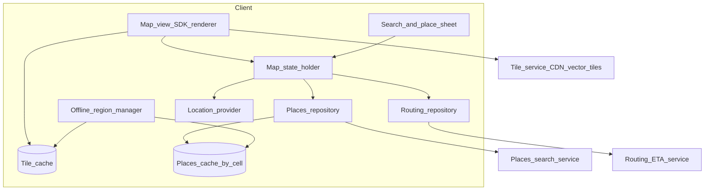
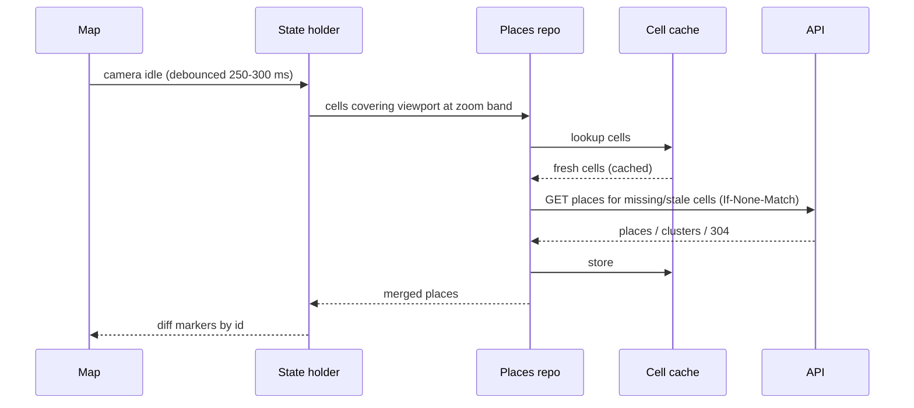

# 23 — Model Solution: Maps / Location

"Design Google Maps" in a mobile round means the **client**: rendering a map smoothly, loading places for what's on screen, showing the user's position honestly, searching, and doing it all without burning battery or data. Strong answers explain **vector tiles and caching, viewport-based place loading with clustering, a location strategy per screen state, offline regions, and privacy**. Turn-by-turn navigation is the natural stretch.

## Timed outline (45–60 min)

| Min | Focus |
|-----|--------|
| 0–6 | Scope: browse map, blue dot, search places, place details, directions preview; defer turn-by-turn |
| 6–12 | NFRs, client architecture, backend in brief (tiles, places, routing) |
| 12–22 | API + data model: tiles, viewport place queries, place details |
| 22–34 | Map rendering and caching; viewport loading, clustering, marker performance |
| 34–44 | Location strategy, search, directions preview, offline regions |
| 44–55 | Failures, privacy, platform implementation, trade-offs, metrics; navigation stretch |

## Clarify and scope

**Prompt:** "Design a maps app — or the maps part of a local-discovery app (restaurants, stores, EV chargers)."

| Question | Assumed answer → design impact |
|----------|--------------------------------|
| Own map rendering or SDK? | Use a map SDK (Google Maps, MapKit, Mapbox/MapLibre) — discuss what it gives you |
| Places? | Millions of POIs; show those in the viewport with category filters |
| Navigation? | Directions preview (routes, ETA) in MVP; voice turn-by-turn is a stretch |
| Offline? | Download a region for travel (tiles + places + basic search) |
| Location sharing? | Not in MVP (see Ch 20 and practice prompt P4) |

**MVP:** pan/zoom map with smooth interaction; user location with accuracy circle; places for the visible area with category filters and clustering; search with autocomplete; place details sheet; route preview between two points (drive/walk/transit) with ETA; recent and saved places; offline region download.

**Defer:** turn-by-turn guidance, live traffic layer internals, Street View, user-generated reviews/photos, indoor maps.

## NFRs

| NFR | Target / rule |
|-----|---------------|
| Interaction | Pan/zoom at 60 fps; no network or parsing on the main thread during gestures |
| First map | Cached tiles visible < 1 s on launch at the last viewport |
| Data | Vector tiles (small) cached aggressively; places fetched per viewport cell, not per gesture |
| Battery | Location updates only while the map is visible; precision matched to the task |
| Accuracy honesty | Show the accuracy radius; never fake precision |
| Offline | Downloaded regions fully browsable and searchable |
| Privacy | Location history off by default; precise location only with consent |

## Architecture



### Backend in brief

| Piece | What to say |
|-------|-------------|
| Tiles | Pre-rendered **vector tiles** per z/x/y on a CDN; client styles them (dark mode, POI density) without new downloads |
| Places | Geo index (geohash/S2/H3 cells) + text index; query by viewport cell + filters; ranking by relevance/popularity/distance |
| Routing | Graph search (contraction hierarchies) with live traffic weights; returns polyline, steps, ETA alternatives |

## API contract

| Endpoint | Purpose |
|----------|---------|
| `GET https://tiles.cdn/{style}/{z}/{x}/{y}.mvt` | Vector tile (immutable, cache headers) — usually handled by the SDK |
| `GET /v1/places?cells=<geohash list>&categories=&zoom=` | Places for viewport cells (cluster summaries at low zoom) |
| `GET /v1/places/autocomplete?q=&near=lat,lng&session=` | Suggestions |
| `GET /v1/places/{id}` | Details (hours, rating, photos, phone) |
| `POST /v1/routes {origin, destination, mode, departAt?}` | Routes with polyline, duration, distance, steps |
| `GET /v1/regions/{id}/package` | Offline region manifest (tile ranges, places snapshot, version) |

```text
GET /v1/places?cells=tdr1w,tdr1x,tdr1y&categories=ev_charging&zoom=13
→ 200
{ "cells": [
   { "cell": "tdr1w", "etag": "c9a1", "places": [ { "id": "pl_1", "name": "ChargePoint", "lat": 12.97, "lng": 77.59,
     "category": "ev_charging", "badge": "4 free" } ] },
   { "cell": "tdr1x", "etag": "77b2", "cluster": { "count": 38, "lat": 12.98, "lng": 77.60 } } ] }
```

- **Query by fixed cells**, not by the exact viewport rectangle: cells are cacheable, reusable across small pans, and give stable cache keys.
- At low zoom the server returns **cluster summaries** per cell instead of thousands of points.

## Data model

```text
CameraState:   lat, lng, zoom, bearing, tilt                     (persisted for next launch)
PlaceSummary:  id, name, lat, lng, category, badge?, cell
CellCache:     cell, zoomBand, filtersHash, etag, fetchedAt, places[] | cluster
PlaceDetail:   id, name, address, hours, rating, phone, photos[], fetchedAt
Route:         id, mode, polyline, durationSec, distanceM, steps[], trafficLevel
SavedPlace:    id, label(home|work|custom), placeId, lat, lng
OfflineRegion: id, name, bounds, tileZoomRange, bytes, version, state(downloading|ready|update_available|expired)
```

## Map rendering and caching

- The SDK renders **vector tiles** on the GPU; your job is to keep the main thread free during gestures and not fight the SDK with heavy overlays.
- **Tile cache:** the SDK's disk cache (size-capped); immutable tile URLs with long cache lifetimes; style changes don't need new tiles.
- **Restore the last camera** on launch so cached tiles show instantly.
- **Overlays** (route polylines, heatmaps) as SDK layers, not hundreds of individual views.

## Viewport-based place loading



1. Fetch on **camera idle**, not on every gesture frame; cancel requests for cells that left the viewport.
2. Compute the covering cells at the current zoom band, plus a ring of neighbours for prefetch.
3. Serve fresh cells from cache; revalidate stale ones with ETags.
4. **Diff markers by id**: add new, remove gone, keep existing (no full redraw).

## Clustering and marker performance

- Low zoom: server-side cluster summaries per cell; mid zoom: client-side clustering (supercluster-style grid/hierarchical) over loaded points; high zoom: individual markers.
- Reuse marker bitmaps per category/badge (cache by key); avoid custom views per marker.
- Cap visible markers (e.g. 200); prioritize by relevance.
- Selection: tapping a marker opens the place sheet and highlights the marker without reloading the layer.

## Location strategy

| State | Accuracy request | Updates | Notes |
|-------|------------------|---------|-------|
| Map visible, idle | Balanced | Every few seconds / on movement > 10–20 m | Blue dot with accuracy circle |
| User taps "my location" | High, one-shot then balanced | — | Recenter camera |
| Directions preview | Balanced | On movement | Origin = current location |
| Turn-by-turn (stretch) | High | ~1 s | Foreground service / background location mode, map matching |
| Map not visible | None | — | Stop updates |

- **Approximate location granted only:** show a larger circle, still useful for "nearby".
- **Denied:** default to the last searched city or a manual search; don't block the app.
- Filter fixes by accuracy and implausible jumps (urban canyons).
- **Heading:** compass for the blue-dot cone when stationary, GPS course when moving.

## Search

- Debounce ~250 ms, cancel stale requests, bias results to the viewport/current location.
- Show recents and saved places instantly (local), then server suggestions.
- Offline: search the downloaded regions' local index (place names, addresses) with FTS.
- Session tokens for providers that bill per search session.

## Directions preview

- `POST /routes` returns alternatives with polylines (encoded), ETA and traffic level.
- Draw polylines as a single layer; fit the camera to the route bounds with padding for the sheet.
- Recompute when origin/destination/mode changes; cache recent routes briefly.

## Offline regions

1. User selects an area → estimate size from the tile ranges × zoom levels → confirm (Wi-Fi by default).
2. Download via a background transfer: tile packs (or SDK offline APIs), a places snapshot, and a search index.
3. Store with a version; check for updates; expire after N days (map data and licences).
4. While offline, the map, places and search use the region data; routing works only if routing tiles were included (say whether they are).

## Offline

| Situation | Behaviour |
|-----------|-----------|
| No network, cached area | Map tiles from cache; places from cell cache with "Last updated" |
| No network, downloaded region | Full browse and search inside the region |
| No network, unknown area | Empty grid with "You're offline" and a link to offline regions |
| Place details uncached | Name and category only, "Details available online" |

## Failures

| Failure | Handling |
|---------|----------|
| Rapid pans flood requests | Debounce on idle; cancel stale cell requests; cap concurrency |
| Places API errors/quota | Keep cached cells; back off; show a subtle banner |
| GPS jumps | Accuracy/velocity filters; keep last good fix |
| Map SDK fails to initialize | Fall back to a list of nearby places |
| Offline region download interrupted | Resume by tile range; verify counts/hashes |
| Memory pressure | Trim marker bitmap cache and tile memory cache (SDK settings) |

## Privacy and permissions

- Ask for location when the user does something that needs it ("Show places near me"), with a rationale.
- Prefer approximate location when precise isn't needed; respect the OS precise/approximate toggle.
- Don't log raw coordinates in analytics; use coarse geohashes and aggregate.
- Location history only with explicit opt-in, with deletion controls.

## Platform implementation

Cross-platform map: [Ch 05](../part-2-building-blocks/05-platforms-android-ios-flutter-react-native.md).

### Android: Views (XML) and Compose

Full toolkit comparison: [Android UI toolkits](../part-2-building-blocks/04-client-architecture.md#android-ui-toolkits-views-xml-and-compose).

| Concern | Views (XML) | Compose |
|---------|-------------|---------|
| Map host | `SupportMapFragment`, or `MapView` with every lifecycle call forwarded (`onCreate`…`onDestroy`, `onLowMemory`) | maps-compose `GoogleMap { }` with `rememberCameraPositionState` |
| Viewport fetch | `setOnCameraIdleListener` → query `projection.visibleRegion` | `snapshotFlow { cameraPositionState.isMoving }` → on idle read `cameraPositionState.projection?.visibleRegion` |
| Many POIs | `ClusterManager` (android-maps-utils) | `Clustering` from maps-compose-utils |
| Marker churn | Diff POI sets; reuse `Marker` objects by id | Stable keys per POI (`key(poi.id) { Marker(...) }`) so markers aren't recreated |
| List + map | Bottom sheet with `RecyclerView`; selected POI in VM | `BottomSheetScaffold` + `LazyColumn`; selected POI in VM |
| Permission | `registerForActivityResult(RequestMultiplePermissions())` | `rememberLauncherForActivityResult(RequestMultiplePermissions())` |

=== "Views (XML)"

    ```kotlin
    // layout: <androidx.fragment.app.FragmentContainerView android:id="@+id/map"
    //           android:name="com.google.android.gms.maps.SupportMapFragment" ... />
    val mapFragment = childFragmentManager.findFragmentById(R.id.map) as SupportMapFragment
    mapFragment.getMapAsync { map ->
        map.addMarker(MarkerOptions().position(pickup).title("Pickup"))
    }
    ```

=== "Compose"

    ```kotlin
    @Composable
    fun PickupMap(pickup: LatLng) {
        val camera = rememberCameraPositionState { position = CameraPosition.fromLatLngZoom(pickup, 15f) }
        GoogleMap(modifier = Modifier.fillMaxSize(), cameraPositionState = camera) {
            Marker(state = rememberMarkerState(position = pickup), title = "Pickup")
        }
    }
    ```

**Mixed codebase:** prefer `SupportMapFragment` over raw `MapView` in legacy screens (no manual lifecycle forwarding); new map screens go straight to maps-compose.

### iOS, Flutter and React Native

| Concern | iOS (UIKit / SwiftUI) | Flutter | React Native |
|---------|-----------------------|---------|--------------|
| Map host | MapKit / Google Maps SDK | `google_maps_flutter`, `flutter_map` (raster/vector tiles, pure Flutter) | `react-native-maps`, MapLibre RN |
| Viewport fetch | `regionDidChangeAnimated` debounced → fetch by bounding box / geohash | `onCameraIdle` → fetch | `onRegionChangeComplete` → fetch |
| Many POIs | `MKClusterAnnotation` / clustering in Google Maps utils | `google_maps_cluster_manager`, supercluster in Dart | `react-native-map-clustering` / supercluster |
| Marker churn | Diff annotations by id; reuse annotation views | Keep marker set keyed by id; avoid recreating bitmaps | Stable `key` per marker; `tracksViewChanges={false}` after first render |
| List + map | Shared selection state in the model | Shared Riverpod provider | Shared store; avoid re-rendering the map when the list scrolls |
| Permission | When-in-use first; precise vs approximate (`accuracyAuthorization`) | `geolocator` permission APIs | `expo-location` permission APIs |
| Background location | "Always" + significant-change / region monitoring | Native config + plugin | Native config + module |

## Trade-offs

| Decision | Alternative | Why pick |
|----------|-------------|----------|
| Map SDK with vector tiles | Self-rendered raster tiles | Smooth zoom, small data, styling, less to build |
| Query by fixed cells | Query by exact viewport | Cacheable, reusable across small pans, stable keys |
| Fetch on camera idle | Fetch during gestures | Protects frames and quota |
| Server clusters at low zoom | Send all points | Data size and marker performance |
| Location only while visible | Always-on location | Battery, permissions, privacy |

## Metrics

| Metric | Why |
|--------|-----|
| Time to first map (cached / cold) | Launch quality |
| Gesture frame drops on map screens | Interaction quality |
| Place fetch latency, cell cache hit rate | Efficiency |
| Location permission grant rate (precise vs approximate) | Funnel |
| Search → place opened conversion | Search quality |
| Offline region download success | Reliability |

## Staff stretch

- **Turn-by-turn navigation:** high-rate location, map matching, rerouting, voice guidance, lock-screen/CarPlay/Android Auto, background location with foreground service.
- **Live layers** (traffic, charger availability) as small delta streams on top of static tiles.
- **Battery budget per session** with remote config by device class.
- **Privacy-preserving analytics** (k-anonymous cells) for "popular times".

## Follow-ups

- The user pans quickly across a city. How many requests do you send, and why?
- How do you show 50,000 places at zoom level 5?
- What does the app do with only approximate location permission?
- How large is an offline region, and how do you decide what to include?
- What changes when you add turn-by-turn navigation?

## See also

- [Ch 20 — Ride hailing](20-ride-hailing.md)
- [Ch 11 — Performance, battery and lifecycle](../part-2-building-blocks/11-performance-battery-lifecycle.md)
- [Ch 07 — Caching and storage](../part-2-building-blocks/07-caching-and-storage.md)
- [Ch 66 — Practice prompts (P4 fitness tracker)](../part-7-practice/66-practice-prompts.md#p4-fitness-tracker)
