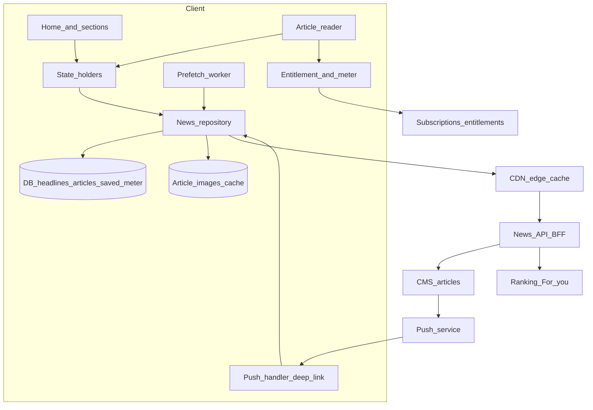
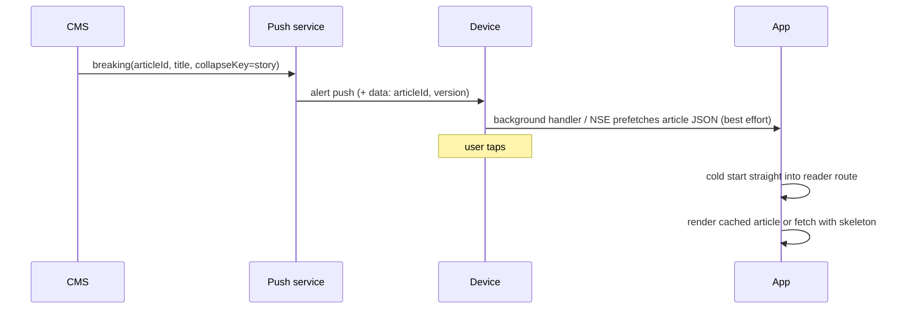

# 24 — Model Solution: News Reader

A news app (Google News, BBC, NYT, Inshorts) is read in short bursts — on the metro, in a lift, with one bar of signal. The strong answer is about **instant headlines from cache, article bodies that render natively and work offline, smart prefetch within a data budget, breaking-news push that opens fast from a cold start, and a paywall/subscription check that doesn't break offline reading**.

## Timed outline (45–60 min)

| Min | Focus |
|-----|--------|
| 0–6 | Scope: sections/topics, headlines, article reader, save for later, breaking news push; defer comments |
| 6–12 | NFRs, client architecture, backend in brief (CMS, ranking, edge cache) |
| 12–22 | API + data model: headline lists, article as structured blocks, ETags |
| 22–34 | List loading, article rendering choices, prefetch policy |
| 34–44 | Offline reading and storage, push breaking news, paywall/metering |
| 44–55 | Failures, accessibility, platform implementation, trade-offs, metrics |

## Clarify and scope

**Prompt:** "Design a news reader app."

| Question | Assumed answer → design impact |
|----------|--------------------------------|
| Content source? | Own CMS (or aggregated publishers) → we control the article format |
| Personalization? | "For you" ranked server-side + fixed sections (World, Business, Sport) |
| Offline? | Yes: recently opened, saved articles, and a morning prefetch |
| Media? | Hero images, galleries, embedded video, live blogs |
| Monetization? | Subscriptions with a metered paywall (N free articles/month) |
| Locales? | Multiple languages and editions → localization and RTL |

**MVP:** home ("Top stories" + "For you") and sections with cached first paint; article reader rendering structured content natively; save for later; offline reading for opened/saved/prefetched articles; breaking-news push with deep link; reader settings (text size, dark mode); paywall check with metering.

**Defer:** comments, audio articles/podcasts (Ch 66 P1), live-blog realtime internals (mention), publisher-side tools.

## NFRs

| NFR | Target / rule |
|-----|---------------|
| Headlines | Cached list < 500 ms after launch; fresh list < 1.5 s on 4G |
| Article open | < 300 ms if prefetched; < 1.5 s otherwise; text before images |
| Offline | Opened and saved articles always readable offline (with images if saved) |
| Data | Morning prefetch on Wi-Fi; cellular budget for prefetch (e.g. 10 MB/day) |
| Storage | Article cache capped (e.g. 200 MB), saved articles excluded from eviction |
| Push | Breaking news delivered within seconds; tap → article visible < 2 s from cold start |
| Accessibility | Dynamic Type / font scaling; screen-reader friendly article structure |

## Architecture



### Backend in brief

| Piece | What to say |
|-------|-------------|
| CMS | Editors publish articles as **structured content** (blocks), versioned; updates (corrections, live blogs) bump the version |
| Edge cache | Section lists and articles cached at the CDN for seconds–minutes (`Cache-Control`, `ETag`); personalized lists bypass or vary by user |
| Ranking | "For you" assembled per user from candidates + signals; returns article ids with summaries |
| Entitlements | Subscription status and metering counters; signed entitlement token cached by the client |
| Push | Editorial "breaking" sends to topic subscribers, collapsed per story |

## API contract

| Endpoint | Purpose |
|----------|---------|
| `GET /v1/sections/{id}/headlines?cursor=` | Section list (edge cached) |
| `GET /v1/foryou?cursor=` | Personalized list |
| `GET /v1/articles/{id}` (+ `If-None-Match`) | Article as structured blocks |
| `POST /v1/articles/batch {ids[]}` | Prefetch several articles in one request |
| `GET /v1/entitlement` | Subscription + meter state, signed token with expiry |
| `PUT /v1/saved/{articleId}` / `DELETE` | Save for later (synced across devices) |

```text
GET /v1/articles/a_771
→ 200   ETag: "v14"   Cache-Control: max-age=60
{ "id": "a_771", "version": 14, "section": "business", "headline": "…", "standfirst": "…",
  "byline": [ "Priya Shah" ], "publishedAt": "…", "updatedAt": "…", "access": "metered",
  "hero": { "image": { "url": "https://cdn/…/{w}.webp", "w": 1600, "h": 900, "caption": "…", "credit": "…" } },
  "blocks": [
    { "type": "paragraph", "text": "…", "marks": [ { "type": "link", "start": 10, "end": 24, "href": "app://article/a_700" } ] },
    { "type": "heading", "level": 2, "text": "What happens next" },
    { "type": "image", "url": "…/{w}.webp", "w": 1200, "h": 800, "caption": "…" },
    { "type": "quote", "text": "…", "attribution": "…" },
    { "type": "embed", "provider": "video", "videoId": "v_9", "poster": "…" },
    { "type": "unknown_future_type", "fallbackHtml": "<p>…</p>" } ] }
```

## Data model

```text
Headline:     id, sectionId, title, summary, thumbUrl, publishedAt, position, listVersion
ArticleCache: id, version, etag, json(blob), fetchedAt, lastOpenedAt, sizeBytes, source(opened|prefetch|saved)
SavedArticle: id, savedAt, imagesDownloaded(bool), syncState
ReadState:    id, readAt, scrollPercent
Entitlement:  status(subscriber|metered|anonymous), freeRemaining, token, expiresAt
Settings:     textScale, theme, edition, topicsFollowed[]
```

## List loading

1. Show cached headlines for the section immediately (with "Updated 5 min ago" if stale).
2. Refresh in parallel with `If-None-Match`; replace the list when it changes (keep scroll position by article id).
3. Cursor pagination for long sections; "For you" is a separate list with its own cache.
4. Mark read articles (dimmed) from `ReadState`.

## Article rendering

| Option | Pros | Cons |
|--------|------|------|
| **Native renderer for structured blocks** (default) | Fast, accessible, consistent typography, offline-friendly, text scaling | Must build block components; new block types need a fallback |
| WebView with templated HTML | Quick to ship, publishers' HTML works | Slower, memory-heavy, weaker accessibility and theming, JS security risks |
| Hybrid | Native for common blocks, WebView only for embeds/unknown blocks | Two rendering paths |

**Interview default:** native blocks, with `fallbackHtml` for unknown block types rendered in a sandboxed lightweight view, and embeds (video, social) loaded on demand.

- Render **text first**; images load progressively at the right width.
- Internal links (`app://article/…`) open in the app; external links in an in-app browser tab.
- Remember scroll position per article.

## Prefetch policy

| Trigger | What | Constraint |
|---------|------|------------|
| Morning (or the user's usual reading time) | Top N stories + followed topics: article JSON + hero images | Wi-Fi + charging preferred; background task (Android WorkManager; iOS `BGAppRefreshTask`, best effort) |
| Home screen visible | Bodies of the first 5–10 headlines | Batch endpoint; cellular budget |
| Article open | Related articles' bodies | Low priority, cancel on exit |
| Push received | The breaking article's body | So the tap opens instantly |

Track a **daily cellular budget**; disable prefetch in data-saver mode.

## Offline reading and storage

- Cache every opened article (JSON + images already loaded).
- **Save for later** pins the article and downloads all its images; synced across devices.
- LRU eviction by `lastOpenedAt` when over the cap; pinned articles never evicted automatically.
- Offline UI: a "Downloaded" section lists everything readable offline.

## Breaking news push



- **Topic subscriptions** (breaking, sport, local edition); per-topic opt-in screen.
- **Collapse/replace** per story so updates don't stack notifications.
- Deep link routes directly to the reader, skipping the home screen work (lazy-load home in the background).
- iOS: Notification Service Extension can attach the hero image; Android builds a rich notification from the data payload.

## Paywall and metering

- Entitlement fetched on launch and cached as a **signed token** with expiry (so offline reading of saved articles still works for subscribers).
- Metered access: the server counts article opens (the client calls `open` when online); offline opens are counted when the device reconnects.
- Prefetched paywalled articles are stored but only displayed if the entitlement allows; show a teaser otherwise.
- Purchases go through StoreKit / Play Billing; the server validates receipts and updates entitlements.

## Offline

| Situation | Behaviour |
|-----------|-----------|
| Launch offline | Cached headlines + "Offline — showing saved stories" |
| Open uncached article | Headline + summary + "Available when you're online"; option to save for later |
| Saved article offline | Full article with images |
| Subscription expired while offline | Grace period until the token expires, then teaser |

## Failures

| Failure | Handling |
|---------|----------|
| Article fetch fails, cached copy exists | Show cached version with "Updated version available" when back online |
| Article corrected/updated | ETag/version change → refresh silently if not open; banner if open |
| Unknown block type | Render `fallbackHtml` or skip with a note; log the type |
| Push for a deleted/unpublished article | Friendly "This story is no longer available" + related stories |
| Prefetch exceeds budget | Stop and resume tomorrow |
| Storage full | Evict unpinned articles; warn before saving more |

## Security & privacy

- HTTPS only; sanitize any HTML fallback; no JavaScript bridges to native code from article content.
- Clearly label sponsored content.
- Reading history is personal data: local by default, synced only when signed in; clearable.
- Entitlement tokens signed and short-lived; validate purchases server-side.

## Accessibility and localization

- Native blocks map to headings/paragraphs/images with alt text (captions) for screen readers.
- Text scales with system settings and in-app text size; layout reflows.
- Editions in several languages, RTL for Arabic/Urdu editions (Ch 16).

## Platform implementation

Cross-platform map: [Ch 05](../part-2-building-blocks/05-platforms-android-ios-flutter-react-native.md).

### Android: Views (XML) and Compose

Full toolkit comparison: [Android UI toolkits](../part-2-building-blocks/04-client-architecture.md#android-ui-toolkits-views-xml-and-compose).

| Concern | Views (XML) | Compose |
|---------|-------------|---------|
| Headline list | `RecyclerView` + `PagingDataAdapter`; `ConcatAdapter` for sections | `LazyColumn` + `collectAsLazyPagingItems()`; `stickyHeader` for sections; `key = article.id` |
| Article body (HTML) | `WebView`, or `TextView` with `Html.fromHtml` spans | `AndroidView` wrapping `WebView`, or `AnnotatedString.fromHtml` for simple markup |
| Swipe between articles | `ViewPager2` + `FragmentStateAdapter` | `HorizontalPager` (foundation) |
| Reader settings (font size, theme) | `TextAppearance` styles; often `recreate()` | Typography from user setting in `MaterialTheme` — recomposes instantly |
| Offline badge / bookmark | DiffUtil payload | Row reads flag from immutable item |

**Mixed codebase:** the `WebView` article body stays a View in both worlds; migrate the list and pager around it.

### iOS, Flutter and React Native

| Concern | iOS (UIKit / SwiftUI) | Flutter | React Native |
|---------|-----------------------|---------|--------------|
| Headline list | Diffable data source / `List` | `ListView.builder` | `FlashList` |
| Article body (HTML) | Native rendering from structured blocks preferred; `WKWebView` with injected CSS if HTML | Block renderer or `flutter_html` / `webview_flutter` | Block renderer or `react-native-webview` |
| Swipe between articles | `UIPageViewController` / `TabView(.page)` | `PageView.builder` | `react-native-pager-view` |
| Reader settings | Dynamic Type + custom scale; persist in `UserDefaults` | `MediaQuery.textScaler` + stored preference | `allowFontScaling` + stored preference |
| Offline / bookmark | Background prefetch via `BGAppRefreshTask`; articles in DB | `workmanager` prefetch | `expo-background-task` prefetch |
| Breaking news push | APNs alert; NSE adds thumbnail | `firebase_messaging` + native NSE | RN Firebase messaging + native NSE |

## Trade-offs

| Decision | Alternative | Why pick |
|----------|-------------|----------|
| Structured blocks + native renderer | WebView HTML | Speed, accessibility, offline, theming |
| Edge-cached section lists | Fully personalized everything | Cheap, fast, resilient during traffic spikes |
| Budgeted prefetch | Prefetch everything / nothing | Instant reads without surprise data bills |
| Pin "saved" articles | LRU only | User trust: saved means saved |
| Signed entitlement token | Online check per article | Offline reading for subscribers |

## Metrics

| Metric | Why |
|--------|-----|
| Time to headlines (cached / fresh) | Launch quality |
| Article open time; % opens served from cache | Reading experience; prefetch effectiveness |
| Prefetch waste (prefetched but never opened) | Data efficiency |
| Push open rate; push → article visible time | Breaking news value |
| Offline opens; save-for-later usage | Offline value |
| Paywall conversion; meter exhaustion | Business |

## Staff stretch

- **Live blogs:** append-only updates via SSE while open; push for key events.
- **On-device personalization** of order within server candidates for privacy.
- **Remote config** for prefetch sizes and budgets by region/network.
- **Traffic spikes:** serve cached lists from the edge with longer TTLs automatically during breaking events.

## Follow-ups

- A correction is published to an article that a user saved offline. What happens?
- How do you make a breaking-news tap open the article in under two seconds from a cold start?
- Why native rendering instead of a WebView, and when would you choose the WebView?
- How do metered paywalls work when the user reads offline?
- How much do you prefetch on cellular, and how do you decide?

## See also

- [Ch 18 — Social feed](18-social-feed.md)
- [Ch 10 — Realtime and push](../part-2-building-blocks/10-realtime-and-push.md)
- [Ch 07 — Caching and storage](../part-2-building-blocks/07-caching-and-storage.md)
- [Ch 16 — Accessibility and localization](../part-2-building-blocks/16-accessibility-and-localization.md)
