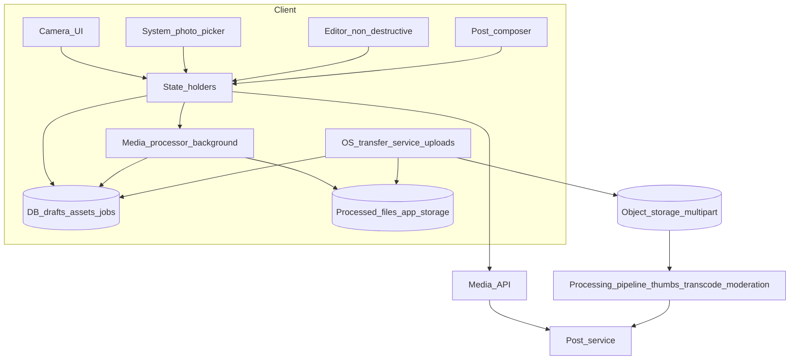
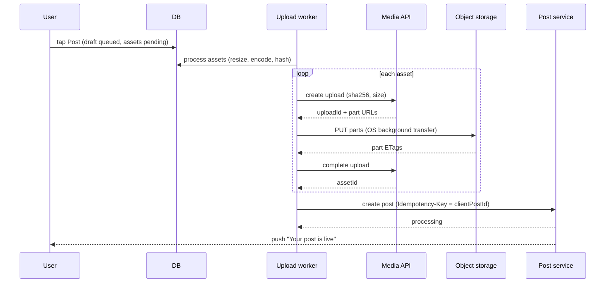

# 25 — Model Solution: Photo Capture and Upload

Posting photos and short videos is where mobile constraints bite hardest: the camera pipeline, memory for big images, slow uplinks, and the OS suspending the app mid-upload. The strong answer is a **durable media pipeline**: capture or pick → process off the main thread → persist a job → upload directly to storage with resumable multipart transfers on the OS transfer service → commit the post only when every asset is uploaded.

## Timed outline (45–60 min)

| Min | Focus |
|-----|--------|
| 0–6 | Scope: capture or pick up to 10 photos/short videos, light edits, caption, post; progress and retry |
| 6–12 | NFRs, client architecture, backend in brief (pre-signed uploads, processing pipeline) |
| 12–22 | API + data model: post draft, assets, upload jobs, states |
| 22–34 | Capture/pick, processing (resize, encode, EXIF), video compression |
| 34–44 | Resumable upload on OS transfer services, commit, post-processing status |
| 44–55 | Failures, privacy, platform implementation, trade-offs, metrics |

## Clarify and scope

**Prompt:** "Design photo capture and upload for a social app (or a cloud photo backup feature)."

| Question | Assumed answer → design impact |
|----------|--------------------------------|
| Social post or backup? | Social post with up to 10 items; backup (Google Photos-style) as a stretch → different scheduling and dedupe |
| Video? | Short videos up to 60 s → transcoding on device, larger uploads |
| Quality? | Upload a high-quality variant (e.g. 2048 px long edge, HEIC/JPEG), not raw originals |
| Network? | Many users on slow/expensive mobile data → resumable uploads, Wi-Fi-only option for videos |
| Edits? | Crop, rotate, filters; non-destructive |
| Privacy? | Strip location metadata by default; limited photo library access |

**MVP:** in-app camera and system photo picker; multi-select up to 10; crop/rotate/filters; caption; post appears instantly in the profile/feed as "Posting…"; uploads continue in background and after app restart; per-item progress, retry and cancel; server processing status ("Processing video…"); final post visible to others only when complete.

**Defer:** cloud backup of the whole library (stretch), advanced editing, live photos, collaborative albums.

## NFRs

| NFR | Target / rule |
|-----|---------------|
| Durability | Once the user taps Post, the post completes even if the app is killed or the device goes offline for hours |
| Responsiveness | Camera opens < 1 s; capture never blocked by uploads; no image work on the main thread |
| Data | Photos ~0.5–2 MB each after processing; videos compressed (e.g. 720p/1080p H.264/HEVC) |
| Reliability | Resumable from the last uploaded part; retries with backoff; no duplicate posts |
| Battery | Big video uploads on Wi-Fi or with user consent; OS transfer services instead of app loops |
| Privacy | Location metadata stripped unless the user adds a location; access only to selected photos |
| Storage | Temporary processed files deleted after success; originals untouched in the user's library |

## Architecture



### Backend in brief

| Piece | What to say |
|-------|-------------|
| Media API | Creates upload sessions and returns **pre-signed multipart URLs**; the API never proxies bytes |
| Object storage | Receives parts directly (S3/GCS multipart); assembles on complete |
| Processing pipeline | Event on upload complete → thumbnails, renditions, video transcoding to HLS, moderation, EXIF scrub |
| Post service | Creates the post from asset ids; publishes when all assets are processed (or publishes with placeholders) |

## API contract

| Endpoint | Purpose |
|----------|---------|
| `POST /v1/uploads {assetClientId, mime, bytes, sha256}` | Start an upload → `uploadId`, part size, pre-signed part URLs (or a URL template) |
| `GET /v1/uploads/{uploadId}` | Which parts the server has (resume) |
| `POST /v1/uploads/{uploadId}/complete {parts[{n, etag}]}` | Finish → `assetId` |
| `POST /v1/posts {clientPostId, caption, assetIds[], location?}` + `Idempotency-Key` | Create post from uploaded assets |
| `GET /v1/posts/{id}` | Status: `processing` / `published` / `failed(reason)` |

```text
POST /v1/uploads
{ "assetClientId": "as_01HJ…", "mime": "video/mp4", "bytes": 48203112, "sha256": "9f2c…" }
→ 201 { "uploadId": "up_77", "partSize": 8388608, "parts": 6,
        "partUrls": [ "https://store/…?partNumber=1&sig=…", … ], "expiresAt": "…" }

POST /v1/posts        Idempotency-Key: post_01HJ…
{ "clientPostId": "post_01HJ…", "caption": "Sunset 🌅", "assetIds": [ "a_1", "a_2" ] }
→ 202 { "postId": "p_900", "status": "processing" }
```

- **SHA-256** lets the server dedupe identical uploads and verify integrity.
- Pre-signed URLs expire; the client asks for fresh ones when resuming after a long time.

## Data model

```text
PostDraft:   clientPostId, caption, location?, state(draft|queued|uploading|committing|processing|published|failed),
             postId?, createdAt
Asset:       assetClientId, clientPostId, index, sourceRef(picker URI / camera file), edits(JSON: crop, rotate, filter),
             processedPath?, mime, bytes?, sha256?, width, height, durationMs?, state(pending|processing|ready|uploading|uploaded|failed), assetId?
UploadJob:   assetClientId, uploadId?, partSize, partsDone[], osTaskId?, attempts, lastError, urlsExpireAt
```

**States in one place:** the composer and the "Posting…" card both observe `PostDraft` + `Asset` rows, so the UI is right after process death.

## Capture and pick

- **System photo picker** (Android Photo Picker, iOS `PHPickerViewController`) needs no full library permission and supports multi-select — prefer it.
- **In-app camera:** CameraX / AVFoundation session on a background queue; capture to a file in app storage (not in memory).
- Copy or reference the picked items immediately: picker URIs may be temporary, so copy into app storage when the user taps Post (or stream-read with persisted access where supported).
- Generate thumbnails for the composer from the system (not by decoding full images on the main thread).

## Processing

| Step | Photos | Videos |
|------|--------|--------|
| Decode | Downsampled decode to the target size (never full 48 MP into memory) | — |
| Edits | Apply crop/rotate/filter on the GPU or a background thread; keep edits as parameters for re-editing | Trim range, crop |
| Encode | HEIC/JPEG (or WebP) at quality ~0.8, long edge 2048 px | H.264/HEVC 720p/1080p, ~4–6 Mbps, AAC audio; hardware encoder |
| Metadata | Strip GPS/EXIF except orientation (or apply orientation and strip all) | Strip location metadata |
| Hash | SHA-256 of the processed file | Same |

- Process at most 1–2 items in parallel (memory and thermals).
- Video compression can take time: run it in a foreground-capable job (Android WorkManager with foreground service type `dataSync`/`mediaProcessing` where applicable; iOS background task or continue while the app is visible) and show progress.

## Upload pipeline



- **OS transfer services** keep uploads going while the app is suspended: Android WorkManager (with constraints and `setForeground` for long user-initiated uploads, or user-initiated data transfer jobs on Android 14+); iOS background `URLSession` upload tasks from files (each part as a task).
- **Resumable:** record finished parts; on restart ask `GET /uploads/{id}` and upload only the missing parts.
- **Part size** 5–8 MB on good networks, smaller on poor networks; 2–3 parts in parallel at most.
- **Commit only when all assets are uploaded:** `POST /posts` with an idempotency key, so a retry after a lost response doesn't create two posts.
- **Status after commit:** server processing (thumbnails, transcoding, moderation) → push or poll until `published`.

## Network policy

- Photos upload on any network; videos ask once ("Upload videos on mobile data?") with a remembered setting.
- Pause on metered networks when data saver is on; resume automatically on Wi-Fi.
- Backoff with jitter on failures; give up after N hours with a visible "Couldn't post — Retry" state (never silently).

## Backup mode (stretch)

- Continuous library backup: observe the photo library for new items (MediaStore / PhotoKit change observer), upload originals or high-quality variants on Wi-Fi + charging, dedupe by content hash on the server.
- iOS: `BGProcessingTask` with power/network requirements plus background `URLSession`; Android: periodic WorkManager with constraints.
- Show backup status and storage quota; never delete local originals automatically without explicit user choice.

## Offline

| Situation | Behaviour |
|-----------|-----------|
| Post while offline | Draft queued; "Will post when you're online"; processing runs offline |
| Connectivity flaps mid-upload | Parts resume; no restart from zero |
| App killed / device rebooted | Jobs re-scheduled from DB; OS transfers re-attached (iOS session identifier) |

## Failures

| Failure | Handling |
|---------|----------|
| Kill during processing | Restart processing for that asset from the source file |
| Kill during upload | Resume missing parts; re-sign URLs if expired |
| Commit response lost | Retry with the same idempotency key → same post |
| Picker source deleted before processing | Mark asset failed with a clear message; allow removing it |
| Out of storage | Fail early before processing; ask the user to free space |
| Video too long / unsupported codec | Validate at selection; transcode or reject with a reason |
| Server processing/moderation rejects | Post `failed(reason)`; keep draft for editing |
| Token expired during long upload | Pre-signed URLs don't need the auth token; refresh before API calls |

## Privacy and security

- Photo picker instead of full library access; ask camera/microphone permission at the moment of use with a reason.
- Strip location by default; show "Location removed" or let the user add a place explicitly.
- Processed temp files in app-private storage, deleted after success; excluded from backups.
- Pre-signed URLs scoped to one object and short-lived; uploads are private until the post is published.
- Sensitive apps (KYC, Ch 42): encrypt files at rest and delete immediately after upload confirmation.

## Platform implementation

Cross-platform map: [Ch 05](../part-2-building-blocks/05-platforms-android-ios-flutter-react-native.md).

### Android: Views (XML) and Compose

Full toolkit comparison: [Android UI toolkits](../part-2-building-blocks/04-client-architecture.md#android-ui-toolkits-views-xml-and-compose).

| Concern | Views (XML) | Compose |
|---------|-------------|---------|
| Camera preview | CameraX `androidx.camera.view.PreviewView` in XML; `LifecycleCameraController` (`previewView.controller = controller`) or `ProcessCameraProvider.bindToLifecycle` | `AndroidView { PreviewView(it) }` with the same controller; or the newer `camera-compose` viewfinder composable |
| Lifecycle binding | Bind to `viewLifecycleOwner` | Bind to `LocalLifecycleOwner.current` in a `DisposableEffect`; `unbind()` on dispose |
| Gallery pick | Photo Picker: `registerForActivityResult(PickVisualMedia())` | `rememberLauncherForActivityResult(PickVisualMedia())` |
| Thumbnail grid | `GridLayoutManager` + Coil/Glide | `LazyVerticalGrid` + `AsyncImage`, `key = mediaId` |
| Upload queue progress | `ListAdapter` on outbox/WorkManager `Flow`; payload for progress | Same `Flow`; `LinearProgressIndicator(progress = { p })` per row |

=== "Views (XML)"

    ```kotlin
    // layout: <androidx.camera.view.PreviewView android:id="@+id/preview" ... />
    val controller = LifecycleCameraController(requireContext())
    controller.bindToLifecycle(viewLifecycleOwner)
    binding.preview.controller = controller
    ```

=== "Compose"

    ```kotlin
    @Composable
    fun CameraPreview(modifier: Modifier = Modifier) {
        val context = LocalContext.current
        val lifecycleOwner = LocalLifecycleOwner.current
        val controller = remember { LifecycleCameraController(context) }
        DisposableEffect(lifecycleOwner) {
            controller.bindToLifecycle(lifecycleOwner)
            onDispose { controller.unbind() }
        }
        AndroidView(factory = { PreviewView(it).apply { this.controller = controller } }, modifier = modifier)
    }
    ```

**Mixed codebase:** camera capture usually stays a `PreviewView` (via `AndroidView`) even in Compose apps; the upload queue screen is an easy Compose migration since it is pure state.

### iOS, Flutter and React Native

| Concern | iOS (UIKit / SwiftUI) | Flutter | React Native |
|---------|-----------------------|---------|--------------|
| Camera preview | AVFoundation `AVCaptureSession` + `AVCaptureVideoPreviewLayer` | `camera` plugin | `react-native-vision-camera` |
| Lifecycle binding | Start/stop the session on a background queue in `viewWillAppear` / `viewDidDisappear` | Dispose / reinit the controller on `AppLifecycleState` changes | `isActive` prop tied to focus + `AppState` |
| Gallery pick | `PHPickerViewController` / `PhotosPicker` (no library permission needed) | `image_picker` (uses the system pickers) | `expo-image-picker` |
| Thumbnail grid | `PHCachingImageManager` for asset thumbnails | `photo_manager` thumbnails | `expo-media-library` + `expo-image` |
| Upload queue | Background `URLSession` upload from a file (survives suspension) | `background_downloader` (native transfer APIs) | Native module / `expo-file-system` background upload task |
| Compression | `UIImage.jpegData` / HEIC via ImageIO; downscale first | `flutter_image_compress` (native) in an isolate | `expo-image-manipulator` (native) |

Notes: only the **native transfer services** keep an upload alive after the app is suspended. A Dart or JS loop uploading chunks stops when the OS suspends the app.

## Trade-offs

| Decision | Alternative | Why pick |
|----------|-------------|----------|
| Direct-to-storage multipart (pre-signed) | Upload through the API server | Scales, resumable, cheaper |
| Process on device | Upload raw originals and process on the server | Less data and faster uploads on mobile networks |
| OS transfer services | App-managed upload loop | Survives suspension and kills |
| Commit post after all assets | Create post first, attach later | Followers never see half-finished posts |
| Strip location by default | Keep EXIF | Privacy by default |

## Metrics

| Metric | Why |
|--------|-----|
| Post success rate; time from tap to published (p50/p95) | Core reliability and speed |
| Upload resume rate; bytes re-sent | Resumability effectiveness |
| Processing time per photo/video on device | Pipeline efficiency, thermals |
| Failure reasons (network, storage, moderation) | Where to invest |
| Duplicate post rate (should be 0) | Idempotency |
| Cellular bytes for video uploads | Data cost |

## Staff stretch

- **Full library backup** with content-hash dedupe and quota management.
- **Adaptive quality** by network and device (upload smaller first, upgrade later on Wi-Fi).
- **On-device moderation/blur** hints before upload for sensitive content.
- **Upload SDK** shared by chat, posts, support tickets (Ch 66 P12).

## Follow-ups

- The user posts 10 photos and closes the app immediately. Walk through what happens on Android and iOS.
- How do you avoid uploading the same 50 MB video twice after a crash?
- Why upload directly to storage instead of through your API?
- What do followers see while the video is still being transcoded?
- How would continuous photo backup differ from posting?

## See also

- [Ch 09 — Media: images and video](../part-2-building-blocks/09-media-images-video.md)
- [Ch 36 — File downloader library](../part-4-libraries-and-sdks/36-file-downloader-library.md)
- [Ch 17 — Backend for mobile](../part-2-building-blocks/17-backend-for-mobile.md)
- [Ch 42 — KYC onboarding](../part-5-fintech/42-kyc-onboarding.md)
