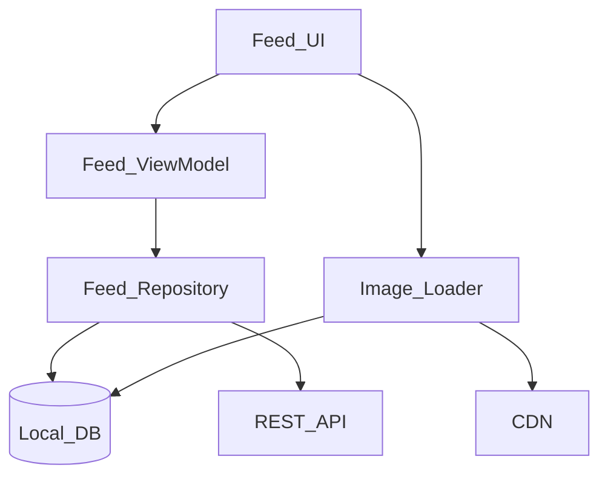
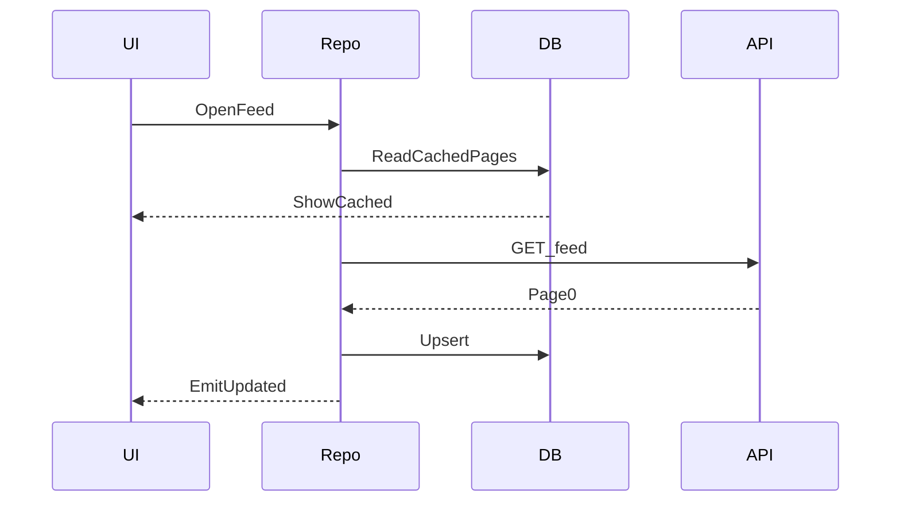

# 13 — Model Solution: Social Feed

## Timed outline (45–60 min)

| Min | Focus |
|-----|--------|
| 0–6 | Clarify MVP: home feed, media, like; defer stories/DMs |
| 6–10 | NFRs: cached first paint, scroll jank, cellular data |
| 10–20 | Architecture + data model + APIs |
| 20–40 | Deep dives: pagination, image pipeline, optimistic like |
| 40–50 | Offline, failures, perf budgets |
| 50–55 | Trade-offs + metrics |

## Clarify and scope

**MVP:** reverse-chronological or ranked home feed of posts (text + images), infinite scroll, pull-to-refresh, like with optimistic UI.

**Out of scope (say so):** Stories, Reels-level video, creator analytics, ads auction internals.

**Assumptions:** Auth exists; CDN for media; cursor pagination available.

## NFRs

- Warm cache: meaningful content < 1s
- Scroll: minimize hitch from decode/bind
- Offline: show last cached pages; queue likes
- Disk media cache budget ~300 MB

## High-level architecture



## Data model (client)

```text
Post: id, authorId, text, media[], likeCount, likedByMe, createdAt, cursor
Media: id, type, url, width, height, blurHash?
FeedPage: posts[], nextCursor, fetchedAt
OutboxLike: postId, targetLiked, clientOpId, status
```

## API (contracts)

- `GET /feed?cursor=&limit=20` → `{ items, nextCursor }`
- `POST /posts/{id}/likes` with `Idempotency-Key`
- `DELETE /posts/{id}/likes` similarly

## Feed loading strategy

1. On open: render DB cache immediately.
2. Parallel network refresh of first page; reconcile.
3. On scroll near end: fetch `nextCursor`; append; persist.
4. Prefetch next page when within last 5 items.
5. Pull-to-refresh resets to head cursor; keep old cache until success.

Prefer **cursor** over offset to avoid duplicates when new posts insert.



## UI implementation notes

- Virtualized list; stable keys = post id
- ViewModel holds `items`, `loading`, `error`, `endReached`
- Diff updates to avoid full rebind
- Video autoplay (if in MVP): one active player; pause offscreen

## Image loading strategy

- Request URL variant matching view width
- Memory LRU + disk cache; key = url + size
- Decode off main; cancel on recycle
- Prefetch next ~8 images in scroll direction; throttle on cellular
- Placeholder: blurHash or gray box

## Optimistic likes

1. Toggle `likedByMe` / `likeCount` locally in same TX as outbox row.
2. Sync worker posts with idempotency key.
3. On 409/conflict: apply server truth.
4. On hard failure: revert + toast; keep retry for transient errors.

## Performance optimizations

- Cap concurrent image downloads (4–6)
- Pause prefetch while flinging if needed
- Paginate DB reads; don’t load entire feed table into memory
- JSON parse off main

## Offline and failures

| Case | Behavior |
|------|----------|
| Offline open | Cached feed + banner |
| Offline like | Outbox; synced later |
| Process kill mid-like | Outbox survives |
| Token expired mid-fetch | Single-flight refresh; retry |
| Partial page failure | Keep prior list; error snackbar |

## Android UI: Views (XML) and Compose

Full toolkit comparison: [Android UI toolkits](../part-2-building-blocks/04-client-architecture.md#android-ui-toolkits-views-xml-and-compose).

| Concern | Views (XML) | Compose |
|---------|-------------|---------|
| Paged list | `RecyclerView` + Paging 3 `PagingDataAdapter` (`DiffUtil.ItemCallback` on post id); `withLoadStateFooter` for spinner/retry | `LazyColumn` + `collectAsLazyPagingItems()`; `key = itemKey { it.id }`; `loadState.append` drives the footer |
| Mixed row types (post, ad, video) | `getItemViewType` + ViewHolder per type; `ConcatAdapter` for header | `contentType` per row so compositions are reused per type |
| Optimistic like | DiffUtil `getChangePayload` → rebind only the like button | Immutable item model; only the changed row recomposes |
| Scroll restore | `cachedIn(viewModelScope)` + adapter `stateRestorationPolicy` | `cachedIn(viewModelScope)` + `rememberLazyListState()` (saveable) |
| Video autoplay | Scroll listener + attach/detach callbacks pick the most-visible row | `snapshotFlow { listState.layoutInfo.visibleItemsInfo }` picks the active row |
| Pull to refresh | `SwipeRefreshLayout` → `adapter.refresh()` | Material 3 `PullToRefreshBox` → `items.refresh()` |

=== "Views (XML)"

    ```kotlin
    class FeedAdapter : PagingDataAdapter<Post, PostVH>(PostDiff) {  // PostDiff: DiffUtil.ItemCallback on id
        override fun onCreateViewHolder(parent: ViewGroup, viewType: Int) = PostVH.create(parent)
        override fun onBindViewHolder(holder: PostVH, position: Int) =
            holder.bind(getItem(position))                         // null = placeholder
    }

    viewLifecycleOwner.lifecycleScope.launch {
        viewLifecycleOwner.repeatOnLifecycle(Lifecycle.State.STARTED) {
            vm.posts.collectLatest(adapter::submitData)
        }
    }
    ```

=== "Compose"

    ```kotlin
    val posts = vm.posts.collectAsLazyPagingItems()
    LazyColumn {
        items(
            count = posts.itemCount,
            key = posts.itemKey { it.id },
            contentType = posts.itemContentType { "post" },
        ) { i -> posts[i]?.let { PostRow(it) } ?: PostPlaceholder() }
    }
    ```

**Mixed codebase:** the same `Flow<PagingData<Post>>` (with `cachedIn`) feeds both; migrate the feed screen whole — a `ComposeView` per RecyclerView row works but doubles the list machinery.

## Trade-offs

| Decision | Alternative | Why pick |
|----------|-------------|----------|
| Cursor pages | Offset | Stability under inserts |
| Local-first UI | Network-only | Perceived performance |
| Client like count | Server-only count | Snappy UX; reconcile |
| Ranked feed server-side | Client rank | Ranking needs global signals |

## Metrics

TTFD cached/uncached, scroll hitch rate, like sync failure, image cache hit rate, prefetch waste bytes.

## Staff stretch

- Feature flag for new image format
- Metrics: TTFD, scroll hitch, like sync failure, cache hit rate
- Soft purge of posts older than N days to bound DB

## Follow-ups to practice

- How do you dedupe boosted/ad posts?
- What if media is multi-image carousel?
- How does “seen” state affect ranking refresh?
