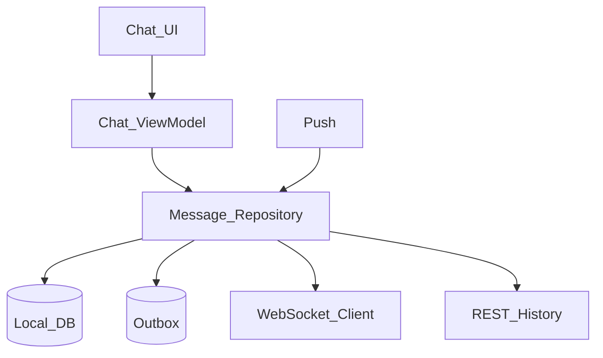
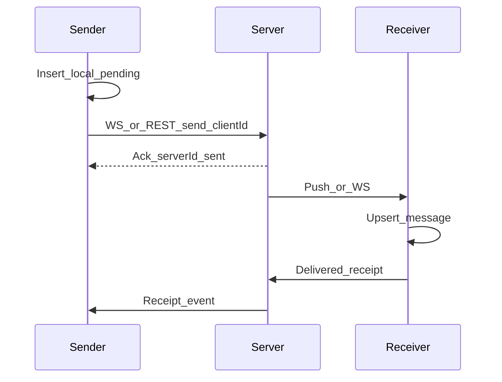

# 14 — Model Solution: Messaging / Chat

## Timed outline

| Min | Focus |
|-----|--------|
| 0–6 | MVP: 1:1 text, delivery states; defer groups/voice |
| 6–20 | Architecture, models, realtime choice |
| 20–40 | Send pipeline, ordering, receipts, offline |
| 40–55 | Push, failures, scale to groups if asked |

## Clarify and scope

**MVP:** 1:1 text chat, send/receive, delivered/read receipts, typing indicator, offline queue.

**Later:** groups, media, reactions, E2E encryption deep dive (mention only if asked).

## NFRs

- Online send: UI ack immediate; server ack within ~1–2s typical
- Ordering per conversation preserved
- Survives kill with outbox
- Push when backgrounded

## High-level architecture



## Data model

```text
Conversation: id, peerId, lastMessageAt, unreadCount
Message: id (server), clientId, conversationId, senderId, body,
         createdAt, status (pending|sent|delivered|read|failed), seq?
Outbox: clientId, payload, attempts, nextAttemptAt
```

Use `clientId` for idempotent create; map to server `id` on ack.

## Realtime communication

**Foreground:** authenticated WebSocket; events `message.new`, `receipt`, `typing`.

**Background:** APNs/FCM → open or silent sync → REST delta.

**Fallback:** if WS fails, poll conversation every N seconds with backoff.



## Message sending flow

1. Validate non-empty; create local message `pending` + outbox (one TX).
2. Append to UI list immediately.
3. Sender tries WS; if disconnected, REST POST.
4. On ack: status `sent`, store server id.
5. Receipts advance `delivered` / `read`.
6. Failures: exponential retry; mark `failed` after cap; user retry.

## Delivery status

| Status | Meaning |
|--------|---------|
| pending | Local only / in flight |
| sent | Server accepted |
| delivered | Peer device ack |
| read | Peer opened conversation (policy-dependent) |
| failed | Exhausted retries |

## Typing indicators

- Local show immediately for self (optional)
- Send throttled `typing` events
- Receiver auto-clears after ~3s without refresh
- Never durable

## Offline support and sync

- History: REST pages by cursor `before=messageId`
- Gap detection: if WS seq jumps, fetch gap range
- On foreground: sync receipts + missed messages since `lastEventId`

## UI implementation

- Inverted list or anchor to bottom
- Pagination upward for history
- Group consecutive messages by sender/time for rendering
- Don’t block input on network

## Group chat stretch (if asked)

- Fan-in on client still per-conversation socket events
- Unread counters per conversation
- Mentions as message annotations
- Ordering still per conversation seq

## Trade-offs

| Decision | Alternative | Why |
|----------|-------------|-----|
| WS + push hybrid | Poll only | Latency vs battery |
| Client IDs | Server IDs only | Offline + retries |
| Per-conversation ordering | Global clock | Avoid skew issues |
| Soft receipts | No receipts | Product call |

## Failures

- Duplicate delivery: upsert by `clientId`/`serverId`
- Clock skew: prefer server timestamp for display ordering after ack
- Push delayed: reconcile on open
- Token refresh mid-WS: reconnect with new token

## Metrics

Send success rate, outbox age p95, WS connect success, push→open latency, duplicate rate.

## Staff stretch

- E2E encryption key custody at high level
- Per-conversation backpressure when outbox grows
- Feature-flag WS vs poll fallback; alert on outbox age

## Follow-ups

- E2E encryption key management sketch
- Media messages with upload + thumbnail
- Moderation / report flow
