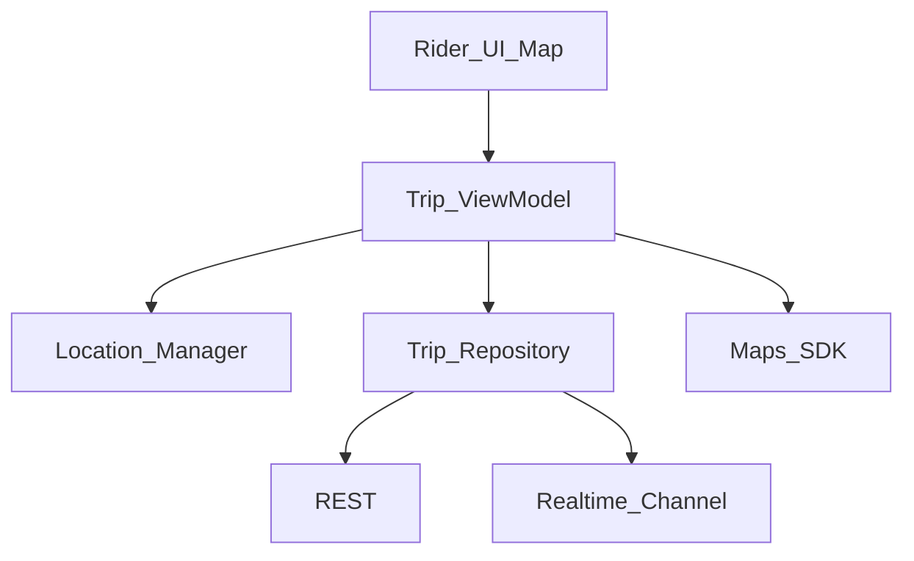
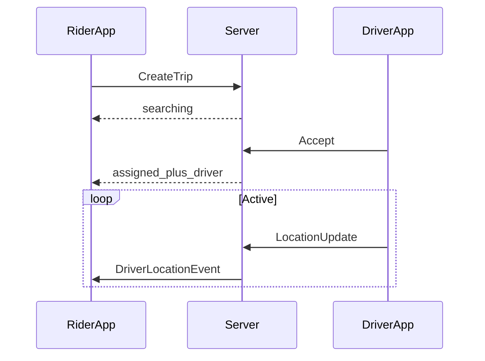

# 15 — Model Solution: Ride Hailing

## Timed outline

| Min | Focus |
|-----|--------|
| 0–7 | Rider MVP: request ride, track driver, status |
| 7–18 | Architecture, location strategy |
| 18–40 | Matching UX, realtime map, battery |
| 40–55 | Failures, offline degraded mode, security |

## Clarify and scope

**MVP (rider):** set pickup/dropoff, request ride, see driver ETA/location during trip, trip status lifecycle.

**Out of scope:** driver app deep design, pricing surge algorithms, multi-stop.

## NFRs

- Location accuracy vs battery trade-off explicit
- Realtime driver updates while trip active (~1–3s cadence negotiated)
- Works under spotty network with status reconciliation
- Privacy: location only when needed

## High-level architecture



## Data model

```text
Place: lat, lng, address, providerPlaceId?
Trip: id, status, pickup, dropoff, driver?, etaSeconds, polyline?
DriverLocation: lat, lng, heading, updatedAt
TripStatus: idle|searching|assigned|arriving|in_progress|completed|cancelled
```

## Location services

| Phase | Accuracy | Cadence |
|-------|----------|---------|
| Idle browsing | Low / none | — |
| Setting pickup | Fine while screen on | On movement |
| Searching / active trip | Fine | Adaptive 2–10s |
| Background trip (if allowed) | OS significant changes + periodic | Policy-compliant |

`Android:` fused location + foreground service when tracking in background. `iOS:` appropriate `CLLocationManager` mode; background modes only with clear UX.

Always explain permission denial path: manual address entry.

## Realtime driver tracking

- Subscribe to trip channel on assign
- Receive throttled location events; interpolate on map for smoothness
- If WS gaps: REST `GET /trips/{id}` snapshot
- Snap driver marker to route polyline cautiously (don’t teleport)



## Map integration

- Maps SDK for tiles, camera, markers, route polyline
- Camera modes: follow pickup, follow driver, overview
- Offline maps: usually not MVP; degrade to list status if map fails

## Ride request flow

1. Geocode / autocomplete pickup & dropoff (debounced).
2. Preview route + fare quote (REST).
3. Confirm → create trip idempotently.
4. Show searching animation; timeout → cancel/retry policy.
5. On assign → track; status transitions drive UI.
6. Complete → receipt screen; stop location.

## Address search with autocomplete

- Debounce 200–300ms
- Cancel in-flight on new keystroke
- Cache recent destinations locally
- Rate-limit; show “network unavailable” with recent history

## Battery and privacy

- Stop fine location when trip ends
- Clear trip channel subscription
- Minimize location in logs
- Disclose why tracking is on during trip

## Offline / failures

| Case | Behavior |
|------|----------|
| Request fails uncertain | Idempotent create; poll trip by client request id |
| WS drop mid-trip | Reconnect + REST snapshot |
| GPS weak | Expand uncertainty circle; allow manual pin |
| App killed mid-trip | Persist active `tripId`; restore tracking on launch |
| Payment failure | Status from server; block restart cleanly |

## Trade-offs

| Decision | Alternative | Why |
|----------|-------------|-----|
| WS for driver loc | Poll 5s | Smoother UX during trip |
| Fine GPS only when active | Always fine | Battery + privacy |
| Server route polyline | Client-only Directions | Consistency with driver |

## Metrics

Trip request success, time-to-assign, location permission funnel, WS uptime during trips, battery attribution (qualitative), crash during active trip.

## Staff stretch

- Payment at trip end: treat as Ch 21 rail (never trust client “paid”)
- Privacy modes for location sharing with ETA only
- Kill switch for live tracking if battery/OS policy regresses

## Follow-ups

- Driver app online/offline + batching
- Carpool matching UI
- Safety sharing live location with contact
