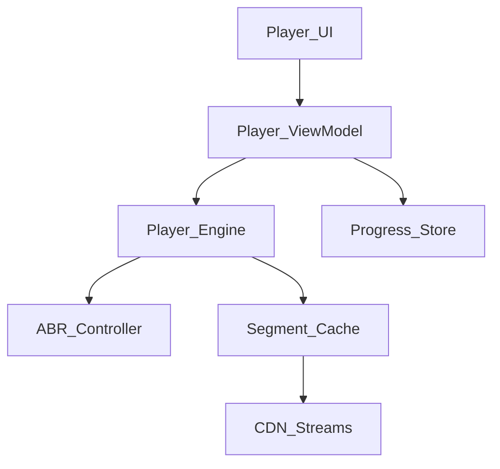
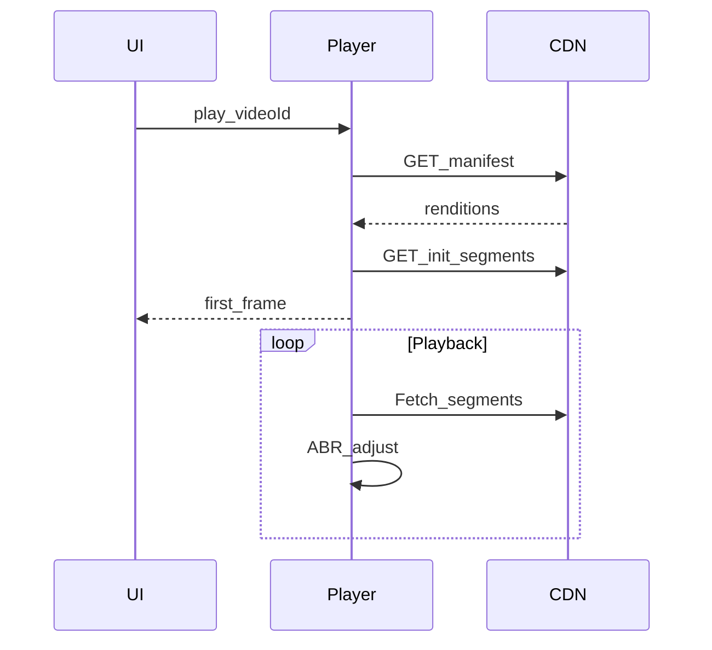

# 16 — Model Solution: Video Player

## Timed outline

| Min | Focus |
|-----|--------|
| 0–6 | MVP: play stream, seek, basic controls |
| 6–18 | Architecture, startup path |
| 18–40 | ABR, buffering, lifecycle, downloads optional |
| 40–55 | Offline, background audio, failures |

## Clarify and scope

**MVP:** play HLS/DASH (or progressive) video, play/pause, seek, fullscreen, remember position.

**Optional stretch:** offline download, background audio, picture-in-picture, captions.

## NFRs

- Time-to-first-frame competitive on typical broadband/LTE
- Minimize rebuffer events
- Pause when offscreen / interrupted
- Data use awareness on cellular

## High-level architecture



## Data model

```text
Video: id, title, manifestUrl, duration, posterUrl, captionsUrl?
PlaybackPosition: videoId, positionMs, updatedAt
DownloadJob?: videoId, status, bytes, filePath
```

## Startup path

1. Show poster + spinner.
2. Fetch manifest (or use embedded).
3. Select initial rung conservatively (or stored bandwidth estimate).
4. Buffer target T seconds then start.
5. Parallel: load captions, analytics session.



## Adaptive bitrate (ABR)

- Inputs: recent throughput, buffer health, error rate
- Actions: switch up carefully; switch down aggressively on starvation
- Avoid oscillation (dwell time / hysteresis)
- On cellular: lower ceiling via user setting (“data saver”)

## Progress tracking

- Persist position every ~5–10s and on pause/background
- On resume: seek to max(0, position − 1s)
- Server sync optional for cross-device; local first

## Offline downloads (stretch)

- User queues download → durable job
- Prefer wifi; expose cellular toggle
- Store segments or single file; license/expiry if DRM
- Integrity check on complete
- Playback uses local manifest/file path

## Background audio / interruptions

- Configure audio session / focus
- Handle phone calls: pause; resume policy explicit
- Headphones unplug: pause
- PiP: retain engine; teardown when user dismisses

## UI implementation

- Controls auto-hide; large seek targets
- Buffering spinner distinct from pause
- Error states: retry, lower quality, offline message
- Accessibility: captions, announce state changes

## Failures

| Case | Behavior |
|------|----------|
| Manifest 404 | Fatal error + related content |
| Segment timeout | Retry; ABR downshift |
| DRM license fail | Clear message; don’t loop |
| App backgrounded | Pause or continue per product; release decoder if needed |
| Memory pressure | Reduce buffer; release unused players |

## Trade-offs

| Decision | Alternative | Why |
|----------|-------------|-----|
| HLS/DASH ABR | Single MP4 | Network variability |
| Local position | Server-only | Instant resume |
| One player instance | Multi decode | Memory/battery |

## Metrics

TTFF, rebuffer ratio, startup failure, bitrate distribution, completion rate, download success.

## Staff stretch

- Multi-player eviction under memory pressure
- Experiment ABR aggressiveness behind flag
- Download license expiry + offline playback audit

## Follow-ups

- Live streaming DVR window
- Prefetch next episode
- Encrypted media / DRM sketch
