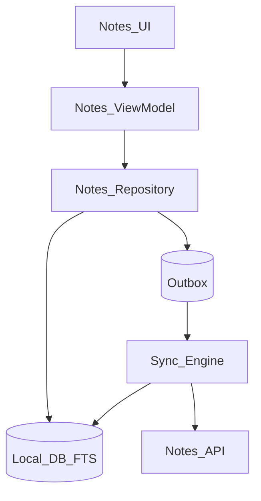
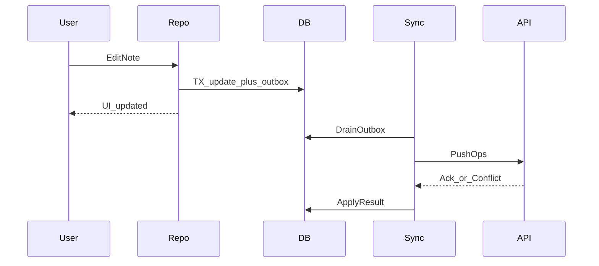

# 17 — Model Solution: Offline Notes

## Timed outline

| Min | Focus |
|-----|--------|
| 0–6 | MVP: CRUD notes offline; sync when online |
| 6–18 | Local-first architecture + models |
| 18–40 | Sync engine, conflicts, search |
| 40–55 | Background sync, failures, multi-device |

## Clarify and scope

**MVP:** create/edit/delete notes offline, sync across devices, full-text search on device, conflict handling.

**Defer:** realtime collaborative editing (OT/CRDT deep), rich media attachments (mention briefly).

## NFRs

- Create note works at 0 connectivity
- Sync eventually consistent; surface conflicts
- Search responsive on thousands of notes
- Process death safe

## High-level architecture



## Data model

```text
Note: id (server nullable), clientId, title, body, updatedAtClient,
      updatedAtServer, version, deleted, syncState
OutboxOp: opId, clientId, type (upsert|delete), payload, baseVersion
```

## Offline-first data flow

- All reads from local DB
- All writes update DB + enqueue outbox atomically
- Sync is asynchronous; UI never waits on network for typing



## Sync engine

1. Push outbox ops in order per note.
2. Pull deltas `since=syncToken`.
3. Apply remote upserts/tombstones.
4. Advance sync token transactionally.
5. Backoff on errors; pause on auth failure.

## Conflict resolution

**Detection:** server returns version conflict when `baseVersion` stale.

**MVP policy:**

- If only one side changed title vs body fields → field merge
- If same field diverged → keep both: `Note (conflict)` copy or in-UI merge screen
- LWW acceptable for low-stakes if you state it—but notes usually deserve merge UI

Collaborative stretch: CRDT on body; explain cost.

## Full-text search

- `Android:` FTS4/FTS5 via Room; `iOS:` Core Data / SQLite FTS / Searchable index
- Update index on write
- Debounce query input
- Rank by recency × text match

## Background sync

- Trigger: foreground, connectivity gain, push “notes changed”, periodic BG task
- Idempotent ops with `opId`
- Large first sync: paginate; show progress

## UI implementation

- List from DB Flow/Combine stream
- Editor autosave locally every few seconds + on background
- Sync badges: pending / error
- Conflict screen with side-by-side

## Failures

| Case | Behavior |
|------|----------|
| Push fails 5xx | Retry; keep pending |
| Pull partial | Don’t advance token until apply ok |
| Schema migration | Multi-step migration; fail closed |
| Dual device rapid edits | Conflict path |
| Storage full | Block new writes with clear error |

## Trade-offs

| Decision | Alternative | Why |
|----------|-------------|-----|
| Local-first | Online-only editor | Core product promise |
| Per-note version | Wall clock LWW | Clear conflicts |
| FTS local | Server search only | Offline search |

## Warning: do not copy this pattern to money

Local-first + optimistic “done” is correct for notes. For wallet/checkout/UPI it is unsafe—persist **intent**, show **processing/unknown**, confirm with server (Ch 07 fintech exception, Ch 21–42).

## Metrics

Outbox depth, sync latency, conflict rate, search latency p95, migrate failure.

## Staff stretch

- CRDT body for collaborative notes; explain battery/CPU cost
- Encrypted sync for sensitive notebooks
- Feature-flag sync algorithm; watch `conflict_rate` before full rollout

## Follow-ups

- Attachments upload + ref integrity
- Folders/sharing ACLs
- E2E encrypted notes
