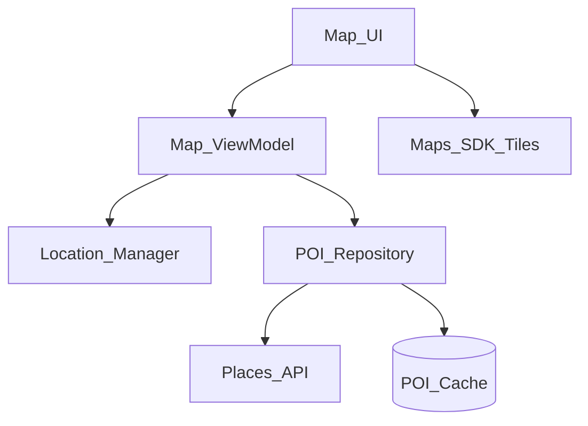
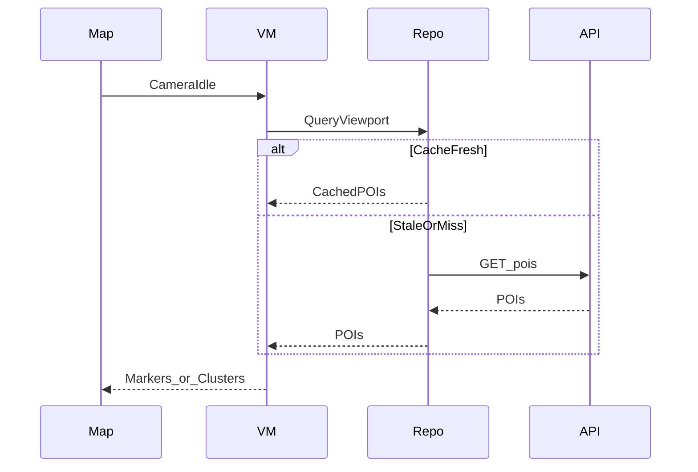

# 18 — Model Solution: Maps / Location

## Timed outline

| Min | Focus |
|-----|--------|
| 0–6 | MVP: map browse, blue-dot, nearby POIs |
| 6–20 | Architecture, tile/POI loading |
| 20–40 | Location accuracy, clustering, battery |
| 40–55 | Offline cache, privacy, failures |

## Clarify and scope

**MVP:** show interactive map, user location, search nearby places, tap POI details.

**Defer:** turn-by-turn navigation, offline full region packs (optional stretch), 3D/live traffic deep dive.

## NFRs

- Smooth pan/zoom (frame budget)
- Battery-aware location
- Reasonable data use for tiles/POIs
- Graceful denial of location permission

## High-level architecture



## Data model

```text
LatLng: lat, lng
Viewport: sw, ne, zoom
POI: id, name, latLng, category, rating?
POIQuery: viewportHash, fetchedAt
```

## Location strategy

| Mode | Use |
|------|-----|
| Passive / significant | App idle with map closed |
| Balanced | Map open browsing |
| High accuracy | User tapping “recenter” or navigation stretch |

Show accuracy circle; don’t pretend precision you don’t have.

## POI loading

1. On camera idle (debounce ~300ms), compute viewport.
2. Fetch POIs for viewport + category filters.
3. Cache by geohash / tile id + zoom band.
4. Cluster markers when zoomed out; expand on zoom in.
5. Cancel stale requests when camera moves again.



## Map performance

- Limit simultaneous marker views; use clustering
- Avoid heavy work on every camera move—debounce idle
- Reuse marker icons; don’t decode large images per POI on main
- Tile SDK owns most rendering—don’t fight it

## Offline / degraded

- Cache recent tiles via SDK settings when available
- Cache last POI results for viewport
- Without network: show cached map area + message
- Without location: default city / last known / manual search

## Privacy and permissions

- Just-in-time permission with rationale
- If denied: search-by-address still works
- Don’t log precise coordinates in analytics by default (geohash)

## Battery

- Stop updates when map not visible
- Lower frequency when camera stationary
- Batch POI fetches; backoff on errors

## Failures

| Case | Behavior |
|------|----------|
| Places API quota | Show cached; degrade categories |
| GPS spoofing / jump | Outlier filter; snap cautiously |
| Rapid pan | Cancel in-flight; don’t stampede |
| SDK crash surface | Fallback list view of POIs |

## Android UI: Views (XML) and Compose

Full toolkit comparison: [Android UI toolkits](../part-2-building-blocks/04-client-architecture.md#android-ui-toolkits-views-xml-and-compose).

| Concern | Views (XML) | Compose |
|---------|-------------|---------|
| Map host | `SupportMapFragment`, or `MapView` with every lifecycle call forwarded (`onCreate`…`onDestroy`, `onLowMemory`) | maps-compose `GoogleMap { }` with `rememberCameraPositionState` |
| Viewport fetch | `setOnCameraIdleListener` → query `projection.visibleRegion` | `snapshotFlow { cameraPositionState.isMoving }` → on idle read `cameraPositionState.projection?.visibleRegion` |
| Many POIs | `ClusterManager` (android-maps-utils) | `Clustering` from maps-compose-utils |
| Marker churn | Diff POI sets; reuse `Marker` objects by id | Stable keys per POI (`key(poi.id) { Marker(...) }`) so markers aren't recreated |
| List + map | Bottom sheet with `RecyclerView`; selected POI in VM | `BottomSheetScaffold` + `LazyColumn`; selected POI in VM |
| Permission | `registerForActivityResult(RequestMultiplePermissions())` | `rememberLauncherForActivityResult(RequestMultiplePermissions())` |

=== "Views (XML)"

    ```kotlin
    // layout: <androidx.fragment.app.FragmentContainerView android:id="@+id/map"
    //           android:name="com.google.android.gms.maps.SupportMapFragment" ... />
    val mapFragment = childFragmentManager.findFragmentById(R.id.map) as SupportMapFragment
    mapFragment.getMapAsync { map ->
        map.addMarker(MarkerOptions().position(pickup).title("Pickup"))
    }
    ```

=== "Compose"

    ```kotlin
    @Composable
    fun PickupMap(pickup: LatLng) {
        val camera = rememberCameraPositionState { position = CameraPosition.fromLatLngZoom(pickup, 15f) }
        GoogleMap(modifier = Modifier.fillMaxSize(), cameraPositionState = camera) {
            Marker(state = rememberMarkerState(position = pickup), title = "Pickup")
        }
    }
    ```

**Mixed codebase:** prefer `SupportMapFragment` over raw `MapView` in legacy screens (no manual lifecycle forwarding); new map screens go straight to maps-compose.

## Trade-offs

| Decision | Alternative | Why |
|----------|-------------|-----|
| Fetch on camera idle | Continuous fetch | Cost / jank |
| Clustering | All pins | Clarity at low zoom |
| SDK tiles | Self-host tiles | Time-to-market |

## Metrics

Permission accept rate, time-to-first-map, POI fetch latency, interaction jank proxies, battery while map foregrounded (lab).

## Staff stretch

- Privacy: coarse location mode for “nearby” discovery
- Tile/POI budget caps on cellular
- Feature-flag clustering algorithm; measure marker bind time

## Follow-ups

- Turn-by-turn navigation client
- Live traffic overlay
- Offline region download manager
