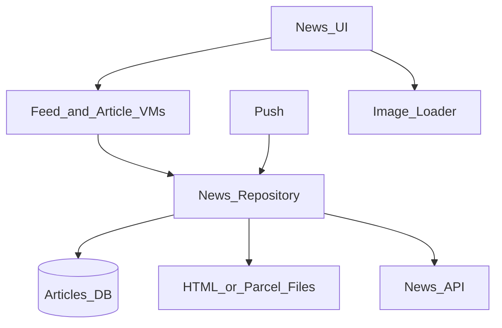
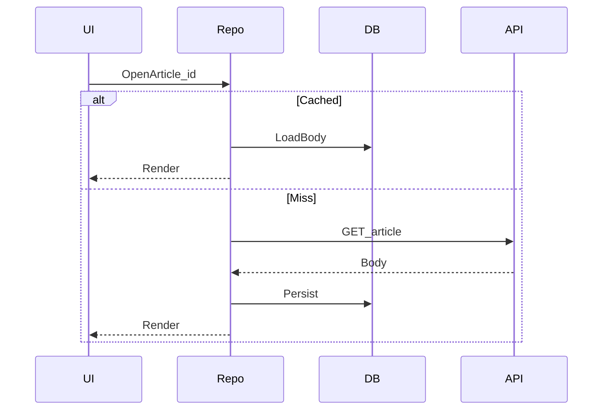

# 19 — Model Solution: News Reader

## Timed outline

| Min | Focus |
|-----|--------|
| 0–6 | MVP: headlines list, article detail, offline reading |
| 6–18 | Architecture, caching policy |
| 18–40 | Pagination, article pack, push breaking news |
| 40–55 | Prefetch, storage eviction, failures |

## Clarify and scope

**MVP:** categorized news list, open article, save for offline, pull-to-refresh, push for breaking news.

**Defer:** personalized ranking ML internals, comments, paywall deep billing.

## NFRs

- Fast list from cache
- Articles readable offline once opened or saved
- Bounded disk usage
- Breaking news timely via push

## High-level architecture



## Data model

```text
Headline: id, title, summary, heroImageUrl, category, publishedAt, cursor
Article: id, headlineId, bodyRef (file path or inline), fetchedAt, read, saved
SyncMeta: category, nextCursor, lastRefreshAt
```

## List loading

- Local-first headlines by category
- Cursor pagination
- Refresh replaces head; keep unread cached items briefly
- Prefetch next page near end

## Article body strategy

| Approach | Pros | Cons |
|----------|------|------|
| Native blocks JSON | Consistent UI | Complex renderer |
| Sanitized HTML WebView | Fast to ship | Weaker a11y/perf control |
| Pre-packaged “reader parcel” | Offline friendly | Server support |

**Interview default:** fetch article JSON/HTML once → persist to disk → render; images via image loader with offline cache if saved.



## Offline reading

- Auto-cache last opened N articles
- Explicit “Save offline” pins article + images
- Evict unpinned by LRU when over budget (~200–400 MB)

## Push breaking news

- Alert push with article id + title
- On tap: cold start → hydrate article (cache or network)
- Collapse key per breaking story
- Data-only push optional overnight to warm caches (careful with battery)

## Prefetch policy

- On wifi: prefetch top K article bodies for current category
- On cellular: headlines + hero thumbs only unless user setting allows

## Failures

| Case | Behavior |
|------|----------|
| Article fetch fail with cache | Show cache + stale label |
| Image fail | Crop placeholder |
| Push opens deleted article | Friendly not found |
| Partial HTML | Sanitize; block external JS |

## Trade-offs

| Decision | Alternative | Why |
|----------|-------------|-----|
| Local cache heavy | Always network | Subway reading |
| Pin vs auto cache | Auto only | User control + disk |
| WebView article | Fully native | Speed to MVP |

## Security / trust

- HTTPS only
- Sanitize HTML; no arbitrary JS bridges
- Clear distinguishing sponsored content if in scope

## Metrics

TTFD headlines, article open success offline, cache hit rate, push open rate, disk footprint.

## Staff stretch

- Breaking-news collapse keys under spike
- Reader-mode sanitizer hardening for WebView
- Prefetch policy remote config by network class

## Follow-ups

- Personalized home mixed feed
- Audio articles / TTS
- Paywalled content token gating
