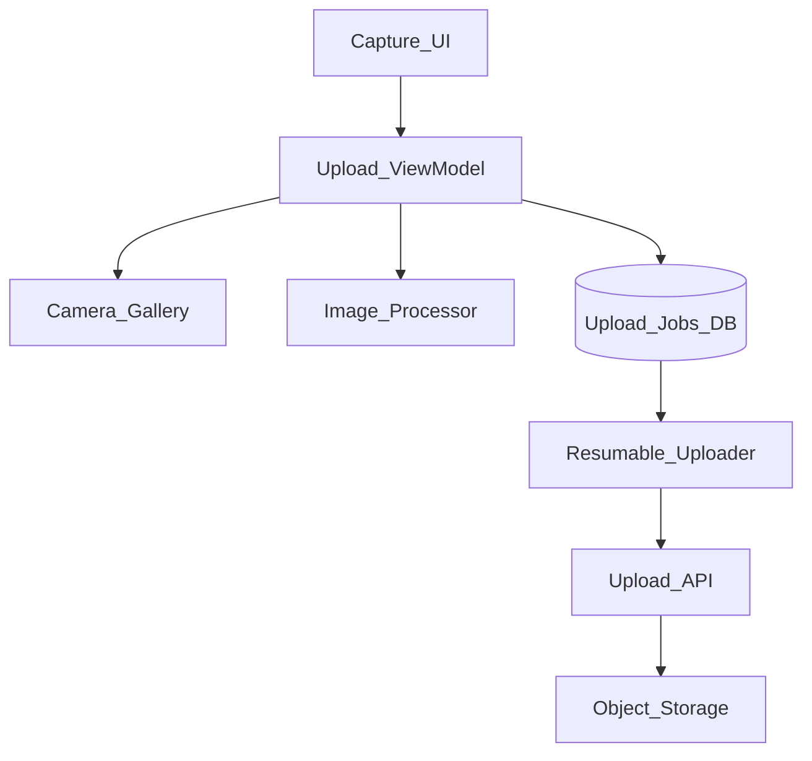
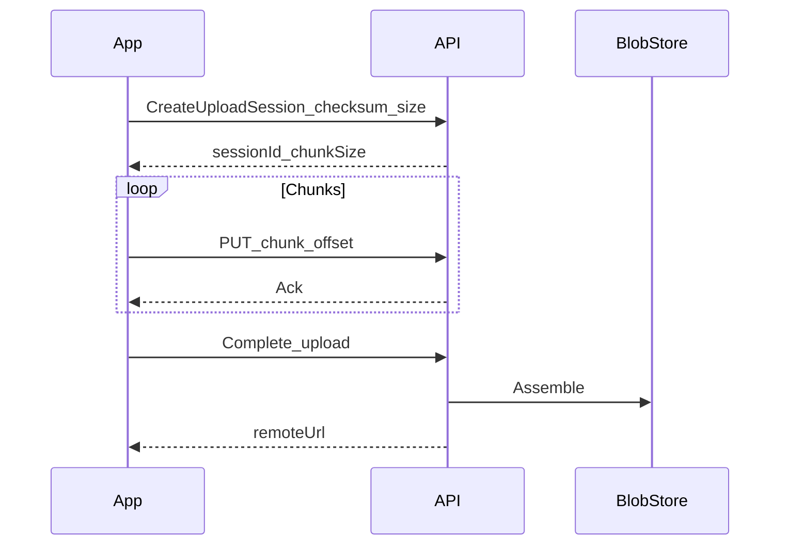

# 20 — Model Solution: Photo Capture and Upload

## Timed outline

| Min | Focus |
|-----|--------|
| 0–6 | MVP: capture/pick, edit light, upload |
| 6–18 | Pipeline architecture |
| 18–40 | Compression, resumable upload, outbox |
| 40–55 | Failures, media library, privacy |

## Clarify and scope

**MVP:** capture via camera or gallery, optional crop, compress, upload to server, show progress, retry.

**Defer:** multi-photo stories, cloud album sync product, on-device ML tagging deep dive.

## NFRs

- Upload survives app kill (resumable + durable job)
- Reasonable cellular upload sizes
- Clear progress / failure UX
- Don’t lose original until success policy decided

## High-level architecture



## Data model

```text
MediaDraft: localId, originalUri, editedUri?, width, height, createdAt
UploadJob: jobId, localId, status, bytesSent, bytesTotal,
           uploadSessionId?, checksum, attempts, remoteUrl?
Status: queued|processing|uploading|completed|failed|cancelled
```

## Capture flow

1. Permission → camera or photo picker.
2. Persist original to app sandbox (not only ephemeral cache).
3. Optional crop/rotate → write edited file.
4. Enqueue job: processing → uploading.

`Android:` Photo Picker / CameraX. `iOS:` PHPicker / AVFoundation. Prefer system pickers for privacy.

## Compression / processing

- Decode bounds first; downsample to max edge (e.g., 1920px) for upload variant
- JPEG/WebP quality tuned (e.g., 0.8); keep original if “full quality” setting
- Strip sensitive EXIF (GPS) by default for social upload; keep for camera roll apps if product needs
- Run on background thread/pool; bound concurrency to 1–2 encodes

## Resumable upload



- Chunk size e.g. 1–4 MB adaptive to network
- Persist `bytesSent` + session id in job row
- On restart: query server status or resume from last ack
- Idempotency: `jobId` / checksum prevents dupes

## Outbox integration

- Job table is the outbox
- Worker drains when online; prefer unmetered for large originals
- Foreground notification while user-initiated large uploads if OS requires

## UI

- Thumbnail from local file immediately
- Progress per item; batch gallery upload queue
- Failed state with retry / cancel
- Don’t block camera for previous upload completion

## Failures

| Case | Behavior |
|------|----------|
| Kill mid-upload | Resume session |
| Network flip wifi→lte | Continue or pause per policy |
| Server 410 session expired | Recreate session; restart chunks |
| Disk full | Fail early with message |
| Corrupt file | Checksum fail; re-capture |
| Auth expired | Refresh; continue |

## Privacy / security

- Camera/gallery permissions rationale
- Avoid uploading before explicit send
- Secure temp files; delete remote-failed temps per policy
- TLS; optionally encrypt-at-rest on device for sensitive apps

## Trade-offs

| Decision | Alternative | Why |
|----------|-------------|-----|
| Resumable chunks | Single PUT | Large media reliability |
| Separate upload variant | Always original | Bandwidth |
| Persist original until ack | Delete early | User trust |

## Metrics

Upload success rate, time-to-complete by network class, retry count, encode time p95, cancel rate, crash during encode.

## Staff stretch

- KYC reuse: encrypt-at-rest + delete-after-ack (Ch 26)
- EXIF GPS strip by default for social; retain only when product needs
- Upload worker fairness vs battery (defer large jobs to unmetered)

## Follow-ups

- Multi-asset posts with transactional server commit
- Live photo / short video same pipeline
- Client-side virus scanning (enterprise)
