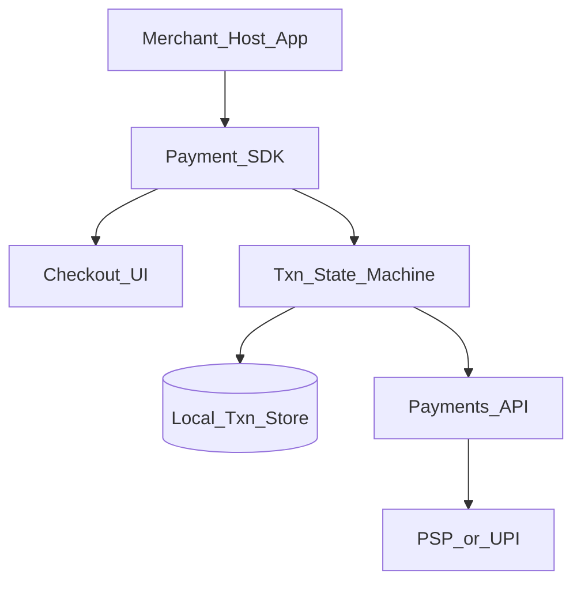
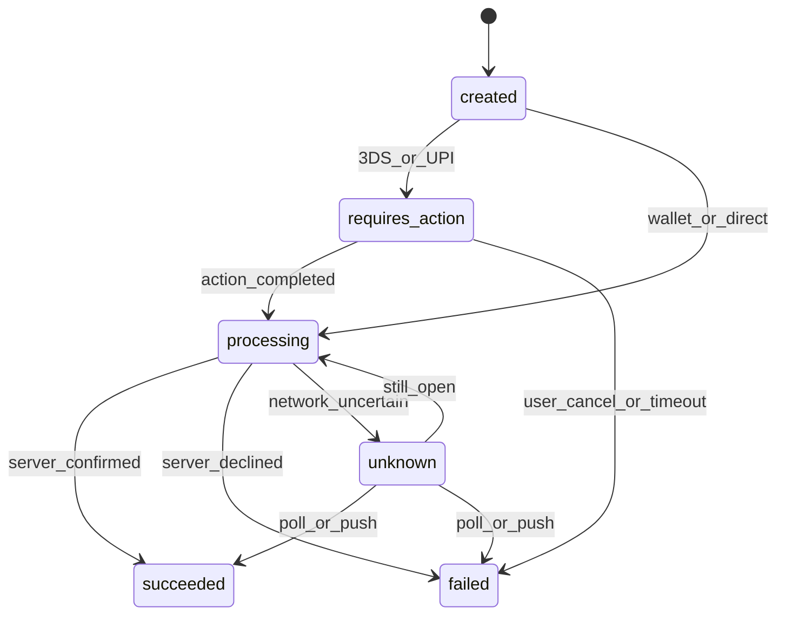

# 21 — Model Solution: Checkout / Payment SDK

## Timed outline (45–60 min)

| Min | Focus |
|-----|--------|
| 0–7 | MVP rails (card, UPI, in-app wallet, Apple/Google Pay); PCI scope |
| 7–18 | Architecture: host app vs SDK; txn state machine |
| 18–40 | Start payment, 3DS/WebView, result recovery |
| 40–55 | Failures, double-charge prevention, metrics |

## Clarify and scope

**Prompt framing:** “Design a mobile checkout / payment SDK used by merchant apps.”

**MVP:** create payment for amount + currency + orderId; support (1) tokenized card via PSP hosted fields / drop-in, (2) UPI handoff (detail in Ch 22), (3) **in-app wallet balance** pay (Ch 23—not Apple/Google Pay), (4) Apple Pay / Google Pay OS wallet rails ([Ch 41](41-apple-google-pay.md)); return success/fail/pending to host.

**Out of scope:** full bank core, settlement ledger internals, card network certification deep dive (mention PCI boundary only).

**Assumptions:** Backend payment service + PSP exist; client never stores PAN/CVV.

## NFRs

- **Correctness over speed:** never show “Paid” from client-only signals
- Idempotent start/confirm; safe retries after kill
- Step-up auth for high value (biometric / app PIN)
- Screenshot blocked on sensitive screens
- Cold path to first interactive checkout < ~2s when cached config

## Golden rule

```text
Client proposes intent → Server + PSP decide outcome → Client renders server truth
```

## High-level architecture



## Public SDK API (sketch)

```text
PaymentSDK.configure(publishableKey, environment)
PaymentSDK.presentCheckout(orderId, amount, currency, customerSession)
  -> callback(Result: success|failed|cancelled|pending, paymentId?)

PaymentSDK.resumePendingPayments() // on cold start
```

Host must handle `pending` as first-class—not only binary success/fail.

## Data model (client)

```text
PaymentAttempt:
  localId, paymentId?, orderId, amount, currency, method,
  status (created|requires_action|processing|succeeded|failed|cancelled|unknown),
  clientMutationId, updatedAt, lastErrorCode?
```

Persist every attempt that left the device. Survive process death.

## Transaction state machine



## Card path (PCI-safe)

1. SDK loads **PSP hosted fields** (WebView or native drop-in) so PAN never enters merchant process memory.
2. PSP returns `paymentMethodToken` to SDK (not raw card).
3. SDK calls `POST /payments` with `orderId`, amount, token, `Idempotency-Key=clientMutationId`.
4. If `requires_action` (3DS2): open challenge WebView / Custom Tabs; on return, call `POST /payments/{id}/confirm` or poll.
5. UI advances only on server status.

`Android:` prefer Custom Tabs / Chrome for 3DS redirects when possible. `iOS:` ASWebAuthenticationSession / SFSafariViewController patterns for redirect flows.

## Wallet path

1. Fetch server balance (short TTL; show “as of”).
2. Optional step-up biometric.
3. `POST /payments` method=wallet with idempotency key.
4. On uncertain network: status=`unknown`, start poller (Ch 24).

## Do not optimistic-complete

| Allowed optimistic UX | Forbidden |
|-----------------------|-----------|
| Disable Pay button, show spinner | “Payment successful” from local guess |
| Show “Processing…” | Decrement local wallet before server ack |
| Cache last quote | Trust WebView JS bridge alone |

## Result delivery to host

Priority order for truth:

1. Payments API `GET /payments/{id}` (or list by `orderId`)
2. Push / webhook-driven refresh after host returns to foreground
3. PSP redirect query params — **hints only**, always re-verify

## Security

- TLS required; pinning for finance SDK with backup pins + remote disable
- Tokens in Keystore/Keychain; never logs
- FLAG_SECURE / `isSecure` on card and PIN screens
- Jailbreak/root soft signal to risk engine (don’t solely block without product policy)
- Validate deep links that resume checkout (signed state / one-time resume token)

## Failures

| Case | Behavior |
|------|----------|
| Kill mid-3DS | On launch, `resumePendingPayments()` → poll server by localId/orderId |
| Double tap Pay | Same idempotency key; single in-flight lock in UI |
| Token expired mid-flow | Refresh session; do not recreate amount silently without re-quote |
| PSP timeout | `unknown` + poll; copy: “Confirming with bank…” |
| Partial refund later | Out of MVP UI; expose paymentId for host support |

## Android UI: Views (XML) and Compose

An SDK does not choose the host's toolkit — it must drop into a View-only app **and** a Compose app. Basis: [Ch 4 — Android UI toolkits](../part-2-building-blocks/04-client-architecture.md#android-ui-toolkits-views-xml-and-compose).

| Concern | Views (XML) | Compose |
|---------|-------------|---------|
| Entry point | `CheckoutActivity` (themed, full screen) + optional embeddable custom View | `@Composable` wrapper in a separate `-compose` artifact |
| Launch + result | `registerForActivityResult(CheckoutContract())` in Activity/Fragment | `rememberLauncherForActivityResult(CheckoutContract())` — same contract |
| Dependencies | Core artifact has **no** Compose dependency — View-only hosts don't pay its size | Compose artifact declares the **lowest** Compose version it needs — a newer pinned BOM would force-upgrade the host via dependency resolution |
| Theming | Theme overlay attrs (`checkoutColorPrimary`, shape, font) the host overrides in XML | `CheckoutTheme(colors, typography)` params; default reads host `MaterialTheme` |
| Process death | Activity restores from `savedInstanceState` + persisted attempt | Same Activity hosts the Compose UI; `rememberSaveable` for screen-local state only |
| Secure screens | `FLAG_SECURE` on the SDK's own Activity window | Same window flag — Compose has no separate one; `Dialog`/`ModalBottomSheet` default `SecureFlagPolicy.Inherit` follows it |

```kotlin
// Core artifact: one contract, usable from any host
class CheckoutContract : ActivityResultContract<CheckoutRequest, CheckoutResult>() {
    override fun createIntent(context: Context, input: CheckoutRequest) =
        Intent(context, CheckoutActivity::class.java).putExtra("orderId", input.orderId)
    override fun parseResult(resultCode: Int, intent: Intent?): CheckoutResult =
        intent?.getStringExtra("paymentId")
            ?.let { CheckoutResult.Done(it, intent.getStringExtra("status") ?: "unknown") }
            ?: CheckoutResult.Cancelled // hint only: host still verifies with server
}

// View host (Fragment)
class CartFragment : Fragment() {
    private val checkout = registerForActivityResult(CheckoutContract()) { onResult(it) }
    fun pay(orderId: String) = checkout.launch(CheckoutRequest(orderId))
    private fun onResult(r: CheckoutResult) { /* verify with server */ }
}

// Compose host (-compose artifact)
@Composable
fun PayButton(orderId: String, onResult: (CheckoutResult) -> Unit) {
    val launcher = rememberLauncherForActivityResult(CheckoutContract(), onResult)
    Button(onClick = { launcher.launch(CheckoutRequest(orderId)) }) { Text("Pay") }
}
```

Shipping a View-based core first and adding Compose as a thin layer later is the safe order: the state machine, contract and Activity don't change; only the entry point does.

**Mixed codebase:** the SDK's Activity can render Compose internally (`setContent`) while its public API stays View-friendly; inside a host's XML screen, an embeddable SDK composable goes in via `ComposeView`, and an SDK custom View goes into Compose via `AndroidView`.

## Trade-offs

| Decision | Alternative | Why |
|----------|-------------|-----|
| Hosted fields | Native PAN entry | Shrink PCI scope |
| Explicit `pending`/`unknown` | Binary callback | Matches real rails |
| SDK owns state machine | Host reinvent each app | Consistency + fewer double charges |

## Staff stretch

- Feature flag per rail (card/UPI/wallet)
- Canary SDK version via remote config
- Metrics: pay_tap → requires_action → terminal; unknown duration p95; double-submit rate
- Accessibility for amount confirmation (read amount aloud before confirm)

## Follow-ups

- Apple Pay / Google Pay wallet rail ([Ch 41](41-apple-google-pay.md))
- Mandates on card (Ch 32)

## See also

- [Ch 22 UPI](22-upi-intent-collect.md) · [Ch 23 Wallet](23-wallet-transfer.md) · [Ch 24 Recovery](24-txn-history-pending-recovery.md) · [Ch 25 Catalog](25-top-fintech-system-design.md) · [Ch 28 Auth](28-secure-auth-device-binding.md) · [Ch 41 Wallet pay](41-apple-google-pay.md)
