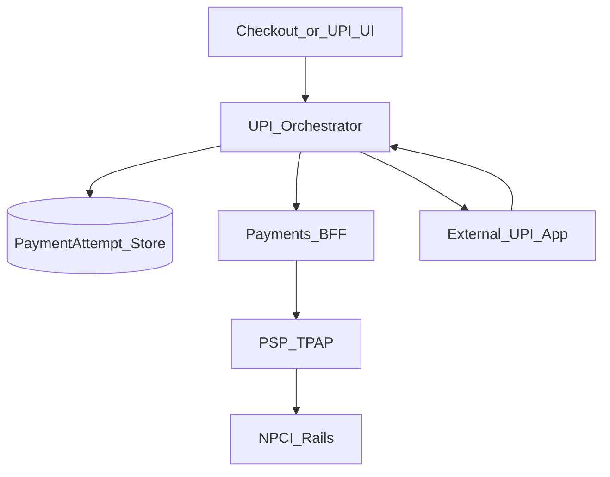
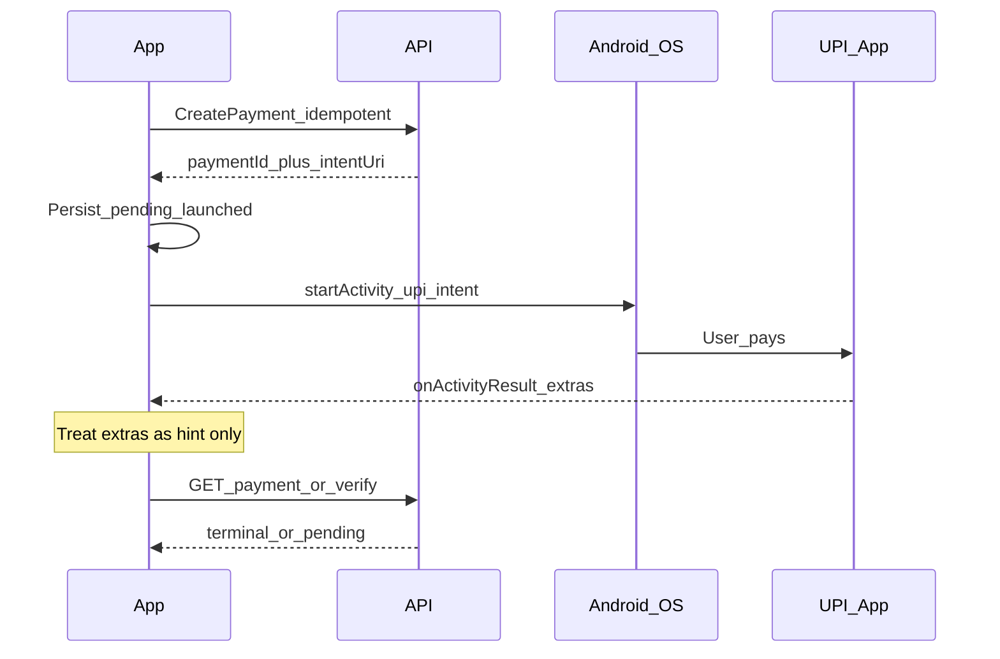

# 22 — Model Solution: UPI Intent and Collect

## Timed outline

| Min | Focus |
|-----|--------|
| 0–6 | India UPI MVP: intent pay + collect approve |
| 6–18 | Client architecture; never trust intent result |
| 18–40 | Intent URL, app chooser, return path, polling |
| 40–55 | Collect flow, no UPI app, failures, privacy |

## Clarify and scope

**MVP (payer app or merchant checkout rail):**

1. **Intent / pay:** build `upi://pay?...` (or PSP-wrapped intent), user pays in GPay/PhonePe/etc., return to app.
2. **Collect:** payee/merchant initiates collect to user’s VPA; user approves in their UPI app; your app shows pending→result.

**Defer:** UPI Lite deep design, autopay mandate UX beyond mention, NPCI switch internals.

**Platform note:** Intent chooser is strongest on **Android**. On **iOS**, UPI is typically via PSP SDK / in-app flows / partner apps—say this aloud; design Android intent path + iOS PSP equivalent.

## NFRs

- Zero double-charge on retry/kill
- Clear pending UX while bank/NPCI settles
- Handle zero UPI apps installed
- Lock-screen notifications must not leak full amount if policy requires

## Architecture



## Data model

```text
UpiPayment:
  localId, paymentId, type (intent|collect), amount, payeeVpaOrHandle,
  txnRef?, status (created|launched|pending|success|failed|expired|unknown),
  clientMutationId, createdAt, pollAfterAt
```

## Intent flow (Android-centric)



### Intent URI responsibilities

- Prefer **server-built** intent URI / PSP payload (amount, pa, pn, tr, tn signed/validated server-side).
- Client may append return package extras per PSP docs but must not recompute amount locally for truth.
- `tr` / transaction ref ties attempt across systems.

### App chooser

- Query package manager for apps that resolve `upi://pay`
- If empty: show install/help CTA; offer other rails (card/wallet)
- Optional: remember last used UPI app (UX only)

### Return path

`Android:` Activity Result / new Activity Result APIs. Also handle user switching back via recents **without** result—status still `unknown/pending` → poll.

`iOS:` If using universal links / PSP callback URL, same rule: verify with backend.

## Collect flow

1. User enters/selects VPA (validate format client-side lightly).
2. `POST /upi/collect` with idempotency key → `paymentId`.
3. UI: “Approve the collect request in your UPI app”.
4. Push (optional) + poll until terminal or expiry (e.g., minutes).
5. On approve/reject at bank, server updates; client refreshes.

Collect does **not** require your app to launch the UPI app, but deep link helpers may exist—still server-authoritative.

## Polling strategy

| Phase | Interval |
|-------|----------|
| First 30s after return | every 2–3s |
| Next 2 min | every 5–10s |
| Later | exponential backoff; cap; allow manual refresh |
| Stop | terminal status or expiry |

Backoff with jitter; single-flight polls per `paymentId`.

## Failure and edge cases

| Case | Behavior |
|------|----------|
| Result `SUCCESS` in intent extras but API `pending` | Keep pending; never celebrate early |
| Result failed extras but API success | Prefer API; rare race—show server |
| User kills app in UPI app | Cold start resume → poll by local pending rows |
| Duplicate create | Same `clientMutationId` |
| DEEMED / unknown bank states | Map to `unknown`; support copy with ref id |
| Clocks skew | Use server timestamps for expiry |

## Security & privacy

- Amount confirmation screen before launch (user sees paise-accurate amount)
- FLAG_SECURE on PIN entry if in-app PIN (collect approval is usually external)
- Do not log VPA + amount together in analytics without policy
- Fraud: device signals on create payment

## Trade-offs

| Decision | Alternative | Why |
|----------|-------------|-----|
| Server-built intent | Client concatenates URI | Tamper resistance |
| Poll + push | Poll only | Faster terminal UX |
| Explicit no-app path | Crash/chooser empty | Conversion |

## Metrics

intent_launch_rate, return_without_result, time_to_terminal p95, mismatch(hint vs server), no_upi_app_rate, collect_expiry_rate.

## Staff stretch

- Rail feature flags; kill switch if PSP degraded
- Accessibility: announce amount before leaving app
- Play integrity / attestation soft gate for high value

## Follow-ups

- QR scan pay
- Intent vs collect product choice for merchant
- Mandate / autopay registration UX
