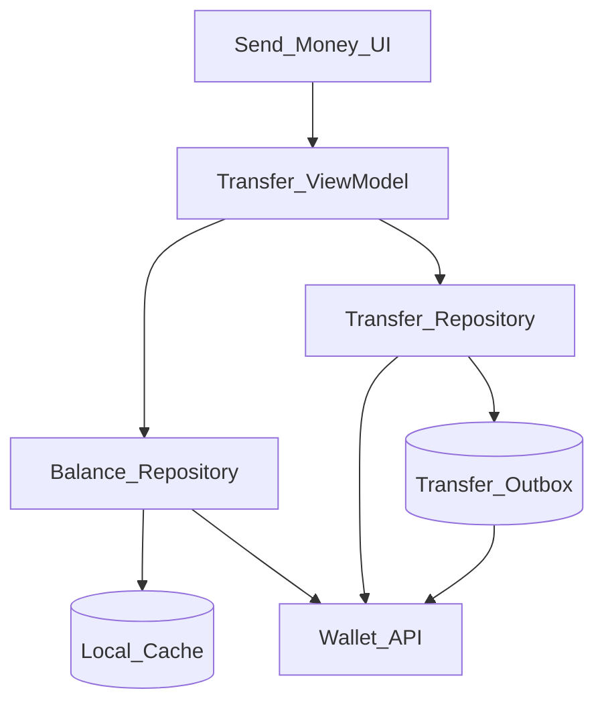
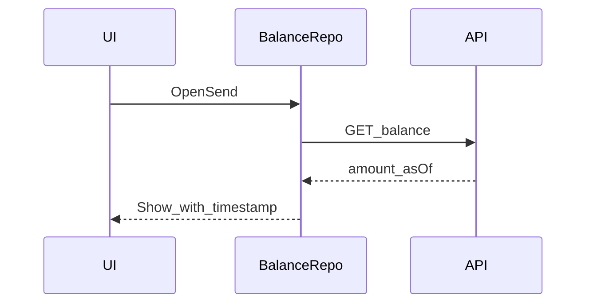

# 23 — Model Solution: Wallet Transfer

## Timed outline

| Min | Focus |
|-----|--------|
| 0–6 | P2P wallet send MVP; regulatory assumptions |
| 6–18 | Architecture; balance freshness; ledger authority |
| 18–40 | Transfer flow, idempotency, step-up, limits |
| 40–55 | Offline rules, conflicts, failures, observability |

## Clarify and scope

**MVP:** logged-in user sends wallet balance to another user (handle/phone/VPA-mapped wallet id); see pending/success/fail; view updated balance from server.

**Defer:** bank withdrawal (IMPS/NEFT), crypto, multi-currency FX deep dive, full PPI regulatory essay (mention escrow/ledger is server-side).

**Assume:** server holds **double-entry ledger**; mobile shows projections only.

## NFRs

- No double send on retry
- Balance display never invents spendable funds from stale cache alone
- Step-up auth above threshold
- Clear pending when debit is in-flight
- Offline: allow **compose draft**, not silent auto-send without connectivity policy

## Architecture



## Data model

```text
BalanceSnapshot: amountMinor, currency, asOf, serverEtag?
Beneficiary: id, displayName, handle
Transfer:
  localId, transferId?, toBeneficiaryId, amountMinor, note?,
  status (draft|queued|processing|succeeded|failed|unknown),
  clientMutationId, createdAt, failureCode?
```

Use **integer minor units** (paise) everywhere—never float.

## Balance freshness

| Approach | Use |
|----------|-----|
| Always fetch on Send screen open | Default for fintech |
| Cache with short TTL (e.g., 15–30s) | OK with “Updated Xs ago” |
| Cache-only spendable | **Avoid** |
| Optimistic decrement | Only as non-authoritative UI if clearly “processing”; revert on fail |



## Transfer flow

1. Select beneficiary (recent list cached OK).
2. Enter amount; validate `0 < amount <= spendable` where spendable comes from fresh snapshot minus in-flight local processing holds.
3. Review screen: amount, fees (if any from server quote), beneficiary.
4. Step-up: biometric / app PIN if amount ≥ threshold or risk flag.
5. `POST /wallet/transfers` with body + `Idempotency-Key=clientMutationId`.
6. Persist local row `processing`/`queued` in same TX as outbox.
7. On response: map to succeeded/failed/unknown.
8. Refresh balance from server (do not trust response balance alone if separate resource).

## In-flight holds (client UX)

When a transfer is `processing`/`unknown`, optionally show **held** amount in UI:

```text
availableToSend ~= serverBalance - sum(localInFlightAmounts)
```

Label it as estimated; server remains final.

## Offline policy (fintech-safe)

| Connectivity | Behavior |
|--------------|----------|
| Offline | Save draft; disable Send or queue with explicit “Will send when online” |
| Queued send | Outbox drains when online; still idempotent |
| Never | Mark succeeded offline |

This differs from notes apps (Ch 17): **money is not local-first authoritative.**

## Limits and compliance UX

- Client enforces UX limits from server config (daily cap, per-txn cap)
- Server re-validates always
- Cool-off / beneficiary warm-up if product requires
- Show regulated warnings / T&Cs as required by market

## Security

- Secure storage for session; step-up gated private key ops if used
- FLAG_SECURE on amount + PIN
- Mask beneficiary identifiers in push (“Transfer update” vs full amount—policy)
- Screenshot/recording protections on review screen

## Failures

| Case | Behavior |
|------|----------|
| HTTP 200 lost after debit | `unknown` → poll transfer by clientMutationId |
| 409 / duplicate | Return original transferId; converge UI |
| Insufficient funds | Failed; refresh balance |
| Beneficiary not found | Failed validation |
| Kill after tap | Outbox + resume poll |
| Stale balance race | Server rejects; show new balance |

## Trade-offs

| Decision | Alternative | Why |
|----------|-------------|-----|
| Server ledger authority | Offline CRDT balance | Money safety |
| Idempotent POST | Non-retryable fire-once | Mobile networks |
| Step-up threshold | Always biometric | UX vs risk |
| Integer minor units | Decimal strings only | Avoid float bugs |

## Metrics

transfer_success_rate, unknown_rate, time_to_terminal, step_up_pass_rate, insufficient_funds_rate, double_submit_blocked, balance_refresh_latency.

## Staff stretch

- Risk SDK hooks (device score) before confirm
- Feature flag for new beneficiaries
- Audit event IDs shown in support (“Reference”)

## Follow-ups

- Request money (pull)
- Split bills
- Wallet top-up via UPI (compose with Ch 22)
