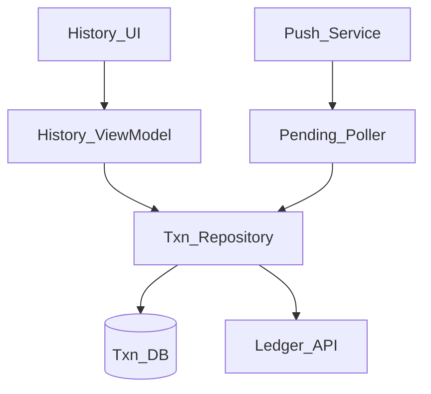
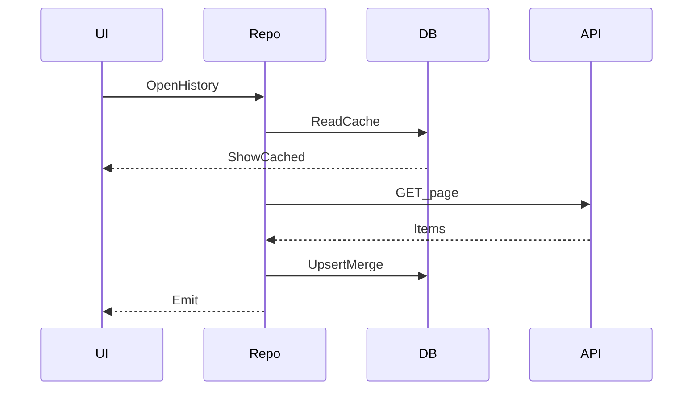

# 24 — Model Solution: Transaction History and Pending Recovery

## Timed outline

| Min | Focus |
|-----|--------|
| 0–6 | History list + pending banner MVP |
| 6–18 | Local cache vs server truth; models |
| 18–40 | Pending recovery poller, pagination, push |
| 40–55 | Disputes entry, failures, observability |

## Clarify and scope

**MVP:** reverse-chronological transactions (payments, transfers, top-ups); filter by status; open detail with reference ids; automatically recover `pending`/`unknown` after kill or flaky return from UPI/PSP; pull-to-refresh.

**Defer:** full dispute/chargeback workflow UI, CSV export, accounting reconciliations admin.

## NFRs

- Pending never silently disappears without terminal status or expiry messaging
- History useful offline from cache with stale labeling
- Correct merge of local attempts and server ledger entries
- Fast open: show cache then refresh

## Architecture



## Data model

```text
Txn:
  id (server), localId?, type, amountMinor, currency, counterparty,
  status, createdAt, updatedAt, rrnOrProviderRef?, orderId?,
  clientMutationId?, isLocalOnly?

PendingWatch:
  paymentOrTransferId, localId, nextPollAt, attemptCount, expiresAt
```

Merge rule: if server row shares `clientMutationId` / `paymentId`, upsert and clear local-only flag.

## History loading

1. Open → paint DB cache immediately.
2. `GET /transactions?cursor=&limit=` (cursor pagination).
3. Upsert; prune very old non-pending per retention policy.
4. Prefetch next page near list end.
5. Filters (status/type) preferably server-side; client filter OK for small caches.



## Pending recovery (core fintech UX)

Triggers:

- App cold start / foreground
- Return from UPI or 3DS
- Push: `payment_updated`
- Manual refresh
- Periodic poller while PendingWatch non-empty

Algorithm:

1. Load all non-terminal local attempts + server `pending/unknown`.
2. For each, `GET /payments/{id}` or `GET /transfers/{id}` (batch API better if exists).
3. Apply terminal status; update history row.
4. If still open and not expired: schedule next poll (same backoff as Ch 22).
5. If expired open: show “Taking longer than usual” + support ref; keep polling slower or mark `needs_attention`.

**Never** auto-mark failed solely because intent result was cancel—verify server.

## Detail screen

Show: amount, status timeline, timestamps, merchant/beneficiary, `paymentId`, provider RRN/UTR if any, method (UPI/card/wallet).

Actions: contact support (prefill ids), retry if failed and business allows, open mandate details if relevant.

## Push

- Data message preferred for status sync; alert message for user-visible “Paid ₹X” per privacy policy
- Collapse key = `paymentId` so rapid updates collapse
- On tap: deep link to detail; trigger fetch

## Offline

- Cached history readable
- Banner: “You’re offline—pending may be outdated”
- Queued transfers (Ch 23) appear as local rows merged later

## Failures

| Case | Behavior |
|------|----------|
| Poll 401 | Re-auth; pause poller |
| Split brain local success vs server fail | Server wins; explain with ref |
| Duplicate rows | Dedupe by paymentId/clientMutationId |
| Huge history | Cursor + DB indexes on createdAt |
| Push delayed | Poller still converges |

## Trade-offs

| Decision | Alternative | Why |
|----------|-------------|-----|
| Merge local+server | Server-only list | Covers in-flight UX |
| Active poller | Refresh only | Recovers UPI returns |
| Cursor pages | Offset | Stable under inserts |

## Metrics

pending_age_p95, recovery_success_rate, history_ttfd_cached, poll_fanout, push_to_ui_latency, stuck_pending_count.

## Staff stretch

- Sampling verbose txn traces only on unknown
- Privacy: amount masked in recents app switcher (FLAG_SECURE optional on detail)
- Support mode: copy all refs one tap

## Follow-ups

- In-app dispute start
- Statement PDF download (reuse resumable download patterns)
- Multi-account / multi-wallet switcher

## Tie-back

Use with Ch 21–23: every payment rail must write a recoverable attempt that this chapter’s poller can finish.
