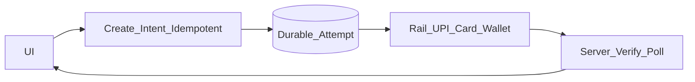

# 25 — Top Fintech Mobile System Design Problems

## Goal

A ranked shortlist of **mobile** system design prompts that show up for payments, banking, wallets, and India fintech roles in 2025–2026—plus what “good” deep-dives look like.

Use this chapter to pick mocks. Full walkthroughs: **Ch 21–24 and 26–42**.

## Ranking criteria

| Weight | Signal |
|--------|--------|
| High | Correctness under flaky networks (money safety) |
| High | Regulatory / PCI / RBI-shaped client constraints |
| High | Common in India fintech + global checkout interviews |
| Med | Appears in neobank / trading / lending mobile rounds |
| Low | Pure backend ledger/NPCI scale without client design |

## Top 12 (practice in this order for fintech roles)

| Rank | Prompt | Why it matters | Primary deep dives | Full chapter |
|------|--------|----------------|--------------------|--------------|
| 1 | Checkout / Payment SDK | Core product surface; PCI boundary | State machine, idempotency, 3DS, pending | [21](21-checkout-payment-sdk.md) |
| 2 | UPI intent + collect | India default rail | Intent hint≠truth, poll, no-app path | [22](22-upi-intent-collect.md) |
| 3 | Wallet transfer (P2P) | Ledger UX on device | Balance freshness, step-up, minor units | [23](23-wallet-transfer.md) |
| 4 | Txn history + pending recovery | Where flaky payments converge | Merge local/server, poller, refs | [24](24-txn-history-pending-recovery.md) |
| 5 | KYC / identity onboarding | Regulated funnel every neobank needs | Doc capture, upload, resume, PII | [26](26-kyc-onboarding.md) |
| 6 | QR pay (payer + merchant show) | High-frequency retail UX | Parse, amount confirm, offline QR limits | [27](27-qr-payments.md) |
| 7 | Secure auth + device binding | Session, SIM/device bind, step-up | Binding, biometric vault, revoke | [28](28-secure-auth-device-binding.md) |
| 8 | Saved cards / tokenization | Recurring checkout | Network tokens, CVV/3DS, one-tap bind | [29](29-saved-cards-tokenization.md) |
| 9 | Bill pay / biller list | BBPS-style product common in India | Directory cache, due quoteId, pay rail | [30](30-bill-pay.md) |
| 10 | Fraud challenge / step-up | Risk engine drives mobile UX | Challenge types, hard vs soft block | [31](31-fraud-challenge-step-up.md) |
| 11 | In-app support for payments | Ops reality | Prefill refs, evidence, case states | [38](38-payment-disputes-support.md) |
| 12 | Statements / PDF export | Trust + compliance UX | Background download, encryption at rest | Tie [Ch 20](20-photo-camera-upload.md) + history |

## Extended track (staff / top-company stretch)

| Prompt | Full chapter |
|--------|--------------|
| UPI Autopay / mandates | [32](32-upi-autopay-mandates.md) |
| UPI Lite / low-value offline-ish | [33](33-upi-lite.md) |
| SoftPOS / tap-to-phone | [34](34-softpos-tap-to-phone.md) |
| Cross-border remittance | [35](35-cross-border-remittance.md) |
| BNPL at checkout | [36](36-bnpl-checkout.md) |
| Beneficiary cool-off | [37](37-beneficiary-cool-off.md) |
| Trading watchlist + orders | [39](39-trading-watchlist-orders.md) |
| Lending apply + e-sign | [40](40-lending-apply-esign.md) |
| Apple Pay / Google Pay | [41](41-apple-google-pay.md) |
| Passkeys (WebAuthn) | [42](42-passkeys-webauthn.md) |

## Universal fintech checklist (say every time)

1. **Source of truth** = server (and PSP/NPCI), not UI.
2. **Idempotency key** on every money create.
3. **States:** `created → requires_action → processing → succeeded|failed|unknown`.
4. **Kill mid-flow** → durable attempt + resume/poll.
5. **Amounts** in integer minor units.
6. **Step-up** above threshold; FLAG_SECURE on sensitive screens.
7. **No PAN/CVV** in app memory when avoidable (hosted fields).
8. **Metrics:** funnel to terminal, unknown age, double-submit blocked.
9. **Kill switch** per rail via remote config.
10. **Support refs** visible (paymentId, UTR/RRN).

## Architecture pattern that repeats

## Mock matrix (2 weeks fintech)

| Day | Mock A | Mock B |
|-----|--------|--------|
| 1 | Checkout SDK | Pending recovery |
| 2 | UPI intent | UPI collect |
| 3 | Wallet send | Balance freshness debate |
| 4 | KYC | QR payer |
| 5 | Device binding | Saved cards |
| 6 | Bill pay | Fraud challenge |
| 7 | Mandates | Beneficiary cool-off |
| 8 | Remittance **or** BNPL | SoftPOS **or** Lite |
| 9 | Disputes support | Trading **or** Lending |
| 10 | Full path: QR → UPI → history | Kill mid-UPI drill |
| 11 | Staff: kill switches + metrics | Cross-rail unknown states |
| 12–14 | Weakest two chapters again | Appendix C scored mocks |

## How this differs from consumer apps

| Consumer default | Fintech default |
|------------------|-----------------|
| Optimistic success | Processing until server ack |
| Local-first truth | Server-first for balances/txns |
| Long disk cache | Short TTL on money reads |
| Push as truth | Push as wake-up to fetch |
| Offline edit freely | Offline draft; careful send queue |

## Checkpoint

If you can run Ch **21→22→24** as one story (start pay, leave to UPI, kill app, reopen, land terminal status in history) **and** defend Ch **29–31** follow-ups, you are interview-ready for most mobile fintech SD rounds. Add **32–42** for staff / specialist loops.

## Related full solutions

| Ch | File |
|----|------|
| 21 | [Checkout / Payment SDK](21-checkout-payment-sdk.md) |
| 22 | [UPI Intent and Collect](22-upi-intent-collect.md) |
| 23 | [Wallet Transfer](23-wallet-transfer.md) |
| 24 | [Txn History + Pending Recovery](24-txn-history-pending-recovery.md) |
| 26 | [KYC Onboarding](26-kyc-onboarding.md) |
| 27 | [QR Payments](27-qr-payments.md) |
| 28 | [Secure Auth + Device Binding](28-secure-auth-device-binding.md) |
| 29 | [Saved Cards / Tokenization](29-saved-cards-tokenization.md) |
| 30 | [Bill Pay](30-bill-pay.md) |
| 31 | [Fraud Challenge / Step-up](31-fraud-challenge-step-up.md) |
| 32 | [UPI Autopay / Mandates](32-upi-autopay-mandates.md) |
| 33 | [UPI Lite](33-upi-lite.md) |
| 34 | [SoftPOS / Tap-to-Phone](34-softpos-tap-to-phone.md) |
| 35 | [Cross-border Remittance](35-cross-border-remittance.md) |
| 36 | [BNPL at Checkout](36-bnpl-checkout.md) |
| 37 | [Beneficiary Cool-off](37-beneficiary-cool-off.md) |
| 38 | [Payment Disputes / Support](38-payment-disputes-support.md) |
| 39 | [Trading Watchlist + Orders](39-trading-watchlist-orders.md) |
| 40 | [Lending Apply + E-sign](40-lending-apply-esign.md) |
| 41 | [Apple Pay / Google Pay](41-apple-google-pay.md) |
| 42 | [Passkeys (WebAuthn)](42-passkeys-webauthn.md) |
