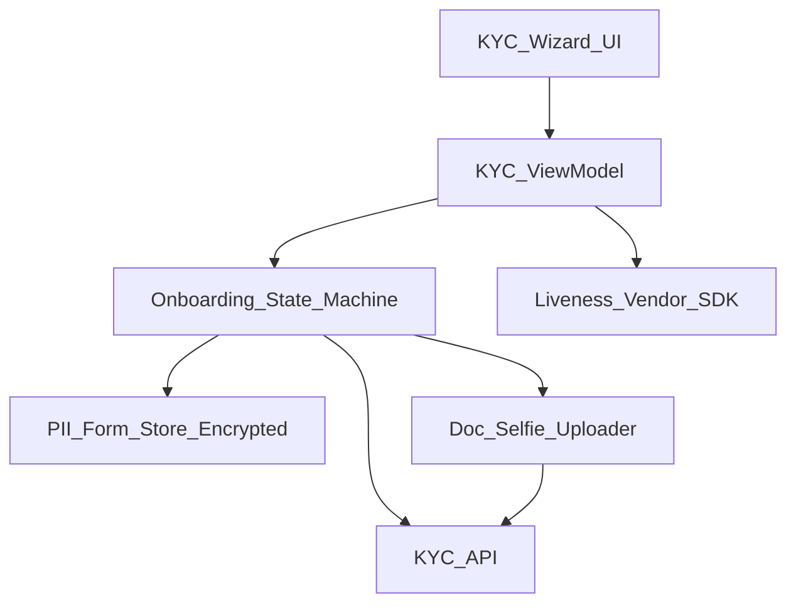
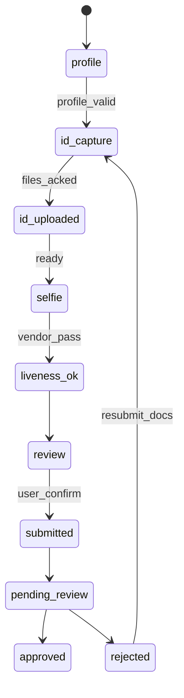

# 26 — Model Solution: KYC / Identity Onboarding

## Timed outline (45–60 min)

| Min | Focus |
|-----|--------|
| 0–6 | MVP steps: PII, docs, selfie/liveness, submit |
| 6–18 | Funnel architecture; resumable state machine |
| 18–40 | Capture, upload, PII storage, drop-off recovery |
| 40–55 | Failures, compliance UX, metrics |

## Clarify and scope

**MVP:** multi-step KYC—personal details → government ID capture → selfie/liveness → review → submit → pending/approved/rejected.

**Defer:** full OCR vendor bake-off, video KYC agent workflow, credit bureau pulls.

**Assume:** vendor SDK optional for liveness; your app owns funnel state and durable uploads.

## NFRs

- Resume after kill without re-entering all PII
- Uploads survive flaky networks (chunked)
- Minimize PII at rest on device; encrypt what you must keep
- Clear status while compliance reviews (hours/days)
- Accessibility + large-font forms

## High-level architecture



## State machine



Persist `currentStep`, `applicationId`, field completion flags server-side; cache draft encrypted locally.

## Data model

```text
KycApplication: id, status, currentStep, updatedAt
KycProfileDraft: name, dob, address..., localOnlyFlags
KycDocument: type (id_front|id_back|selfie), localUri, remoteId?, uploadStatus
LivenessSession: vendorSessionId, resultToken?, expiresAt
```

## Document capture

1. Camera with overlay guides; reject blur via simple sharpness heuristic if available.
2. Write to app sandbox (not shared gallery by default).
3. Downscale if vendor allows; keep enough DPI for OCR.
4. Strip unrelated EXIF where policy requires; keep orientation.
5. Enqueue resumable upload with `documentId` + checksum (reuse Ch 20).

## Selfie / liveness

- Prefer vendor SDK for challenge-response liveness; treat SDK token as opaque.
- On success, send `livenessToken` to your backend for verification—**don’t trust client boolean alone**.
- Timeout sessions; restart cleanly.
- Fallback: manual review path if vendor fails closed.

## PII handling

| Data | Client policy |
|------|----------------|
| PAN/Aadhaar numbers etc. | Mask in UI; encrypt at rest; never log |
| ID images | Delete local after server ack + retention policy |
| Draft form | Encrypted DB/prefs; wipe on approve/logout |
| Analytics | Funnel steps only; no raw doc bytes |

`Android:` EncryptedFile / SQLCipher; avoid backups for kyc DB. `iOS:` Keychain for keys; exclude from backup.

## Resume & drop-off

- Cold start → `GET /kyc/application` → route to `currentStep`
- Local draft merges if server empty fields
- Push: “Complete verification” deep link to step
- Don’t force re-upload of already-acked documents

## Submit & review UX

- Review screen lists what will be sent; checkbox attestations
- `POST /kyc/submit` idempotent by `applicationId`
- Pending: timeline + SLA copy; disable edits that break review (or versioned resubmit)
- Rejected: server reasons mapped to fields; only those steps reopen

## Failures

| Case | Behavior |
|------|----------|
| Upload unknown | Poll document status by id |
| Vendor crash | Catch; offer retry; don’t block forever without support |
| Kill mid-step | Resume step; no duplicate applications (stable applicationId) |
| Storage full | Fail early before camera |
| Expired liveness token | Restart selfie step only |

## Trade-offs

| Decision | Alternative | Why |
|----------|-------------|-----|
| Server-driven steps | Hardcoded wizard | Policy changes without app release |
| Vendor liveness | In-house ML | Accuracy + fraud arms race |
| Delete local docs post-ack | Keep until approve | Reduce PII footprint |

## Metrics

step_completion_rates, time_per_step, upload_success, liveness_pass_rate, drop_off_by_step, resume_success, approval_latency (from push/poll).

## Staff stretch

- Remote config: skip optional steps by geography
- Feature flag new ID types
- Privacy review checklist; data deletion on account close

## Follow-ups

- Video KYC scheduling
- Re-KYC / periodic refresh
- NFC ID read where available
