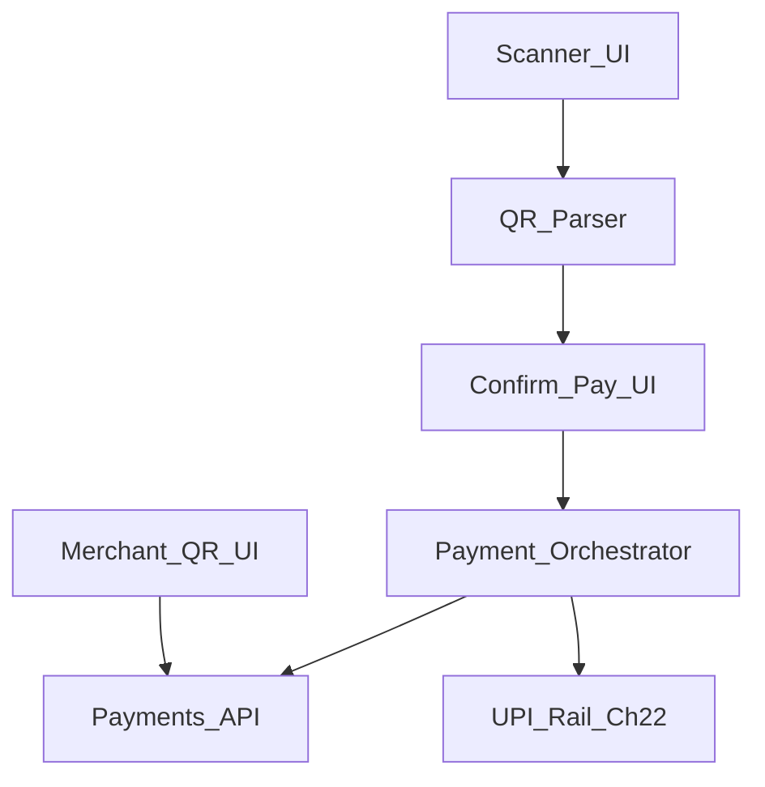
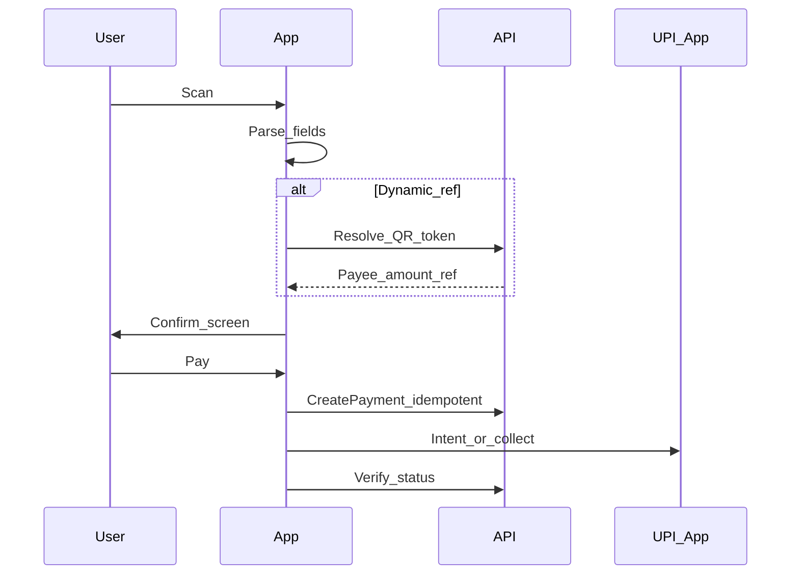

# 27 — Model Solution: QR Payments

## Timed outline

| Min | Focus |
|-----|--------|
| 0–6 | Payer scan + merchant show-QR MVP |
| 6–18 | Architecture; parse vs pay |
| 18–40 | Camera scan, amount confirm, UPI handoff |
| 40–55 | Static vs dynamic QR, offline, fraud |

## Clarify and scope

**MVP:**

1. **Payer:** scan QR → parse → confirm amount/payee → pay (usually UPI intent / collect).
2. **Merchant (optional in same interview):** display dynamic QR for invoice amount; poll for payment.

**Defer:** BharatQR variant deep specs, multi-currency, tip adjustments beyond mention.

## NFRs

- Fast scan under varied lighting
- User must confirm amount before leaving to UPI app
- Tamper-evident: prefer server-validated dynamic QR payloads
- Clear failure when QR unsupported

## Architecture

## QR types

| Type | Contents | Risk |
|------|----------|------|
| Static VPA QR | Payee identity; user enters amount | Phishing stickers; confirm name/VPA carefully |
| Dynamic QR | Server-signed payload with amount + txn ref | Prefer for merchants |
| BharatQR / EMVCo | Structured fields | Parser must be strict |

**Interview default:** support static + dynamic; always show parsed payee + amount edit rules.

## Payer flow

### Camera / scan

- Continuous scan with debounce on same payload
- Torch toggle; haptic on lock
- Permission denied → gallery image upload parse fallback
- Cancel in-flight parse when leaving screen

### Confirm screen (non-negotiable)

Show: payee display name, VPA/UPI id (masked middle if long), amount (editable only if static QR rules allow), note optional.

If dynamic QR locks amount, disable edit.

## Merchant show-QR

1. Create invoice `POST /merchant/qrs` → image payload / string + `qrId`.
2. Render QR; keep screen awake.
3. Poll `GET /merchant/qrs/{id}/status` or push.
4. On success: checkmark + receipt; invalidate QR.
5. On expiry: regenerate.

Dynamic QR should be single-use or short TTL.

## Security & fraud

- Warn on copy-paste VPA mismatch vs display name when server provides both
- Rate-limit scan→pay attempts
- FLAG_SECURE optional on confirm
- Don’t auto-pay on scan without confirm
- Server validates dynamic signature/expiry

## Offline

| Mode | Behavior |
|------|----------|
| Offline scan static | May parse locally; **cannot** safely pay without network create |
| Offline merchant | Show last QR only if still valid TTL; else block |
| Airplane after create | Pending recovery via Ch 24 |

## Failures

| Case | Behavior |
|------|----------|
| Unparseable QR | Error + tips |
| Expired dynamic | Refresh CTA |
| Amount 0 static | Force enter amount with max limits |
| UPI return unknown | Poll; history entry |
| Camera busy / permission | Gallery fallback |

## Trade-offs

| Decision | Alternative | Why |
|----------|-------------|-----|
| Confirm always | Tap-scan-pay | Fraud reduction |
| Server resolve dynamic | Pure client parse | Tamper resistance |
| Short TTL merchant QR | Long-lived static | Reduce replay |

## Metrics

scan_lock_time, parse_success, confirm_to_pay, abandon_on_confirm, dynamic_expire_rate, merchant_time_to_paid.

## Staff stretch

- Accessibility: amount confirmation readout
- Feature flag new QR schemas
- Merchant loud success sound optional

## Follow-ups

- P2P QR profile share
- Payment link (non-QR) same confirm pipeline
- Tip / split on confirm
