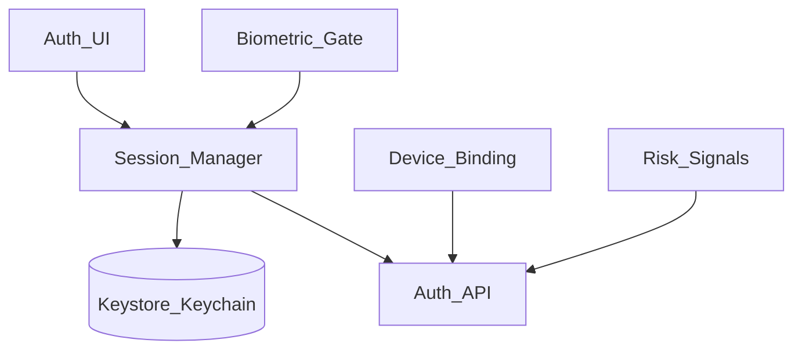
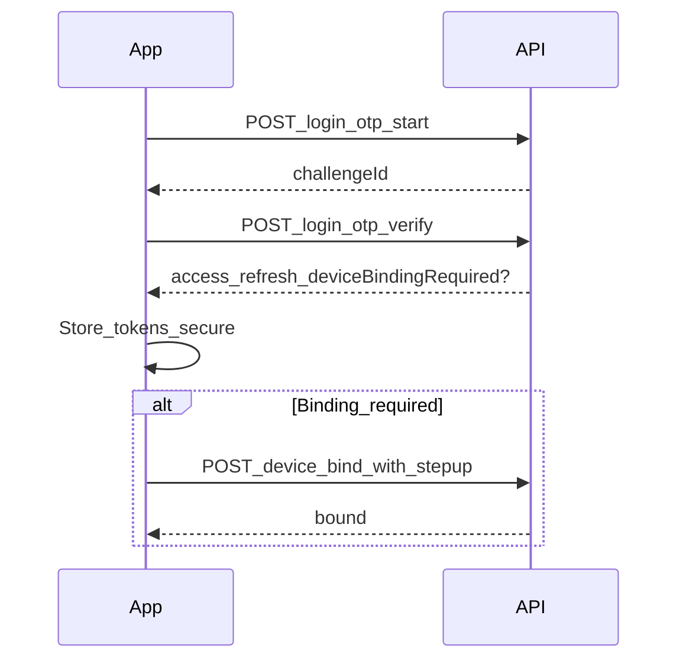

# 28 — Model Solution: Secure Auth and Device Binding

## Timed outline

| Min | Focus |
|-----|--------|
| 0–6 | Login, session, app lock, device bind MVP |
| 6–18 | Token architecture; binding model |
| 18–40 | Biometric unlock, step-up, revoke |
| 40–55 | Root signals, failures, multi-device |

## Clarify and scope

**MVP:** phone/email + OTP (or password) login; refreshable session; optional biometric app unlock; **device binding** for payments; logout/revoke; step-up for high risk.

**Defer:** federated bank SSO internals. Passkeys: full design in [Ch 42](42-passkeys-webauthn.md).

## NFRs

- Stolen-phone resistance: OS lock + app lock + remote revoke
- Binding changes require step-up
- Tokens only in hardware-backed storage when available
- Clear multi-device story

## High-level architecture



## Data model

```text
Device: deviceId (stable app instance id), platform, pushToken?,
        boundAt?, bindingStatus (unbound|pending|bound|revoked)
Tokens: accessToken, refreshToken, expiresAt
AppLock: enabled, biometricAllowed, pinFallbackEnabled
StepUpSession: challengeId, expiresAt, purpose (bind|pay|beneficiary)
```

`deviceId`: generate once, store securely; rotate only with re-bind flow.

## Login sequence



## Device binding

**Why:** tie high-privilege actions to a known device (common in India UPI/banking apps).

Flow:

1. After login, if unbound → prompt bind.
2. Collect signals: deviceId, OS version, push token, **Play Integrity / DeviceCheck** soft result.
3. Step-up: SMS OTP / email / existing biometric after first bind.
4. Server stores binding; issues elevated refresh or scope claim `device_bound`.
5. Payments APIs require bound device; else `403 binding_required`.

Re-bind on new install: treat as new device; may cool-off payments.

## Session & refresh

- Short-lived access token; rotating refresh
- Single-flight refresh; queue 401s
- On refresh revoke → hard logout, clear secrets
- Background: don’t refresh forever; honor server idle timeout

## Biometric app lock

- Not a replacement for server auth; unlocks locally cached session
- `Android:` BiometricPrompt + crypto-bound key optional
- `iOS:` LocalAuthentication / Keychain access control
- Fallback PIN/passcode stored securely (hashed/keyed), with attempt lockout
- App lock on leave + time threshold; always lock on payment screens if policy says

## Step-up auth

Purposes: bind device, add beneficiary, raise limits, high-value pay.

```text
API → 401/403 challenge_required{type, challengeId}
UI → complete challenge → retry original call with challenge token
```

Never store OTP in logs; auto-clear fields.

## Risk signals (client)

Send (policy-limited): rooted/jailbreak heuristics, emulator, accessibility weirdness, mocked location—**as inputs**, server decides.

Don’t solely brick the app on signal without product/legal policy; prefer step-up or limited mode.

## Multi-device

- List devices in settings from server
- Remote revoke other device → that device fails refresh
- Optional: notify push “New device logged in”

## Failures

| Case | Behavior |
|------|----------|
| Biometric hardware missing | PIN fallback |
| Clock skew token expiry | Nudge NTP; refresh |
| Bind fails offline | Block pay; allow browse if product allows |
| Token theft suspicion | Server revoke all; force re-login |
| App backup restores tokens | Use backup exclusions; detect clone → re-bind |

## Trade-offs

| Decision | Alternative | Why |
|----------|-------------|-----|
| Device bind | Soft trust every install | Reduce account takeover |
| Biometric unlock | Re-OTP every open | UX |
| Rotating refresh | Long-lived access | Breach blast radius |
| Attestation soft | Hard block | False positives on OEM |

## Security checklist

- TLS + optional pinning with backup pins
- No tokens in WebView localStorage
- Screenshot secure on OTP/PIN
- Clipboard scrub after OTP paste
- Certificate transparency / cleartext disabled

## Metrics

login_success, otp_fail, bind_success, refresh_revoke_rate, step_up_pass, biometric_opt_in, time_to_first_bound_pay.

## Staff stretch

- Passkeys as primary factor — see [Ch 42](42-passkeys-webauthn.md)
- Per-device payment limits
- SOC2-minded audit events on bind/revoke

## Follow-ups

- Cool-off on new device (24h low limits)
- Number change / SIM swap recovery
- Corporate SSO for employee expense apps

## Tie-back

Ch 21–23 should call `device_bound` + step-up before high-value rails; Ch 24 shows revoked-device sessions failing closed.
