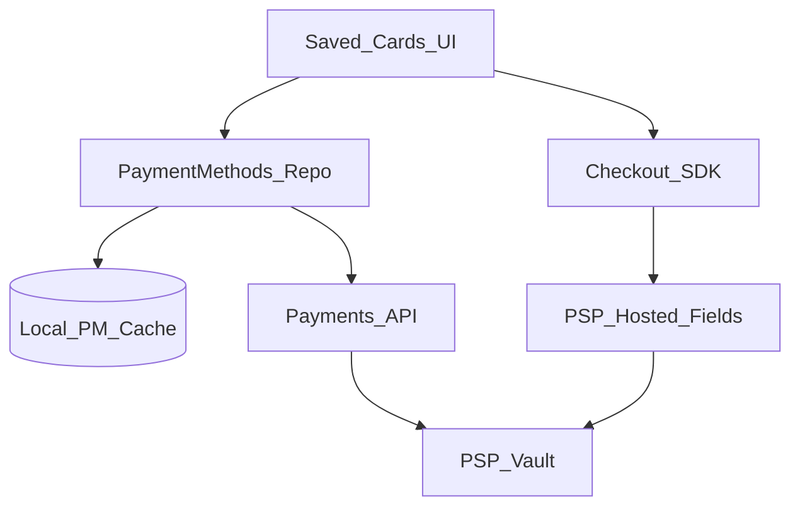
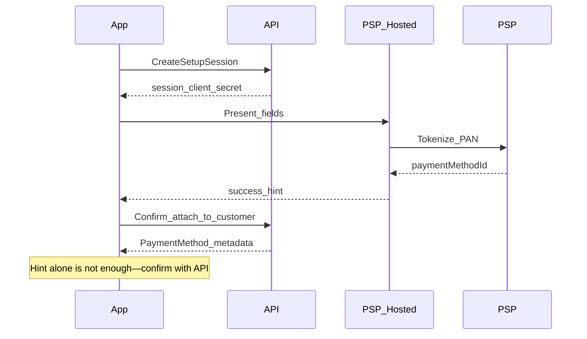

# 29 — Model Solution: Saved Cards / Tokenization

## Timed outline (45–60 min)

| Min | Focus |
|-----|--------|
| 0–6 | MVP: list/add/delete tokens; pay with saved card |
| 6–18 | PCI boundary; network tokens vs vault tokens |
| 18–40 | Add-card hosted fields; one-tap pay + 3DS/CVV |
| 40–55 | Device binding gate, failures, metrics |

## Clarify and scope

**Prompt:** “Design saved cards for a payments app / checkout SDK.”

**MVP:** list saved payment methods (last4, brand, expiry, isDefault); add card via PSP hosted fields; pay with token; delete/revoke; optional set default.

**Out of scope:** issuer token provisioning internals (mention network tokens), full card-on-file regulatory essay, PAN entry in merchant WebView.

**Assume:** PSP returns `paymentMethodId` / network token; **no PAN/CVV** stored in app DB.

## NFRs

- PCI scope stays in PSP hosted UI
- Pay never trusts local “card still valid” alone
- Step-up / CVV / 3DS per risk + network rules
- Delete is server-authoritative; local cache follows
- One-tap gated by device binding (Ch 28)

## Golden rule

```text
App stores token ids + display metadata only → PSP/server owns real credentials
```

## High-level architecture



## Data model (client)

```text
PaymentMethod:
  id, brand, last4, expMonth, expYear, isDefault,
  tokenType (network|vault), fingerprint?,
  requiresCvvOnPay?, updatedAt

AddCardSession:
  sessionId, status (open|succeeded|failed|cancelled)
```

Never persist PAN, CVV, full track, or raw network token secret.

## List + cache

1. `GET /payment-methods` on screen open (short TTL OK with pull-to-refresh).
2. Cache for offline **display** only—“Pay” disabled or forced online refresh if stale beyond policy.
3. After add/delete/pay, invalidate list (or patch from response).

## Add card flow



- Hosted fields / drop-in only for PAN entry.
- On kill mid-add: reopen → query setup session status; do not assume card saved.
- Fingerprint/device signals may attach for fraud (server decides).

## Pay with saved card

1. User selects method → confirm amount (minor units).
2. `POST /payments` with `paymentMethodId` + `Idempotency-Key`.
3. Server may return:
   - `succeeded`
   - `requires_action` (3DS)
   - `requires_cvv` / `challenge_required` (Ch 31)
4. Local attempt row: `processing|unknown|succeeded|failed` (reuse Ch 21/24).
5. **Forbidden:** “Paid” from cached card row or WebView JS alone.

### CVV re-entry

Some networks require CVV even for tokens. Collect CVV in PSP secure field (not app `EditText` if avoidable); never log or disk-cache CVV.

## Delete / revoke

| Step | Behavior |
|------|----------|
| User deletes | Optimistic remove from UI **or** wait—either OK if labeled |
| API | `DELETE /payment-methods/{id}` |
| Failure | Re-fetch list; restore row |
| Default card deleted | Server picks new default; client refreshes |

## Device binding & one-tap

- One-tap / biometric pay requires **bound device** + recent step-up policy.
- New install: tokens still on server, but one-tap disabled until bind + cool-off (Ch 28/37 patterns).
- Remote revoke of binding → force full auth on next pay.

## Failures

| Case | Behavior |
|------|----------|
| Expired card | Server decline; prompt update/remove |
| Token revoked at PSP | Remove from list on sync; clear default |
| 3DS kill | Resume pending payment poll (Ch 21/24) |
| Duplicate add | Idempotent setup session / dedupe by fingerprint server-side |
| Offline pay | Block or queue **intent** only—never local success |

## Security

- Display metadata is not secret but still PII-ish—careful screenshots (FLAG_SECURE on CVV/3DS).
- No card numbers in analytics events.
- Pinning + backup pins for finance SDK.
- Validate deep links that return from 3DS.

## Android UI: Views (XML) and Compose

PAN entry stays in PSP hosted fields / drop-in; the app's own UI is the card list, CVV re-entry and secure sheets. Basis: [Ch 4 — Android UI toolkits](../part-2-building-blocks/04-client-architecture.md#android-ui-toolkits-views-xml-and-compose).

| Concern | Views (XML) | Compose |
|---------|-------------|---------|
| CVV field | `EditText` `inputType="numberPassword"`, `autofillHints="creditCardSecurityCode"`, `maxLength` | `OutlinedTextField` + `KeyboardType.NumberPassword` + `PasswordVisualTransformation` |
| Autofill | Mature: `autofillHints` on each View | Newer: content-type semantics (Compose 1.8+); older Compose has no reliable autofill — a reason PSPs still ship View-based fields |
| Masking / grouping | `TextWatcher` inserting spaces (cursor bugs) | `VisualTransformation` with `OffsetMapping` — display-only, value stays digits |
| Screenshot block | `FLAG_SECURE` on the Activity window; a `BottomSheetDialogFragment` is its own window — set it on `dialog.window` too | Same Activity flag; `ModalBottomSheet`/`Dialog` inherit it by default (`SecureFlagPolicy.Inherit`), or force `SecureOn` for just the sheet |
| Saved state leak | `isSaveEnabled = false` so CVV isn't in the Bundle | Keep CVV in `remember` (not `rememberSaveable`) — lost on rotation by design |
| Card list | `RecyclerView` + `ListAdapter` | `LazyColumn` keyed by `paymentMethodId` |

```kotlin
// Views
fun EditText.asCvv() {
    inputType = InputType.TYPE_CLASS_NUMBER or InputType.TYPE_NUMBER_VARIATION_PASSWORD
    setAutofillHints(View.AUTOFILL_HINT_CREDIT_CARD_SECURITY_CODE)
    isSaveEnabled = false // don't put CVV in saved instance state
}

// Compose
@Composable
fun CvvField(value: String, onChange: (String) -> Unit) = OutlinedTextField(
    value = value,
    onValueChange = { v -> if (v.length <= 4 && v.all(Char::isDigit)) onChange(v) },
    label = { Text("CVV") },
    visualTransformation = PasswordVisualTransformation(),
    keyboardOptions = KeyboardOptions(keyboardType = KeyboardType.NumberPassword, autoCorrectEnabled = false),
)

@Composable
fun SecureSheet(onDismiss: () -> Unit, content: @Composable () -> Unit) =
    ModalBottomSheet(
        onDismissRequest = onDismiss,
        properties = ModalBottomSheetProperties(securePolicy = SecureFlagPolicy.SecureOn),
    ) { content() }
```

**Mixed codebase:** a PSP's View-based card form goes into a Compose screen with `AndroidView`; keep it there rather than re-implementing PAN entry in Compose — that would pull the app into PCI scope.

## Trade-offs

| Decision | Alternative | Why |
|----------|-------------|-----|
| Network tokens | Merchant vault PAN | Better auth rates + less PCI |
| Hosted fields | Native PAN form | Shrink PCI / breach blast radius |
| Server list as truth | Local-only wallet of cards | Cross-device + revoke works |

## Metrics

add_card_start → tokenized → attached; pay_with_token → requires_action → terminal; cvv_reentry_rate; delete_fail; stale_list_pay_blocked.

## Staff stretch

- Co-branded / private-label cards
- Account updater (expiry refresh) UX without user re-entry
- Per-merchant tokenization vs platform wallet
- Accessibility: announce “Visa ending 4242” before confirm

## Follow-ups

- Apple Pay / Google Pay ([Ch 41](41-apple-google-pay.md))
- Mandates on card (Ch 32)

## See also

- [Ch 21 Checkout](21-checkout-payment-sdk.md) · [Ch 28 Auth](28-secure-auth-device-binding.md) · [Ch 31 Fraud](31-fraud-challenge-step-up.md) · [Ch 25 Catalog](25-top-fintech-system-design.md)
