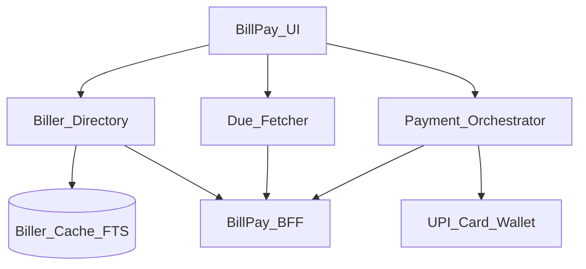
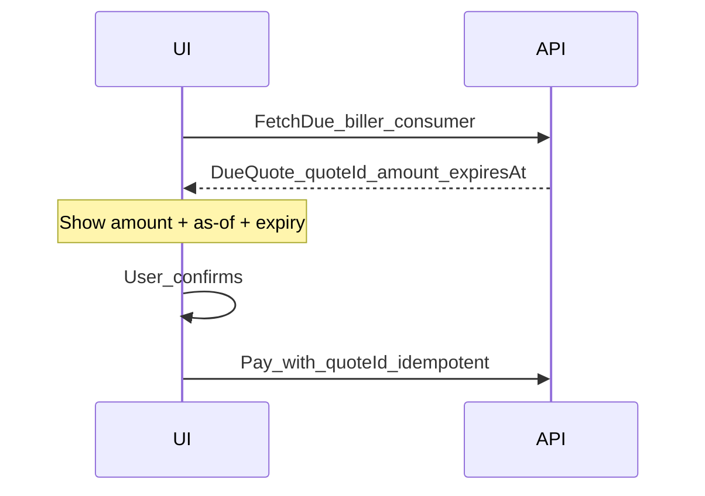

# 30 — Model Solution: Bill Pay / Biller List

## Timed outline (45–60 min)

| Min | Focus |
|-----|--------|
| 0–6 | MVP: search billers, fetch due, pay |
| 6–18 | Directory cache vs fresh due amount |
| 18–40 | Pay rail handoff; receipts; schedules |
| 40–55 | Failures, stale due, support refs |

## Clarify and scope

**Prompt:** “Design mobile bill pay (BBPS-style / utilities / credit cards).”

**MVP:** search/browse billers; enter consumer account / identifiers; fetch **current due**; pay via UPI/card/wallet; show receipt with biller + consumer refs.

**Defer:** biller onboarding ops, settlement with billers, full BBPS switch internals (client sees BFF contracts).

## NFRs

- Due amount at confirm must be **fresh** (stale due = support fire)
- Idempotent pay; pending first-class
- Fast biller search (local index + network)
- Clear copy when bill already paid / partial / overdue

## Architecture



## Data model

```text
Biller:
  id, name, category, logoUrl?, inputFields[],
  version, updatedAt

BillAccount:
  billerId, consumerRef, nickname?

DueQuote:
  quoteId, billerId, consumerRef, amountMinor, currency,
  billDate?, dueDate?, minAmount?, maxAmount?,
  fetchedAt, expiresAt, status (open|paid|unavailable)

PaymentAttempt: // reuse Ch 21/24
  localId, paymentId?, quoteId, amountMinor, status, clientMutationId
```

## Biller directory

| Concern | Approach |
|---------|----------|
| Search | Local FTS on cached directory + server search fallback |
| Freshness | Version/ETag; background refresh; force refresh weekly |
| Categories | Cache with directory |
| Logos | Disk LRU; placeholder on miss |

Do **not** treat directory freshness as due freshness.

## Fetch due (critical path)



Rules:

1. Always fetch due when entering confirm (or if `expiresAt` passed).
2. Show “Updated just now” / clock; if fetch fails, block pay.
3. Pay references `quoteId` so server rejects stale quotes.
4. Optional partial pay only if quote allows `min/max`.

## Pay flow

1. Confirm screen: biller name, consumer ref, amount (minor units), rail picker.
2. Create payment with `quoteId` + idempotency key → hand off to Ch 21/22/23 rails.
3. On terminal success: receipt with biller, consumer ref, UTR/RRN, paymentId.
4. History row links to same refs (Ch 24).

**Never** auto-pay on successful due fetch.

## Scheduled / reminders

- Reminder notification → deep link to **confirm** with fresh due fetch (not silent charge).
- Autopay/mandate for bills → Ch 32; still show pre-debit notification where regulation requires.

## Offline

| Action | Offline OK? |
|--------|-------------|
| Browse cached billers | Yes |
| Fetch due | No (or show last quote clearly expired) |
| Pay | No silent success; draft only |
| View past receipts | Yes from history cache |

## Failures

| Case | Behavior |
|------|----------|
| Quote expired at pay | Re-fetch due; user reconfirms |
| Already paid | Server code → success-like receipt or “no due” |
| Wrong consumer ref | Validation error before pay |
| Kill mid-UPI | Pending recovery (Ch 24) |
| Directory search empty | Offer category browse + “request biller” |

## Security & privacy

- Consumer account numbers are sensitive—mask in lists; FLAG_SECURE on confirm if policy.
- Analytics: biller category OK; full consumer ref hashed or avoided.
- Support: copyable paymentId + UTR without exposing full account in chat if possible.

## Trade-offs

| Decision | Alternative | Why |
|----------|-------------|-----|
| quoteId-bound pay | Client sends free amount | Prevents stale/overpay races |
| Local FTS directory | Network search only | Snappy UX on poor networks |
| Reminder ≠ autopay | Silent scheduled debit | Consent + fewer disputes |

## Metrics

due_fetch_latency, quote_expiry_at_pay, pay_terminal_rate by rail, wrong_account_rate, search_zero_results, reminder_to_pay conversion.

## Staff stretch

- Multi-account nicknames + hide/show
- Credit card bill: min due vs total due UX
- Biller outage banner from remote config
- Accessibility: amount confirmation readback

## Follow-ups

- BBPS dispute / complaint ticket (Ch 38)
- Autopay registration (Ch 32)
- Cross-border billers / FX (Ch 35)

## See also

- [Ch 21](21-checkout-payment-sdk.md) · [Ch 22](22-upi-intent-collect.md) · [Ch 24](24-txn-history-pending-recovery.md) · [Ch 32 Mandates](32-upi-autopay-mandates.md)
